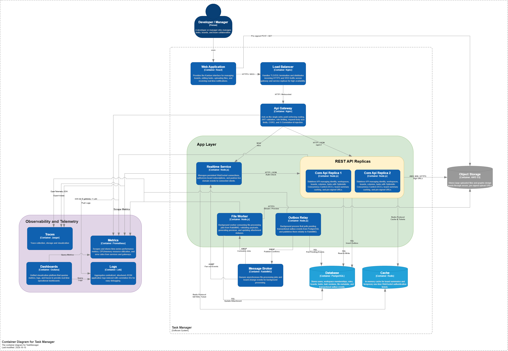
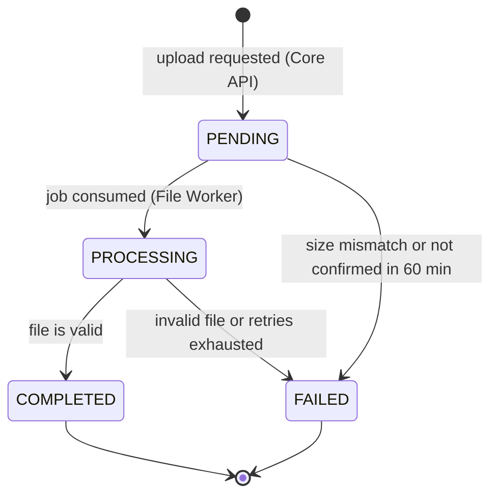

# TaskMaster — API and Contract Specification

> Contract specification for **Case 8: TaskMaster — Enterprise Kanban (Concurrency)**.
> Wave 2 source code is reviewed against this file. Contract changes are made here first.

| | |
|---|---|
| **Team** | TS-008 |
| **Case** | Case 8: TaskMaster — Enterprise Kanban (Concurrency) |
| **Status** | Draft |
| **Version** | 0.2.0 |
| **Last updated** | 2026-10-20 |
| **Related documents** | [ADR 001](adrs/001-optimistic-concurrency-control.md) · [ADR 002](adrs/002-presigned-uploads-async-workers.md) · [ADR 003](adrs/003-transactional-outbox-realtime-notifications.md) · [C4 container diagram](assets/C4-TaskManager.png) |

The key words **MUST**, **MUST NOT**, **SHALL** and **SHOULD** are to be interpreted as described in RFC 2119. Numeric limits marked *(initial value)* are starting points that can be tuned without changing the contract.

## Contents

1. [Overview](#1-overview)
2. [Domain data schemas](#2-domain-data-schemas)
3. [REST API](#3-rest-api)
4. [Asynchronous events and integration contracts](#4-asynchronous-events-and-integration-contracts)
5. [Requirements and scenarios](#5-requirements-and-scenarios)
6. [Non-functional requirements](#6-non-functional-requirements)
7. [Edge cases and failure handling](#7-edge-cases-and-failure-handling)
8. [Constraints, open questions and glossary](#8-constraints-open-questions-and-glossary)

---

## 1. Overview

### 1.1 Purpose

TaskMaster provides Trello-style Kanban boards for enterprise teams: workspaces contain boards, boards contain columns, and columns contain task cards. This document is the single source of truth for the system's contracts: data schemas, REST endpoints, the WebSocket protocol, asynchronous events, and the verifiable requirements of the five mandatory features.

### 1.2 Problem statement

Large enterprise clients have many people working on the same cards at the same time. Two failures cost TaskMaster their trust:

| Failure | What the customer sees | Business impact |
|---|---|---|
| **Lost update** | Developer A edits a task description and saves. Two seconds later Manager B moves the same task to another column. B's client resends the whole task it loaded earlier, and A's description is silently overwritten. | Valuable information is lost and nobody receives an error, so nobody knows it happened. |
| **Upload memory exhaustion** | A user uploads a 150 MB design file. The Node.js API receives the whole stream in memory, runs out of RAM and disconnects teammates who only wanted to read tasks. | Service outages that affect users who were not even uploading. |

The architecture removes both failures at the root:

- Task writes are partial, intent-based and conditional on the version the client last saw ([ADR 001](adrs/001-optimistic-concurrency-control.md)).
- File bytes never reach the API: the browser uploads directly to object storage with a pre-signed URL and a background worker processes the file ([ADR 002](adrs/002-presigned-uploads-async-workers.md)).
- Board changes reach connected users through a transactional outbox, RabbitMQ and WebSockets, without coupling the write to the delivery ([ADR 003](adrs/003-transactional-outbox-realtime-notifications.md)).

### 1.3 Goals and non-goals

**Goals**

| # | Goal | Feature |
|---|---|---|
| G1 | Every request and every real-time subscription is authorized against workspace roles and board permissions. | F1 |
| G2 | A board opens quickly: its summary carries only lightweight cards and is served from a cache. | F2 |
| G3 | Nobody overwrites another user's work without knowing: every task write is conditional on the version the client saw. | F3 |
| G4 | Files up to 250 MiB are uploaded directly to object storage and processed asynchronously; API memory does not depend on file size. | F4 |
| G5 | Users viewing a board are notified of its modifications within seconds, and no event is lost. | F5 |

**Non-goals (out of scope for this version)**

- Pessimistic locks or "being edited by" locks (rejected in ADR 001).
- Automatic merge of concurrent changes to disjoint fields (future work in ADR 001); the client re-applies its change after a conflict.
- Resumable or chunked uploads (rejected in ADR 002) and files larger than 250 MiB.
- Creating, renaming, reordering or deleting columns (a board is created with three fixed columns).
- Removing members from a workspace or a board.
- Refresh tokens.

### 1.4 Users

| Persona | Main use cases |
|---|---|
| Developer | Edits task details, attaches design files, follows board changes live. |
| Manager | Moves cards through the workflow and manages who has access to the workspace and its boards. |

Roles and what each one can do are defined in [§2.2](#22-roles-and-permissions).

### 1.5 Architecture and services

The service names below match the C4 container diagram.



| Container | Technology | Responsibility | ADR |
|---|---|---|---|
| **Web Application** | React | Kanban UI. Sends partial writes with `If-Match`, resolves `412` conflicts, uploads files directly to object storage, holds the WebSocket connection. | 001, 002, 003 |
| **Load Balancer** | Nginx | TLS termination; distributes HTTPS and WSS traffic. | — |
| **API Gateway** | Nginx | Single entry point: routing, session-token validation, rate limiting, request-body size limit (1 MiB), CORS, `X-Correlation-Id` injection, WebSocket proxying. | — |
| **Core API** (2 replicas) | Node.js | Identity, workspaces, boards, tasks with optimistic concurrency, board summary (cached in Redis), attachment metadata and pre-signed URLs. Writes the outbox in the same transaction as the data change. Stateless. | 001, 002, 003 |
| **Outbox Relay** | Node.js | Polls pending rows of `outbox_events` and publishes them reliably to RabbitMQ. | 003 |
| **Realtime Service** | Node.js | Holds WebSocket connections, authorizes board subscriptions through Core API, consumes domain events and pushes them to authorized subscribers. | 003 |
| **File Worker** | Node.js | Consumes file-processing jobs, validates files, generates previews for images, updates attachment status, cleans up abandoned uploads. | 002 |
| **Message Broker** | RabbitMQ | Fan-out of domain events and the file-processing job queue, with retries and a dead-letter queue. | 002, 003 |
| **Database** | PostgreSQL | Source of truth: users, memberships, roles, boards, tasks and their versions, attachment metadata, outbox events. | 001, 002, 003 |
| **Cache** | Redis | Board-summary cache and one-time WebSocket tickets. Never a source of truth. | — |
| **Object Storage** | AWS S3 (MinIO in Docker Compose) | Uploaded files, in a private bucket reached only through pre-signed URLs. | 002 |
| **Observability** | Prometheus, Loki, Grafana | Metrics, centralized JSON logs indexed by correlation ID, dashboards. | — |

### 1.6 Feature traceability

| Mandatory feature | What is built | ADR | Where in this document |
|---|---|---|---|
| **F1** Roles, workspaces and board permissions | Workspace roles, board roles, permission checks on every request and subscription | — | §2.2, §3, §5.1 |
| **F2** Optimized board summary | Lightweight summary endpoint cached in Redis | — | §2.5, §3, §5.2 |
| **F3** Optimistic concurrency control | Task `version`, `ETag` / `If-Match`, `412` and `428`, partial writes | ADR 001 | §2.3, §3, §5.3 |
| **F4** Heavy uploads off the API | Pre-signed direct upload to S3, confirmation, file worker | ADR 002 | §2.7, §3, §4, §5.4 |
| **F5** Web notifications of board changes | Transactional outbox, RabbitMQ, WebSocket delivery | ADR 003 | §3, §4, §5.5 |

---

## 2. Domain data schemas

### 2.1 Bounded contexts

| Context | Type | Owns | Owner |
|---|---|---|---|
| Board Collaboration | Core domain | Boards, columns, tasks, task versions, board summary | Core API |
| Identity & Access | Supporting | Users, workspaces, memberships, roles | Core API |
| Attachments | Supporting | Attachment metadata, stored objects, processing | Core API (metadata, URLs), File Worker (processing) |
| Notifications | Supporting | WebSocket sessions and subscriptions | Realtime Service |

### 2.2 Roles and permissions

| Enum | Values |
|---|---|
| `WorkspaceRole` | `OWNER`, `MEMBER` |
| `BoardRole` | `ADMIN`, `EDITOR`, `VIEWER` |
| `AttachmentStatus` | `PENDING`, `PROCESSING`, `COMPLETED`, `FAILED` |

**Effective board role.** An explicit `board_members` role, or an implicit `ADMIN` role when the user is workspace `OWNER`. A user with no effective role has no access to the board.

| Action | VIEWER | EDITOR | ADMIN |
|---|:-:|:-:|:-:|
| Read the board summary, tasks and attachments; subscribe to notifications | ✓ | ✓ | ✓ |
| Create, edit and move tasks; request uploads | | ✓ | ✓ |
| Add members to the board | | | ✓ |

| Workspace action | MEMBER | OWNER |
|---|:-:|:-:|
| Create boards | ✓ | ✓ |
| Add members to the workspace | | ✓ |

A user must be a workspace member before being added to one of its boards. The creator of a workspace is its `OWNER`; the creator of a board is its explicit `ADMIN`.

### 2.3 Relational schema (PostgreSQL)

```sql
CREATE TYPE workspace_role    AS ENUM ('OWNER', 'MEMBER');
CREATE TYPE board_role        AS ENUM ('ADMIN', 'EDITOR', 'VIEWER');
CREATE TYPE attachment_status AS ENUM ('PENDING', 'PROCESSING', 'COMPLETED', 'FAILED');

CREATE TABLE users (
  id             uuid PRIMARY KEY DEFAULT gen_random_uuid(),
  email          varchar(254) NOT NULL UNIQUE,            -- stored lower-case
  display_name   varchar(100) NOT NULL,
  password_hash  text NOT NULL,                           -- argon2id
  created_at     timestamptz NOT NULL DEFAULT now()
);

CREATE TABLE workspaces (
  id          uuid PRIMARY KEY DEFAULT gen_random_uuid(),
  name        varchar(100) NOT NULL,
  created_by  uuid NOT NULL REFERENCES users(id),
  created_at  timestamptz NOT NULL DEFAULT now()
);

CREATE TABLE workspace_members (
  workspace_id  uuid NOT NULL REFERENCES workspaces(id),
  user_id       uuid NOT NULL REFERENCES users(id),
  role          workspace_role NOT NULL,
  PRIMARY KEY (workspace_id, user_id)
);

CREATE TABLE boards (
  id            uuid PRIMARY KEY DEFAULT gen_random_uuid(),
  workspace_id  uuid NOT NULL REFERENCES workspaces(id),
  name          varchar(100) NOT NULL,
  description   varchar(2000),
  created_by    uuid NOT NULL REFERENCES users(id),
  created_at    timestamptz NOT NULL DEFAULT now()
);

CREATE TABLE board_members (
  board_id  uuid NOT NULL REFERENCES boards(id),
  user_id   uuid NOT NULL REFERENCES users(id),
  role      board_role NOT NULL,
  PRIMARY KEY (board_id, user_id)
);

CREATE TABLE board_columns (
  id        uuid PRIMARY KEY DEFAULT gen_random_uuid(),
  board_id  uuid NOT NULL REFERENCES boards(id),
  name      varchar(100) NOT NULL,
  position  integer NOT NULL
);

CREATE TABLE tasks (
  id            uuid PRIMARY KEY DEFAULT gen_random_uuid(),
  board_id      uuid NOT NULL REFERENCES boards(id),
  column_id     uuid NOT NULL REFERENCES board_columns(id),
  title         varchar(200) NOT NULL,
  description   text NOT NULL DEFAULT '' CHECK (char_length(description) <= 20000),
  assignee_ids  uuid[] NOT NULL DEFAULT '{}',
  due_date      date,
  position      bigint NOT NULL,                          -- order inside the column (new cards go last)
  version       integer NOT NULL DEFAULT 1,               -- optimistic concurrency token (ADR 001)
  created_by    uuid NOT NULL REFERENCES users(id),
  updated_by    uuid NOT NULL REFERENCES users(id),
  created_at    timestamptz NOT NULL DEFAULT now(),
  updated_at    timestamptz NOT NULL DEFAULT now()
);
CREATE INDEX tasks_board_column_idx ON tasks (board_id, column_id, position);

CREATE TABLE attachments (
  id                   uuid PRIMARY KEY DEFAULT gen_random_uuid(),
  task_id              uuid NOT NULL REFERENCES tasks(id),
  board_id             uuid NOT NULL REFERENCES boards(id),
  uploaded_by          uuid NOT NULL REFERENCES users(id),
  file_name            varchar(255) NOT NULL,
  content_type         varchar(127) NOT NULL,
  size_bytes           bigint NOT NULL CHECK (size_bytes BETWEEN 1 AND 262144000),   -- 250 MiB
  storage_key          text NOT NULL UNIQUE,
  preview_key          text,                                  -- set by the File Worker for images
  status               attachment_status NOT NULL DEFAULT 'PENDING',
  failure_reason       varchar(32),
  upload_confirmed_at  timestamptz,
  created_at           timestamptz NOT NULL DEFAULT now(),
  updated_at           timestamptz NOT NULL DEFAULT now()
);
CREATE INDEX attachments_task_idx  ON attachments (task_id);
CREATE INDEX attachments_stale_idx ON attachments (status, updated_at) WHERE status IN ('PENDING', 'PROCESSING');

CREATE TABLE outbox_events (
  seq           bigint GENERATED ALWAYS AS IDENTITY PRIMARY KEY,
  event_id      uuid NOT NULL UNIQUE,
  exchange      varchar(100) NOT NULL,
  routing_key   varchar(100) NOT NULL,
  payload       jsonb NOT NULL,                           -- full event envelope (section 4.2)
  occurred_at   timestamptz NOT NULL DEFAULT now(),
  published_at  timestamptz,
  attempts      integer NOT NULL DEFAULT 0
);
CREATE INDEX outbox_pending_idx ON outbox_events (seq) WHERE published_at IS NULL;
```

**Optimistic concurrency (ADR 001).** Every task write is a single conditional statement, so the guarantee comes from PostgreSQL and holds with any number of API replicas:

```sql
UPDATE tasks
SET    description = $3, updated_by = $4, updated_at = now(), version = version + 1
WHERE  id = $1 AND version = $2
RETURNING *;
```

When it affects 0 rows, Core API reads the task: if it does not exist the answer is `404`, otherwise `412 VERSION_CONFLICT`.

### 2.4 Resource representations

Identifiers are UUID v4 and timestamps are RFC 3339 UTC. The full JSON schemas are in the OpenAPI block of [§3.3](#33-openapi-definition).

| Resource | Fields |
|---|---|
| `User` | `id`, `email`, `displayName`, `createdAt` |
| `Workspace` | `id`, `name`, `myRole`, `createdAt` |
| `Member` | `userId`, `email`, `displayName`, `role` |
| `Board` | `id`, `workspaceId`, `name`, `description`, `myRole`, `columns[]` (`id`, `name`, `position`), `createdAt` |
| `TaskCard` (lightweight) | `id`, `columnId`, `title`, `assigneeIds`, `dueDate`, `position`, `version`, `updatedAt` |
| `TaskDetail` | everything in `TaskCard` plus `boardId`, `description`, `attachments[]`, `createdBy`, `createdAt`, `updatedBy` |
| `Attachment` | `id`, `taskId`, `fileName`, `contentType`, `sizeBytes`, `status`, `failureReason`, `hasPreview`, `uploadedBy`, `createdAt`, `updatedAt` |
| `BoardSummary` | `board`, `columns[]` (each with `id`, `name`, `position`, `tasks: TaskCard[]`), `generatedAt` |
| `Problem` (errors, RFC 9457) | `type`, `title`, `status`, `code`, `detail`, `instance`, `correlationId` |

**Field constraints**

| Field | Constraint |
|---|---|
| `email` | Valid address, at most 254 characters, compared case-insensitively. |
| `password` | 12 to 128 characters. |
| Names (`displayName`, workspace, board) | 1 to 100 characters after trimming. |
| Task `title` | 1 to 200 characters. |
| Task `description` | Markdown, at most 20,000 characters. |
| Task `assigneeIds` | At most 10 users; each must have an effective role on the board. |
| Attachment `fileName` | 1 to 255 characters, no `/`, `\` or control characters. |

### 2.5 Cache keys (Redis)

| Key | Value | TTL | Written by | Deleted by |
|---|---|---|---|---|
| `board-summary:{boardId}` | JSON `BoardSummary` without `board.myRole` | 300 s *(initial value)* | Core API on a cache miss | Core API right after any committed write that changes the summary (task created, updated or moved) |
| `ws-ticket:{ticket}` | `{"userId": "<UUID>"}` | 30 s | Core API | Realtime Service, which reads and deletes it in one atomic operation (`GETDEL`) |

### 2.6 Object storage layout

- Bucket `taskmaster-attachments`, private (no public access), with CORS allowing `POST` from the web origin.
- Object key: `boards/{boardId}/tasks/{taskId}/attachments/{attachmentId}/original`.
- Preview key (images only): `boards/{boardId}/tasks/{taskId}/attachments/{attachmentId}/preview.webp`.
- The user-supplied file name is stored only in PostgreSQL.

### 2.7 Attachment lifecycle



`failureReason` is one of `UPLOAD_NOT_CONFIRMED`, `SIZE_MISMATCH`, `CONTENT_TYPE_MISMATCH`, `PROCESSING_ERROR`. Transitions are guarded in SQL (`WHERE status = ...`), so a duplicate or late job can never move a finished attachment.

---

## 3. REST API

### 3.1 Conventions

| Topic | Rule |
|---|---|
| Base URL | `http://localhost:8080/api/v1` in Docker Compose, always through the API Gateway. |
| Format | JSON, UTF-8. Errors use `application/problem+json` with `code`, `detail` and `correlationId`. |
| Authentication | `Authorization: Bearer <accessToken>`: a JWT issued at login, valid 8 hours *(initial value)*, with claims `sub`, `email`, `iat`, `exp`. Roles are **not** in the token: Core API reads them on every request, so a role change applies on the user's next request. The gateway validates the token before the request reaches Core API. |
| Correlation | The gateway generates `X-Correlation-Id` when missing and echoes it in every response, log line, error body and event. |
| Concurrency (tasks) | Task responses carry a strong `ETag: "<version>"`. `PATCH /tasks/{taskId}` and `PATCH /tasks/{taskId}/position` MUST send `If-Match: "<version>"` ([ADR 001](adrs/001-optimistic-concurrency-control.md)). |
| Strict schemas | Unknown JSON fields are rejected with `400 VALIDATION_ERROR`. |
| Not found vs. forbidden | A caller with no role on a workspace or board gets `404` (existence is not revealed); a caller with access but an insufficient role gets `403`. |
| Gateway | Rejects request bodies larger than 1 MiB (`413`), applies rate limiting (`429`) and an upstream timeout (`504`). |

**Error catalog**

| HTTP | `code` | Meaning |
|---|---|---|
| 400 | `VALIDATION_ERROR` | Body, path or query violates the schema (includes unknown fields). |
| 400 | `INVALID_IF_MATCH` | `If-Match` is not a single strong ETag such as `"7"`. |
| 400 | `INVALID_ASSIGNEE` | An assignee has no effective role on the board. |
| 400 | `FILE_TOO_LARGE` / `UNSUPPORTED_CONTENT_TYPE` | `sizeBytes` is above 250 MiB, or `contentType` is not allowed ([§3.4](#34-attachments-uploads-and-downloads)). |
| 401 | `UNAUTHENTICATED` / `INVALID_CREDENTIALS` | Missing, invalid or expired token; wrong email or password. |
| 403 | `FORBIDDEN` | The caller has access but not the required role. |
| 404 | `NOT_FOUND` / `USER_NOT_FOUND` | Resource missing or the caller has no role on it; no user with that email. |
| 409 | `EMAIL_ALREADY_REGISTERED`, `ALREADY_MEMBER`, `NOT_WORKSPACE_MEMBER` | State conflicts on accounts and memberships. |
| 409 | `UPLOAD_NOT_FOUND`, `UPLOAD_SIZE_MISMATCH`, `ATTACHMENT_NOT_READY` | State conflicts on attachments. |
| 410 | `UPLOAD_EXPIRED` | The attachment was cleaned up before being confirmed. |
| 412 | `VERSION_CONFLICT` | `If-Match` differs from the current task version; the body carries the current task. |
| 413 / 429 / 504 | `PAYLOAD_TOO_LARGE` / `RATE_LIMITED` / `GATEWAY_TIMEOUT` | Returned by the gateway. |
| 428 | `PRECONDITION_REQUIRED` | Task write without `If-Match`. |
| 500 / 503 | `INTERNAL_ERROR` / `SERVICE_UNAVAILABLE` | Unexpected error; a required dependency (PostgreSQL, Redis for tickets, object storage) is down. |

**Example fixture** used by every example in this document:

| Name | Id | Notes |
|---|---|---|
| Workspace *Acme* | `3f1c2a9e-5b7d-4e8a-9c21-0a6b4d2e8f10` | |
| Board *Platform* | `b7e4d1c2-8a3f-4b6e-9d05-1c2e3f4a5b6c` | Columns *To Do* (`c0000000-0000-4000-8000-00000000000a`), *In Progress* (`…0b`), *Done* (`…0c`) |
| Alice | `0a11ce00-0000-4000-8000-000000000001` | Developer. Workspace `MEMBER`, board `EDITOR`. |
| Bob | `0b0b0000-0000-4000-8000-000000000002` | Manager. Workspace `OWNER`, board `ADMIN`. |
| Carol | `0ca10000-0000-4000-8000-000000000003` | Workspace `MEMBER`, board `VIEWER`. |
| Dave | `0da00000-0000-4000-8000-000000000004` | Registered user with no access to *Acme*. |
| Task 42 | `7a5c0000-0000-4000-8000-000000000042` | *Login page*, in *To Do*, version 7. |
| Attachment 150 | `f11e0000-0000-4000-8000-000000000150` | 150 MB design file on task 42. |

### 3.2 Endpoint overview

| Method and path | Purpose | Minimum role | Feature |
|---|---|---|---|
| `POST /auth/register` | Create an account | Public | F1 |
| `POST /auth/login` | Get an access token | Public | F1 |
| `POST /workspaces` | Create a workspace (caller becomes `OWNER`) | Any user | F1 |
| `POST /workspaces/{workspaceId}/members` | Add a registered user to the workspace | Workspace `OWNER` | F1 |
| `POST /workspaces/{workspaceId}/boards` | Create a board with three default columns (caller becomes board `ADMIN`) | Workspace member | F1 |
| `POST /boards/{boardId}/members` | Give a workspace member a board role | Board `ADMIN` | F1 |
| `GET /boards/{boardId}/summary` | Lightweight, cached board view | Board `VIEWER` | F2 |
| `POST /boards/{boardId}/tasks` | Create a task at the bottom of a column | Board `EDITOR` | F3 |
| `GET /tasks/{taskId}` | Read a full task and its `ETag` | Board `VIEWER` | F3 |
| `PATCH /tasks/{taskId}` | Edit task content (conditional) | Board `EDITOR` | F3 |
| `PATCH /tasks/{taskId}/position` | Move a task to another column (conditional) | Board `EDITOR` | F3 |
| `POST /tasks/{taskId}/attachments` | Authorize an upload, get a pre-signed URL | Board `EDITOR` | F4 |
| `POST /attachments/{attachmentId}/confirm` | Tell the API the upload finished | The uploader | F4 |
| `GET /attachments/{attachmentId}` | Read attachment status | Board `VIEWER` | F4 |
| `GET /attachments/{attachmentId}/download-url` | Get a pre-signed download URL | Board `VIEWER` | F4 |
| `POST /realtime/tickets` | Get a one-time ticket to open a WebSocket | Any user | F5 |
| `GET /ws?ticket=…` (WebSocket) | Real-time board events | Ticket | F5 |

### 3.3 OpenAPI definition

Every REST endpoint is defined below with its authentication, request body, responses (2xx, 4xx, 5xx) and an example. The WebSocket protocol is in [§3.5](#35-websocket-protocol).

```yaml
openapi: 3.0.3
info: { title: TaskMaster API, version: 0.2.0 }
servers: [ { url: 'http://localhost:8080/api/v1' } ]
security: [ { bearerAuth: [] } ]
paths:
  /auth/register:
    post:
      summary: Create an account
      description: 'Errors: 409 EMAIL_ALREADY_REGISTERED.'
      security: []
      requestBody: { required: true, content: { application/json: { schema: { $ref: '#/components/schemas/RegisterRequest' }, example: { email: alice@acme.test, password: correct-horse-battery, displayName: Alice } } } }
      responses:
        '201': { description: Account created, content: { application/json: { schema: { $ref: '#/components/schemas/User' }, example: { id: 0a11ce00-0000-4000-8000-000000000001, email: alice@acme.test, displayName: Alice, createdAt: '2026-10-13T14:00:00.000Z' } } } }
        '400': { $ref: '#/components/responses/BadRequest' }
        '409': { $ref: '#/components/responses/Conflict' }
        '500': { $ref: '#/components/responses/InternalError' }
        '503': { $ref: '#/components/responses/ServiceUnavailable' }

  /auth/login:
    post:
      summary: Get an access token
      description: 'Errors: 401 INVALID_CREDENTIALS.'
      security: []
      requestBody: { required: true, content: { application/json: { schema: { $ref: '#/components/schemas/LoginRequest' }, example: { email: alice@acme.test, password: correct-horse-battery } } } }
      responses:
        '200': { description: Authenticated, content: { application/json: { schema: { $ref: '#/components/schemas/LoginResponse' }, example: { accessToken: 'eyJhbGciOiJSUzI1NiJ9...', tokenType: Bearer, expiresIn: 28800, user: { id: 0a11ce00-0000-4000-8000-000000000001, email: alice@acme.test, displayName: Alice, createdAt: '2026-10-13T14:00:00.000Z' } } } } }
        '400': { $ref: '#/components/responses/BadRequest' }
        '401': { $ref: '#/components/responses/Unauthorized' }
        '500': { $ref: '#/components/responses/InternalError' }
        '503': { $ref: '#/components/responses/ServiceUnavailable' }

  /workspaces:
    post:
      summary: Create a workspace; the caller becomes its OWNER
      requestBody: { required: true, content: { application/json: { schema: { $ref: '#/components/schemas/NameRequest' }, example: { name: Acme } } } }
      responses:
        '201': { description: Workspace created, content: { application/json: { schema: { $ref: '#/components/schemas/Workspace' }, example: { id: 3f1c2a9e-5b7d-4e8a-9c21-0a6b4d2e8f10, name: Acme, myRole: OWNER, createdAt: '2026-10-01T08:00:00.000Z' } } } }
        '400': { $ref: '#/components/responses/BadRequest' }
        '401': { $ref: '#/components/responses/Unauthorized' }
        '500': { $ref: '#/components/responses/InternalError' }
        '503': { $ref: '#/components/responses/ServiceUnavailable' }

  /workspaces/{workspaceId}/members:
    post:
      summary: Add a registered user to the workspace (workspace OWNER only)
      description: 'Errors: 404 USER_NOT_FOUND, 409 ALREADY_MEMBER.'
      parameters: [ { $ref: '#/components/parameters/WorkspaceId' } ]
      requestBody: { required: true, content: { application/json: { schema: { $ref: '#/components/schemas/WorkspaceMemberRequest' }, example: { email: carol@acme.test, role: MEMBER } } } }
      responses:
        '201': { description: Member added, content: { application/json: { schema: { $ref: '#/components/schemas/Member' }, example: { userId: 0ca10000-0000-4000-8000-000000000003, email: carol@acme.test, displayName: Carol, role: MEMBER } } } }
        '400': { $ref: '#/components/responses/BadRequest' }
        '401': { $ref: '#/components/responses/Unauthorized' }
        '403': { $ref: '#/components/responses/Forbidden' }
        '404': { $ref: '#/components/responses/NotFound' }
        '409': { $ref: '#/components/responses/Conflict' }
        '500': { $ref: '#/components/responses/InternalError' }
        '503': { $ref: '#/components/responses/ServiceUnavailable' }

  /workspaces/{workspaceId}/boards:
    post:
      summary: Create a board with the default columns To Do, In Progress and Done
      parameters: [ { $ref: '#/components/parameters/WorkspaceId' } ]
      requestBody: { required: true, content: { application/json: { schema: { $ref: '#/components/schemas/CreateBoardRequest' }, example: { name: Platform, description: Platform team delivery board } } } }
      responses:
        '201':
          description: Board created; the caller is its ADMIN
          content:
            application/json:
              schema: { $ref: '#/components/schemas/Board' }
              example:
                id: b7e4d1c2-8a3f-4b6e-9d05-1c2e3f4a5b6c
                workspaceId: 3f1c2a9e-5b7d-4e8a-9c21-0a6b4d2e8f10
                name: Platform
                description: Platform team delivery board
                myRole: ADMIN
                columns: [ { id: c0000000-0000-4000-8000-00000000000a, name: To Do, position: 1 }, { id: c0000000-0000-4000-8000-00000000000b, name: In Progress, position: 2 }, { id: c0000000-0000-4000-8000-00000000000c, name: Done, position: 3 } ]
                createdAt: '2026-10-01T09:00:00.000Z'
        '400': { $ref: '#/components/responses/BadRequest' }
        '401': { $ref: '#/components/responses/Unauthorized' }
        '404': { $ref: '#/components/responses/NotFound' }
        '500': { $ref: '#/components/responses/InternalError' }
        '503': { $ref: '#/components/responses/ServiceUnavailable' }

  /boards/{boardId}/members:
    post:
      summary: Give a workspace member a board role (board ADMIN only)
      description: 'Errors: 409 NOT_WORKSPACE_MEMBER, 409 ALREADY_MEMBER.'
      parameters: [ { $ref: '#/components/parameters/BoardId' } ]
      requestBody: { required: true, content: { application/json: { schema: { $ref: '#/components/schemas/BoardMemberRequest' }, example: { userId: 0ca10000-0000-4000-8000-000000000003, role: VIEWER } } } }
      responses:
        '201': { description: Board role granted, content: { application/json: { schema: { $ref: '#/components/schemas/Member' }, example: { userId: 0ca10000-0000-4000-8000-000000000003, email: carol@acme.test, displayName: Carol, role: VIEWER } } } }
        '400': { $ref: '#/components/responses/BadRequest' }
        '401': { $ref: '#/components/responses/Unauthorized' }
        '403': { $ref: '#/components/responses/Forbidden' }
        '404': { $ref: '#/components/responses/NotFound' }
        '409': { $ref: '#/components/responses/Conflict' }
        '500': { $ref: '#/components/responses/InternalError' }
        '503': { $ref: '#/components/responses/ServiceUnavailable' }

  /boards/{boardId}/summary:
    get:
      summary: Lightweight board view (columns and task cards), served from Redis when cached
      description: Returns no task descriptions and no attachments; the query never reads `tasks.description`.
      parameters: [ { $ref: '#/components/parameters/BoardId' } ]
      responses:
        '200':
          description: Board summary
          content:
            application/json:
              schema: { $ref: '#/components/schemas/BoardSummary' }
              example:
                board: { id: b7e4d1c2-8a3f-4b6e-9d05-1c2e3f4a5b6c, workspaceId: 3f1c2a9e-5b7d-4e8a-9c21-0a6b4d2e8f10, name: Platform, myRole: VIEWER, createdAt: '2026-10-01T09:00:00.000Z' }
                columns:
                  - { id: c0000000-0000-4000-8000-00000000000a, name: To Do, position: 1, tasks: [ { id: 7a5c0000-0000-4000-8000-000000000042, columnId: c0000000-0000-4000-8000-00000000000a, title: Login page, assigneeIds: [ 0a11ce00-0000-4000-8000-000000000001 ], dueDate: '2026-10-30', position: 1, version: 7, updatedAt: '2026-10-13T14:02:11.000Z' } ] }
                  - { id: c0000000-0000-4000-8000-00000000000b, name: In Progress, position: 2, tasks: [] }
                  - { id: c0000000-0000-4000-8000-00000000000c, name: Done, position: 3, tasks: [] }
                generatedAt: '2026-10-13T14:05:00.000Z'
        '401': { $ref: '#/components/responses/Unauthorized' }
        '404': { $ref: '#/components/responses/NotFound' }
        '500': { $ref: '#/components/responses/InternalError' }
        '503': { $ref: '#/components/responses/ServiceUnavailable' }

  /boards/{boardId}/tasks:
    post:
      summary: Create a task at the bottom of a column
      description: 'Errors: 400 INVALID_ASSIGNEE. Emits task.created.'
      parameters: [ { $ref: '#/components/parameters/BoardId' } ]
      requestBody: { required: true, content: { application/json: { schema: { $ref: '#/components/schemas/CreateTaskRequest' }, example: { columnId: c0000000-0000-4000-8000-00000000000a, title: Login page, assigneeIds: [ 0a11ce00-0000-4000-8000-000000000001 ], dueDate: '2026-10-30' } } } }
      responses:
        '201': { description: Task created, headers: { ETag: { $ref: '#/components/headers/ETag' } }, content: { application/json: { schema: { $ref: '#/components/schemas/TaskDetail' }, examples: { created: { $ref: '#/components/examples/Task1' } } } } }
        '400': { $ref: '#/components/responses/BadRequest' }
        '401': { $ref: '#/components/responses/Unauthorized' }
        '403': { $ref: '#/components/responses/Forbidden' }
        '404': { $ref: '#/components/responses/NotFound' }
        '500': { $ref: '#/components/responses/InternalError' }
        '503': { $ref: '#/components/responses/ServiceUnavailable' }

  /tasks/{taskId}:
    get:
      summary: Read a full task; the ETag is its current version
      parameters: [ { $ref: '#/components/parameters/TaskId' } ]
      responses:
        '200': { description: Task, headers: { ETag: { $ref: '#/components/headers/ETag' } }, content: { application/json: { schema: { $ref: '#/components/schemas/TaskDetail' }, examples: { loaded: { $ref: '#/components/examples/Task7' } } } } }
        '401': { $ref: '#/components/responses/Unauthorized' }
        '404': { $ref: '#/components/responses/NotFound' }
        '500': { $ref: '#/components/responses/InternalError' }
        '503': { $ref: '#/components/responses/ServiceUnavailable' }
    patch:
      summary: Edit task content; only the fields present are changed (ADR 001)
      description: >
        Requires If-Match. Missing header: 428. Malformed header: 400 INVALID_IF_MATCH. Different
        version: 412 VERSION_CONFLICT with the current task. Column and position cannot be changed
        here (use /position). If no value actually changes, the response is 200 with the same
        version and no event. Emits task.updated.
      parameters: [ { $ref: '#/components/parameters/TaskId' }, { $ref: '#/components/parameters/IfMatch' } ]
      requestBody: { required: true, content: { application/json: { schema: { $ref: '#/components/schemas/UpdateTaskRequest' }, example: { description: 'Use the OAuth2 authorization code flow with PKCE.' } } } }
      responses:
        '200': { description: 'Task updated; ETag is the new version', headers: { ETag: { $ref: '#/components/headers/ETag' } }, content: { application/json: { schema: { $ref: '#/components/schemas/TaskDetail' }, examples: { updated: { $ref: '#/components/examples/Task8' } } } } }
        '400': { $ref: '#/components/responses/BadRequest' }
        '401': { $ref: '#/components/responses/Unauthorized' }
        '403': { $ref: '#/components/responses/Forbidden' }
        '404': { $ref: '#/components/responses/NotFound' }
        '412': { $ref: '#/components/responses/PreconditionFailed' }
        '428': { $ref: '#/components/responses/PreconditionRequired' }
        '500': { $ref: '#/components/responses/InternalError' }
        '503': { $ref: '#/components/responses/ServiceUnavailable' }

  /tasks/{taskId}/position:
    patch:
      summary: Move a task to another column; it goes to the bottom of that column (ADR 001)
      description: >
        Requires If-Match. Only column_id, position, version, updated_by and updated_at change;
        the description is never touched. Moving to the current column is a no-op (200, same
        version, no event). Emits task.moved.
      parameters: [ { $ref: '#/components/parameters/TaskId' }, { $ref: '#/components/parameters/IfMatch' } ]
      requestBody: { required: true, content: { application/json: { schema: { $ref: '#/components/schemas/MoveTaskRequest' }, example: { columnId: c0000000-0000-4000-8000-00000000000b } } } }
      responses:
        '200': { description: 'Task moved; ETag is the new version', headers: { ETag: { $ref: '#/components/headers/ETag' } }, content: { application/json: { schema: { $ref: '#/components/schemas/TaskDetail' }, examples: { moved: { $ref: '#/components/examples/Task9' } } } } }
        '400': { $ref: '#/components/responses/BadRequest' }
        '401': { $ref: '#/components/responses/Unauthorized' }
        '403': { $ref: '#/components/responses/Forbidden' }
        '404': { $ref: '#/components/responses/NotFound' }
        '412': { $ref: '#/components/responses/PreconditionFailed' }
        '428': { $ref: '#/components/responses/PreconditionRequired' }
        '500': { $ref: '#/components/responses/InternalError' }
        '503': { $ref: '#/components/responses/ServiceUnavailable' }

  /tasks/{taskId}/attachments:
    post:
      summary: Authorize an upload; returns a pre-signed S3 POST valid for 15 minutes (ADR 002)
      description: >
        Creates the attachment as PENDING. The policy fixes the object key, the Content-Type and
        the exact size; the browser then uploads straight to object storage. Errors: 400
        FILE_TOO_LARGE, 400 UNSUPPORTED_CONTENT_TYPE. Does not change the task version.
      parameters: [ { $ref: '#/components/parameters/TaskId' } ]
      requestBody: { required: true, content: { application/json: { schema: { $ref: '#/components/schemas/UploadRequest' }, example: { fileName: homepage-v3.psd, contentType: image/vnd.adobe.photoshop, sizeBytes: 157286400 } } } }
      responses:
        '201':
          description: Attachment created and upload authorized
          content:
            application/json:
              schema: { $ref: '#/components/schemas/UploadAuthorization' }
              example:
                attachment: { id: f11e0000-0000-4000-8000-000000000150, taskId: 7a5c0000-0000-4000-8000-000000000042, fileName: homepage-v3.psd, contentType: image/vnd.adobe.photoshop, sizeBytes: 157286400, status: PENDING, failureReason: null, hasPreview: false, uploadedBy: 0a11ce00-0000-4000-8000-000000000001, createdAt: '2026-10-13T14:30:00.000Z', updatedAt: '2026-10-13T14:30:00.000Z' }
                upload: { method: POST, url: 'https://taskmaster-attachments.s3.amazonaws.com/', fields: { key: 'boards/b7e4d1c2-.../attachments/f11e0000-.../original', Content-Type: image/vnd.adobe.photoshop, policy: '<base64-policy>', x-amz-signature: '<signature>' }, expiresAt: '2026-10-13T14:45:00.000Z' }
        '400': { $ref: '#/components/responses/BadRequest' }
        '401': { $ref: '#/components/responses/Unauthorized' }
        '403': { $ref: '#/components/responses/Forbidden' }
        '404': { $ref: '#/components/responses/NotFound' }
        '500': { $ref: '#/components/responses/InternalError' }
        '503': { $ref: '#/components/responses/ServiceUnavailable' }

  /attachments/{attachmentId}/confirm:
    post:
      summary: Confirm that the upload finished (uploader only)
      description: >
        Core API checks the object in storage (it must exist and match sizeBytes) and, in one
        transaction, stores uploadConfirmedAt and inserts the attachment.process job into the
        outbox. Idempotent: confirming twice creates a single job. Errors: 409 UPLOAD_NOT_FOUND,
        409 UPLOAD_SIZE_MISMATCH (the attachment becomes FAILED), 410 UPLOAD_EXPIRED.
      parameters: [ { $ref: '#/components/parameters/AttachmentId' } ]
      responses:
        '202': { description: 'Accepted; processing continues asynchronously', content: { application/json: { schema: { $ref: '#/components/schemas/Attachment' }, examples: { pending: { $ref: '#/components/examples/AttachmentPending' } } } } }
        '401': { $ref: '#/components/responses/Unauthorized' }
        '403': { $ref: '#/components/responses/Forbidden' }
        '404': { $ref: '#/components/responses/NotFound' }
        '409': { $ref: '#/components/responses/Conflict' }
        '410': { $ref: '#/components/responses/Gone' }
        '500': { $ref: '#/components/responses/InternalError' }
        '503': { $ref: '#/components/responses/ServiceUnavailable' }

  /attachments/{attachmentId}:
    get:
      summary: Read attachment metadata and processing status
      parameters: [ { $ref: '#/components/parameters/AttachmentId' } ]
      responses:
        '200': { description: Attachment, content: { application/json: { schema: { $ref: '#/components/schemas/Attachment' }, examples: { completed: { $ref: '#/components/examples/AttachmentCompleted' } } } } }
        '401': { $ref: '#/components/responses/Unauthorized' }
        '404': { $ref: '#/components/responses/NotFound' }
        '500': { $ref: '#/components/responses/InternalError' }
        '503': { $ref: '#/components/responses/ServiceUnavailable' }

  /attachments/{attachmentId}/download-url:
    get:
      summary: Get a pre-signed download URL valid for 5 minutes
      description: 'Errors: 409 ATTACHMENT_NOT_READY unless the status is COMPLETED. previewUrl is null when there is no preview.'
      parameters: [ { $ref: '#/components/parameters/AttachmentId' } ]
      responses:
        '200': { description: Download URL, content: { application/json: { schema: { $ref: '#/components/schemas/DownloadUrl' }, example: { url: 'https://taskmaster-attachments.s3.amazonaws.com/boards/.../original?X-Amz-Expires=300&...', previewUrl: null, expiresAt: '2026-10-13T15:05:00.000Z' } } } }
        '401': { $ref: '#/components/responses/Unauthorized' }
        '404': { $ref: '#/components/responses/NotFound' }
        '409': { $ref: '#/components/responses/Conflict' }
        '500': { $ref: '#/components/responses/InternalError' }
        '503': { $ref: '#/components/responses/ServiceUnavailable' }

  /realtime/tickets:
    post:
      summary: Get a one-time ticket (valid 30 seconds) to open a WebSocket (ADR 003)
      description: The ticket is stored in Redis and consumed atomically by the Realtime Service.
      responses:
        '201': { description: Ticket issued, content: { application/json: { schema: { $ref: '#/components/schemas/Ticket' }, example: { ticket: wst_8Jf2kQ0mZr6Yb1Xc, expiresAt: '2026-10-13T14:00:30.000Z', url: 'ws://localhost:8080/ws' } } } }
        '401': { $ref: '#/components/responses/Unauthorized' }
        '500': { $ref: '#/components/responses/InternalError' }
        '503': { $ref: '#/components/responses/ServiceUnavailable' }

components:
  securitySchemes:
    bearerAuth: { type: http, scheme: bearer, bearerFormat: JWT }
  parameters:
    WorkspaceId: { name: workspaceId, in: path, required: true, schema: { type: string, format: uuid } }
    BoardId: { name: boardId, in: path, required: true, schema: { type: string, format: uuid } }
    TaskId: { name: taskId, in: path, required: true, schema: { type: string, format: uuid } }
    AttachmentId: { name: attachmentId, in: path, required: true, schema: { type: string, format: uuid } }
    IfMatch: { name: If-Match, in: header, required: true, description: 'Task version the client last saw, as a strong ETag, for example "7".', schema: { type: string, example: '"7"' } }
  headers:
    ETag: { description: 'Current task version as a strong ETag, for example "8".', schema: { type: string } }
  examples:
    Task1: { value: { id: 7a5c0000-0000-4000-8000-000000000042, boardId: b7e4d1c2-8a3f-4b6e-9d05-1c2e3f4a5b6c, columnId: c0000000-0000-4000-8000-00000000000a, title: Login page, description: '', assigneeIds: [ 0a11ce00-0000-4000-8000-000000000001 ], dueDate: '2026-10-30', position: 1, version: 1, attachments: [], createdBy: 0a11ce00-0000-4000-8000-000000000001, createdAt: '2026-10-10T09:00:00.000Z', updatedBy: 0a11ce00-0000-4000-8000-000000000001, updatedAt: '2026-10-10T09:00:00.000Z' } }
    Task7: { value: { id: 7a5c0000-0000-4000-8000-000000000042, boardId: b7e4d1c2-8a3f-4b6e-9d05-1c2e3f4a5b6c, columnId: c0000000-0000-4000-8000-00000000000a, title: Login page, description: Build the login form., assigneeIds: [ 0a11ce00-0000-4000-8000-000000000001 ], dueDate: '2026-10-30', position: 1, version: 7, attachments: [], createdBy: 0a11ce00-0000-4000-8000-000000000001, createdAt: '2026-10-10T09:00:00.000Z', updatedBy: 0b0b0000-0000-4000-8000-000000000002, updatedAt: '2026-10-13T14:02:11.000Z' } }
    Task8: { value: { id: 7a5c0000-0000-4000-8000-000000000042, boardId: b7e4d1c2-8a3f-4b6e-9d05-1c2e3f4a5b6c, columnId: c0000000-0000-4000-8000-00000000000a, title: Login page, description: 'Use the OAuth2 authorization code flow with PKCE.', assigneeIds: [ 0a11ce00-0000-4000-8000-000000000001 ], dueDate: '2026-10-30', position: 1, version: 8, attachments: [], createdBy: 0a11ce00-0000-4000-8000-000000000001, createdAt: '2026-10-10T09:00:00.000Z', updatedBy: 0a11ce00-0000-4000-8000-000000000001, updatedAt: '2026-10-13T14:10:00.000Z' } }
    Task9: { value: { id: 7a5c0000-0000-4000-8000-000000000042, boardId: b7e4d1c2-8a3f-4b6e-9d05-1c2e3f4a5b6c, columnId: c0000000-0000-4000-8000-00000000000b, title: Login page, description: 'Use the OAuth2 authorization code flow with PKCE.', assigneeIds: [ 0a11ce00-0000-4000-8000-000000000001 ], dueDate: '2026-10-30', position: 1, version: 9, attachments: [], createdBy: 0a11ce00-0000-4000-8000-000000000001, createdAt: '2026-10-10T09:00:00.000Z', updatedBy: 0b0b0000-0000-4000-8000-000000000002, updatedAt: '2026-10-13T14:12:00.000Z' } }
    AttachmentPending: { value: { id: f11e0000-0000-4000-8000-000000000150, taskId: 7a5c0000-0000-4000-8000-000000000042, fileName: homepage-v3.psd, contentType: image/vnd.adobe.photoshop, sizeBytes: 157286400, status: PENDING, failureReason: null, hasPreview: false, uploadedBy: 0a11ce00-0000-4000-8000-000000000001, createdAt: '2026-10-13T14:30:00.000Z', updatedAt: '2026-10-13T14:33:10.000Z' } }
    AttachmentCompleted: { value: { id: f11e0000-0000-4000-8000-000000000150, taskId: 7a5c0000-0000-4000-8000-000000000042, fileName: homepage-v3.psd, contentType: image/vnd.adobe.photoshop, sizeBytes: 157286400, status: COMPLETED, failureReason: null, hasPreview: false, uploadedBy: 0a11ce00-0000-4000-8000-000000000001, createdAt: '2026-10-13T14:30:00.000Z', updatedAt: '2026-10-13T14:33:41.000Z' } }
  responses:
    BadRequest: { description: 'VALIDATION_ERROR, INVALID_IF_MATCH, INVALID_ASSIGNEE, FILE_TOO_LARGE or UNSUPPORTED_CONTENT_TYPE', content: { application/problem+json: { schema: { $ref: '#/components/schemas/Problem' } } } }
    Unauthorized: { description: 'UNAUTHENTICATED or INVALID_CREDENTIALS', content: { application/problem+json: { schema: { $ref: '#/components/schemas/Problem' } } } }
    Forbidden: { description: 'FORBIDDEN: the caller has access but not the required role', content: { application/problem+json: { schema: { $ref: '#/components/schemas/Problem' } } } }
    NotFound: { description: 'NOT_FOUND or USER_NOT_FOUND: also returned when the caller has no role on the resource', content: { application/problem+json: { schema: { $ref: '#/components/schemas/Problem' } } } }
    Conflict: { description: 'State conflict; `code` identifies the case', content: { application/problem+json: { schema: { $ref: '#/components/schemas/Problem' } } } }
    Gone: { description: 'UPLOAD_EXPIRED: the attachment was cleaned up before being confirmed', content: { application/problem+json: { schema: { $ref: '#/components/schemas/Problem' } } } }
    PreconditionRequired: { description: 'PRECONDITION_REQUIRED: If-Match is missing', content: { application/problem+json: { schema: { $ref: '#/components/schemas/Problem' } } } }
    PreconditionFailed:
      description: 'VERSION_CONFLICT: the task changed after the client loaded it. Nothing was written.'
      headers: { ETag: { $ref: '#/components/headers/ETag' } }
      content:
        application/problem+json:
          schema:
            allOf:
              - { $ref: '#/components/schemas/Problem' }
              - { type: object, properties: { currentVersion: { type: integer }, current: { $ref: '#/components/schemas/TaskDetail' } } }
          example:
            type: /problems/version-conflict
            title: Version conflict
            status: 412
            code: VERSION_CONFLICT
            detail: 'The task was modified by another user. Review the current state and retry with If-Match: "8".'
            instance: /api/v1/tasks/7a5c0000-0000-4000-8000-000000000042/position
            correlationId: c0ffee00-0000-4000-8000-000000000002
            currentVersion: 8
            current: { id: 7a5c0000-0000-4000-8000-000000000042, boardId: b7e4d1c2-8a3f-4b6e-9d05-1c2e3f4a5b6c, columnId: c0000000-0000-4000-8000-00000000000a, title: Login page, description: 'Use the OAuth2 authorization code flow with PKCE.', assigneeIds: [ 0a11ce00-0000-4000-8000-000000000001 ], dueDate: '2026-10-30', position: 1, version: 8, attachments: [], createdBy: 0a11ce00-0000-4000-8000-000000000001, createdAt: '2026-10-10T09:00:00.000Z', updatedBy: 0a11ce00-0000-4000-8000-000000000001, updatedAt: '2026-10-13T14:10:00.000Z' }
    InternalError: { description: 'INTERNAL_ERROR', content: { application/problem+json: { schema: { $ref: '#/components/schemas/Problem' } } } }
    ServiceUnavailable: { description: 'SERVICE_UNAVAILABLE: a required dependency is down', content: { application/problem+json: { schema: { $ref: '#/components/schemas/Problem' } } } }
  schemas:
    WorkspaceRole: { type: string, enum: [ OWNER, MEMBER ] }
    BoardRole: { type: string, enum: [ ADMIN, EDITOR, VIEWER ] }
    Problem: { type: object, required: [ type, title, status, code, detail, instance, correlationId ], properties: { type: { type: string }, title: { type: string }, status: { type: integer }, code: { type: string }, detail: { type: string }, instance: { type: string }, correlationId: { type: string } } }
    NameRequest: { type: object, additionalProperties: false, required: [ name ], properties: { name: { type: string, minLength: 1, maxLength: 100 } } }
    RegisterRequest: { type: object, additionalProperties: false, required: [ email, password, displayName ], properties: { email: { type: string, format: email }, password: { type: string, minLength: 12, maxLength: 128 }, displayName: { type: string, minLength: 1, maxLength: 100 } } }
    LoginRequest: { type: object, additionalProperties: false, required: [ email, password ], properties: { email: { type: string, format: email }, password: { type: string } } }
    LoginResponse: { type: object, required: [ accessToken, tokenType, expiresIn, user ], properties: { accessToken: { type: string }, tokenType: { type: string, enum: [ Bearer ] }, expiresIn: { type: integer }, user: { $ref: '#/components/schemas/User' } } }
    User: { type: object, required: [ id, email, displayName, createdAt ], properties: { id: { type: string, format: uuid }, email: { type: string }, displayName: { type: string }, createdAt: { type: string, format: date-time } } }
    Workspace: { type: object, required: [ id, name, myRole, createdAt ], properties: { id: { type: string, format: uuid }, name: { type: string }, myRole: { $ref: '#/components/schemas/WorkspaceRole' }, createdAt: { type: string, format: date-time } } }
    WorkspaceMemberRequest: { type: object, additionalProperties: false, required: [ email, role ], properties: { email: { type: string, format: email }, role: { $ref: '#/components/schemas/WorkspaceRole' } } }
    BoardMemberRequest: { type: object, additionalProperties: false, required: [ userId, role ], properties: { userId: { type: string, format: uuid }, role: { $ref: '#/components/schemas/BoardRole' } } }
    Member: { type: object, required: [ userId, email, displayName, role ], properties: { userId: { type: string, format: uuid }, email: { type: string }, displayName: { type: string }, role: { type: string, description: WorkspaceRole or BoardRole } } }
    CreateBoardRequest: { type: object, additionalProperties: false, required: [ name ], properties: { name: { type: string, minLength: 1, maxLength: 100 }, description: { type: string, maxLength: 2000 } } }
    Column: { type: object, required: [ id, name, position ], properties: { id: { type: string, format: uuid }, name: { type: string }, position: { type: integer } } }
    Board:
      type: object
      required: [ id, workspaceId, name, myRole, createdAt ]
      properties:
        id: { type: string, format: uuid }
        workspaceId: { type: string, format: uuid }
        name: { type: string }
        description: { type: string, nullable: true }
        myRole: { $ref: '#/components/schemas/BoardRole' }
        columns: { type: array, items: { $ref: '#/components/schemas/Column' } }
        createdAt: { type: string, format: date-time }
    TaskCard:
      type: object
      required: [ id, columnId, title, assigneeIds, position, version, updatedAt ]
      properties:
        id: { type: string, format: uuid }
        columnId: { type: string, format: uuid }
        title: { type: string }
        assigneeIds: { type: array, items: { type: string, format: uuid } }
        dueDate: { type: string, format: date, nullable: true }
        position: { type: integer }
        version: { type: integer, minimum: 1 }
        updatedAt: { type: string, format: date-time }
    TaskDetail:
      allOf:
        - { $ref: '#/components/schemas/TaskCard' }
        - type: object
          required: [ boardId, description, attachments, createdBy, createdAt, updatedBy ]
          properties:
            boardId: { type: string, format: uuid }
            description: { type: string, maxLength: 20000 }
            attachments: { type: array, items: { $ref: '#/components/schemas/Attachment' } }
            createdBy: { type: string, format: uuid }
            createdAt: { type: string, format: date-time }
            updatedBy: { type: string, format: uuid }
    CreateTaskRequest: { type: object, additionalProperties: false, required: [ columnId, title ], properties: { columnId: { type: string, format: uuid }, title: { type: string, minLength: 1, maxLength: 200 }, description: { type: string, maxLength: 20000 }, assigneeIds: { type: array, maxItems: 10, items: { type: string, format: uuid } }, dueDate: { type: string, format: date } } }
    UpdateTaskRequest: { type: object, additionalProperties: false, minProperties: 1, properties: { title: { type: string, minLength: 1, maxLength: 200 }, description: { type: string, maxLength: 20000 }, assigneeIds: { type: array, maxItems: 10, items: { type: string, format: uuid } }, dueDate: { type: string, format: date, nullable: true } } }
    MoveTaskRequest: { type: object, additionalProperties: false, required: [ columnId ], properties: { columnId: { type: string, format: uuid } } }
    UploadRequest: { type: object, additionalProperties: false, required: [ fileName, contentType, sizeBytes ], properties: { fileName: { type: string, maxLength: 255 }, contentType: { type: string }, sizeBytes: { type: integer, minimum: 1, maximum: 262144000 } } }
    Attachment:
      type: object
      required: [ id, taskId, fileName, contentType, sizeBytes, status, hasPreview, uploadedBy, createdAt, updatedAt ]
      properties:
        id: { type: string, format: uuid }
        taskId: { type: string, format: uuid }
        fileName: { type: string }
        contentType: { type: string }
        sizeBytes: { type: integer }
        status: { type: string, enum: [ PENDING, PROCESSING, COMPLETED, FAILED ] }
        failureReason: { type: string, nullable: true, enum: [ UPLOAD_NOT_CONFIRMED, SIZE_MISMATCH, CONTENT_TYPE_MISMATCH, PROCESSING_ERROR, null ] }
        hasPreview: { type: boolean, description: True when the File Worker generated a preview }
        uploadedBy: { type: string, format: uuid }
        createdAt: { type: string, format: date-time }
        updatedAt: { type: string, format: date-time }
    UploadAuthorization: { type: object, required: [ attachment, upload ], properties: { attachment: { $ref: '#/components/schemas/Attachment' }, upload: { type: object, required: [ method, url, fields, expiresAt ], properties: { method: { type: string, enum: [ POST ] }, url: { type: string }, fields: { type: object, additionalProperties: { type: string } }, expiresAt: { type: string, format: date-time } } } } }
    DownloadUrl: { type: object, required: [ url, previewUrl, expiresAt ], properties: { url: { type: string }, previewUrl: { type: string, nullable: true }, expiresAt: { type: string, format: date-time } } }
    Ticket: { type: object, required: [ ticket, expiresAt, url ], properties: { ticket: { type: string }, expiresAt: { type: string, format: date-time }, url: { type: string } } }
    BoardSummary: { type: object, required: [ board, columns, generatedAt ], properties: { board: { $ref: '#/components/schemas/Board' }, columns: { type: array, items: { allOf: [ { $ref: '#/components/schemas/Column' }, { type: object, required: [ tasks ], properties: { tasks: { type: array, items: { $ref: '#/components/schemas/TaskCard' } } } } ] } }, generatedAt: { type: string, format: date-time } } }
```

### 3.4 Attachments: uploads and downloads

File bytes never pass through the gateway or Core API ([ADR 002](adrs/002-presigned-uploads-async-workers.md)). The flow:

1. `POST /tasks/{taskId}/attachments`: Core API authorizes the user, stores the attachment as `PENDING` and returns a pre-signed `POST` for object storage.
2. **Direct upload (not an API endpoint).** The browser sends `POST {upload.url}` as `multipart/form-data` with every entry of `upload.fields` followed by the `file` part. Object storage answers `204`, or `4xx` when the policy is expired, the key or `Content-Type` differ, or the size is not exactly `sizeBytes`.
3. `POST /attachments/{attachmentId}/confirm`: Core API verifies the object and queues the processing job through the outbox ([§4.4](#44-file-processing-job)).
4. The File Worker validates the file, generates a preview when it is an image, and sets the final status; the client reads it with `GET /attachments/{attachmentId}` or receives `attachment.processed` over the WebSocket.

| Rule *(initial values)* | Value |
|---|---|
| Maximum file size | 262,144,000 bytes (250 MiB) |
| Allowed content types | `image/png`, `image/jpeg`, `image/webp`, `image/gif`, `application/pdf`, `image/vnd.adobe.photoshop`, `application/postscript` (`.ai`, `.eps`), `application/zip` |
| Never accepted | `image/svg+xml`, `text/html` and executables |
| Previews | WebP, longest side at most 512 px, generated only for `image/png`, `image/jpeg`, `image/webp` and `image/gif` |
| Upload URL validity | 15 minutes |
| Download URL validity | 5 minutes, served with `Content-Disposition: attachment` |

### 3.5 WebSocket protocol

The browser opens `GET /ws?ticket={ticket}` through the gateway ([ADR 003](adrs/003-transactional-outbox-realtime-notifications.md)). The Realtime Service reads and deletes the ticket in Redis (`GETDEL`); a missing, expired or already used ticket closes the connection with code `4401`. A ticket only identifies the user: board access is checked separately.

| Direction | `type` | Fields | Meaning |
|---|---|---|---|
| Client → server | `subscribe` | `requestId`, `boardId` | The Realtime Service asks Core API whether the user has an effective role on the board and replies `subscribed` or `error`. |
| Server → client | `subscribed` | `requestId`, `boardId` | Subscription accepted. |
| Server → client | `event` | `boardId`, `event` (full envelope, [§4.2](#42-event-envelope)) | A domain event for a subscribed board. |
| Server → client | `error` | `requestId`, `code` (`FORBIDDEN`, `VALIDATION_ERROR`), `message` | The request failed; `FORBIDDEN` is also used for nonexistent boards. |

Close codes: `4401` unauthenticated, `1008` malformed message, `1011` internal error. The client reconnects with exponential backoff (1 s up to 30 s), requests a new ticket, subscribes again and reloads the board summary to catch up.

```jsonc
// client → server
{"type": "subscribe", "requestId": "1", "boardId": "b7e4d1c2-8a3f-4b6e-9d05-1c2e3f4a5b6c"}
// server → client
{"type": "subscribed", "requestId": "1", "boardId": "b7e4d1c2-8a3f-4b6e-9d05-1c2e3f4a5b6c"}
// server → client, after Alice saves the description of task 42
{"type": "event", "boardId": "b7e4d1c2-8a3f-4b6e-9d05-1c2e3f4a5b6c", "event": { "eventId": "e0000000-0000-4000-8000-000000000001", "eventType": "task.updated", "...": "see section 4.3" }}
```

**Internal access check (not routed by the gateway).** `GET /internal/boards/{boardId}/access/{userId}` on Core API, authenticated with an `X-Internal-Token` shared secret, returns `200 {"boardId", "userId", "role"}` or `404` when the user has no effective role on the board.

---

## 4. Asynchronous events and integration contracts

### 4.1 Broker topology (RabbitMQ)

| Exchange | Type | Used for |
|---|---|---|
| `taskmaster.domain-events` | topic, durable | Domain events; routing key = event name. |
| `taskmaster.file-jobs` | direct, durable | File-processing jobs. |
| `taskmaster.dlx` | direct, durable | Dead letters. |

| Queue | Bound to | Consumer | Notes |
|---|---|---|---|
| `realtime.{instanceId}` | `taskmaster.domain-events`, `task.*` and `attachment.processed` | One Realtime Service instance | One queue per instance, so every instance receives every event. Exclusive and auto-delete. |
| `file-worker.attachment-process` | `taskmaster.file-jobs`, `attachment.process` | File Worker | Durable; manual acknowledgement after the database update. |
| `file-worker.attachment-process.dlq` | `taskmaster.dlx` | Operators | Holds jobs that failed after every retry. |

### 4.2 Event envelope

Every message (domain events and jobs) uses the same envelope. AMQP properties: `message_id` = `eventId`, `content_type` = `application/json`, persistent delivery, header `x-correlation-id`.

```ts
interface EventEnvelope<T> {
  eventId: string;          // UUID, unique; idempotency key
  eventType: string;        // e.g. "task.updated"; equals the routing key
  eventVersion: 1;
  occurredAt: string;       // time of the producing transaction
  producer: "core-api" | "file-worker";
  correlationId: string;    // X-Correlation-Id of the originating request
  actorId: string | null;   // user who caused the change; null for system actions
  workspaceId: string;
  boardId: string;
  aggregate: { type: "task" | "attachment"; id: string; version: number | null };  // version = task version after the change
  data: T;
}
```

### 4.3 Event catalog

All events are written to the outbox in the same transaction as the change that causes them ([ADR 003](adrs/003-transactional-outbox-realtime-notifications.md)); the Outbox Relay publishes them.

| Event | Producer | Consumers (queue) | Trigger | Payload (`data`) |
|---|---|---|---|---|
| `task.created` | Core API | Realtime Service (`realtime.{instanceId}`) | `POST /boards/{boardId}/tasks` | `{ task: TaskCard }` |
| `task.updated` | Core API | Realtime Service | `PATCH /tasks/{taskId}` with a real change | `{ changedFields: ("title"\|"description"\|"assigneeIds"\|"dueDate")[], task: TaskCard }` (the description text is never included) |
| `task.moved` | Core API | Realtime Service | `PATCH /tasks/{taskId}/position` with a real change | `{ fromColumnId, toColumnId, task: TaskCard }` |
| `attachment.processed` | File Worker | Realtime Service | An attachment reaches `COMPLETED` or `FAILED` | `{ taskId, attachment: Attachment }` |
| `attachment.process` (job) | Core API | File Worker (`file-worker.attachment-process`) | `POST /attachments/{attachmentId}/confirm` | `{ attachmentId, taskId, storageKey, declaredContentType, declaredSizeBytes }` |

**Delivery guarantees (all events)**

| Aspect | Guarantee |
|---|---|
| Delivery | At least once. The outbox row is written atomically with the change; the relay publishes with publisher confirms and marks the row only after the confirmation. A crash between publishing and marking can publish an event twice. |
| Ordering | No global order. For one task, events are ordered by `aggregate.version`. |
| Idempotency | Every event has a unique `eventId`. Consumers ignore an `eventId` they already processed, and the web client ignores task events whose `aggregate.version` is less than or equal to the version it holds. |
| Retries | The relay retries with exponential backoff (1 s doubling up to 30 s) while the broker is unavailable; rows stay in the outbox until confirmed. Published rows are purged after 7 days *(initial value)*. |

Example (`task.moved`, after Bob's successful retry):

```json
{
  "eventId": "e0000000-0000-4000-8000-000000000002",
  "eventType": "task.moved",
  "eventVersion": 1,
  "occurredAt": "2026-10-13T14:12:00.000Z",
  "producer": "core-api",
  "correlationId": "c0ffee00-0000-4000-8000-000000000003",
  "actorId": "0b0b0000-0000-4000-8000-000000000002",
  "workspaceId": "3f1c2a9e-5b7d-4e8a-9c21-0a6b4d2e8f10",
  "boardId": "b7e4d1c2-8a3f-4b6e-9d05-1c2e3f4a5b6c",
  "aggregate": { "type": "task", "id": "7a5c0000-0000-4000-8000-000000000042", "version": 9 },
  "data": {
    "fromColumnId": "c0000000-0000-4000-8000-00000000000a",
    "toColumnId": "c0000000-0000-4000-8000-00000000000b",
    "task": { "id": "7a5c0000-0000-4000-8000-000000000042", "columnId": "c0000000-0000-4000-8000-00000000000b", "title": "Login page", "assigneeIds": ["0a11ce00-0000-4000-8000-000000000001"], "dueDate": "2026-10-30", "position": 1, "version": 9, "updatedAt": "2026-10-13T14:12:00.000Z" }
  }
}
```

**Realtime Service behavior.** It forwards each event only to the sockets subscribed to the event's `boardId`. Board access is verified when the user subscribes ([ADR 003](adrs/003-transactional-outbox-realtime-notifications.md)).

### 4.4 File-processing job

| | |
|---|---|
| **Producer / consumer** | Core API (through the outbox) / File Worker |
| **Queue** | `taskmaster.file-jobs` → `file-worker.attachment-process` |
| **Idempotency** | Per `attachmentId`: status changes are guarded in SQL, so a job for an attachment already `COMPLETED` or `FAILED`, or that no longer exists, is acknowledged without work. |
| **Ordering** | Not required; jobs are independent. |
| **Retries** | Temporary errors (storage or database timeouts) are retried up to 3 times with growing delays (10 s, 60 s, 300 s; *initial values*). After the last failure the message goes to `file-worker.attachment-process.dlq` and the attachment becomes `FAILED` / `PROCESSING_ERROR`. Permanent errors (wrong file signature, size mismatch) are not retried. |
| **Result** | The status update and the `attachment.processed` outbox row are written in the same transaction. |

**What the File Worker does** ([ADR 002](adrs/002-presigned-uploads-async-workers.md)): moves the attachment `PENDING → PROCESSING`; streams the object (never loading it whole in memory); checks that the file signature matches the declared content type; for image types generates a WebP preview (longest side at most 512 px) and stores its key; sets `COMPLETED`, or `FAILED` and deletes the object. It also runs a cleanup every 10 minutes: attachments still `PENDING` 60 minutes after creation become `FAILED` / `UPLOAD_NOT_CONFIRMED` (their object is deleted if present), and attachments `PROCESSING` with no update for 30 minutes become `FAILED` / `PROCESSING_ERROR`.

---

## 5. Requirements and scenarios

Each requirement is stated with **SHALL** and verified by scenarios (**GIVEN** the state, **WHEN** the event, **THEN** the expected result), written to be automated as integration tests. Scenarios use the fixture from [§3.1](#31-conventions).

## 5.1 F1 — Roles, workspaces and board permissions

### Requirement: FR-1.1 Authenticated access

Every endpoint except `POST /auth/register` and `POST /auth/login` SHALL require a valid, unexpired access token, and the API Gateway SHALL reject requests without one before they reach Core API.

#### Scenario: Request without a token

**WHEN** a client calls `GET /boards/{platform}/summary` without an `Authorization` header · **THEN** the gateway responds `401 UNAUTHENTICATED` and Core API receives no request.

### Requirement: FR-1.2 Role-based authorization

Core API SHALL authorize every request against the matrices in [§2.2](#22-roles-and-permissions), reading the caller's effective role from PostgreSQL at request time.

#### Scenario: A viewer cannot edit a task

**GIVEN** Carol is `VIEWER` on *Platform* and task 42 is at version 7 · **WHEN** she sends `PATCH /tasks/42` with `If-Match: "7"` · **THEN** the response is `403 FORBIDDEN`, task 42 is still at version 7 and no outbox event is written.

#### Scenario: The workspace owner administers every board

**GIVEN** Bob is workspace `OWNER` of *Acme* · **WHEN** he adds Carol as `EDITOR` to a board he did not create · **THEN** the response is `201 Created`.

### Requirement: FR-1.3 Access isolation

A request for a resource where the caller has no effective role SHALL respond `404 NOT_FOUND`, indistinguishable from a nonexistent resource.

#### Scenario: A stranger probes a board

**WHEN** Dave requests `GET /boards/{platform}/summary` and `GET /tasks/42` · **THEN** each response is `404 NOT_FOUND`, with the same shape as for a random nonexistent id.

## 5.2 F2 — Optimized board summary

### Requirement: FR-2.1 Lightweight summary

`GET /boards/{boardId}/summary` SHALL return the board and, for each column ordered by position, its tasks as `TaskCard`s. It SHALL NOT include task descriptions or attachments, and the query that builds it SHALL NOT read `tasks.description`.

#### Scenario: Heavy fields are excluded

**GIVEN** task 42 has a 20,000-character description and 3 attachments · **WHEN** Carol requests the *Platform* summary · **THEN** the card for task 42 contains exactly the `TaskCard` fields and the response has no description or attachment data.

### Requirement: FR-2.2 Cache in Redis

Core API SHALL serve the summary from `board-summary:{boardId}` when present; on a miss it SHALL build it from PostgreSQL and store it with a TTL of 300 s *(initial value)*. After any committed write that changes the summary it SHALL delete the key. The per-user `board.myRole` SHALL be computed on each request and never stored in the cache.

#### Scenario: Repeated reads hit the cache

**GIVEN** the *Platform* summary is not cached · **WHEN** Carol requests it twice with no writes in between · **THEN** the first request queries PostgreSQL and stores the key, and the second is answered from Redis without querying the tasks table.

#### Scenario: A write invalidates the cache

**GIVEN** the *Platform* summary is cached · **WHEN** Bob moves task 42 to *In Progress*, receives `200`, and Carol then requests the summary · **THEN** the response shows task 42 in *In Progress* with `version: 9`.

## 5.3 F3 — Optimistic concurrency control on tasks

### Requirement: FR-3.1 Conditional writes with versions

Every task SHALL have an integer `version` that starts at 1 and increases by exactly 1 with each successful `PATCH /tasks/{taskId}` or `PATCH /tasks/{taskId}/position`. Task responses SHALL carry `ETag: "<version>"`. Those two endpoints SHALL require `If-Match`: a missing header returns `428 PRECONDITION_REQUIRED`, a malformed one `400 INVALID_IF_MATCH`, and a different version `412 VERSION_CONFLICT` with the current task. A rejected write SHALL change nothing and emit no event.

#### Scenario: The lost update from the case is prevented

**GIVEN** Alice and Bob both loaded task 42 at version 7, in *To Do* · **WHEN** Alice sends `PATCH /tasks/42` with a new description and `If-Match: "7"`, and two seconds later Bob sends `PATCH /tasks/42/position` to *In Progress* with `If-Match: "7"` · **THEN** Alice receives `200` with `ETag: "8"`; Bob receives `412 VERSION_CONFLICT` whose `current.version` is 8 and `current.description` is Alice's text; task 42 is still in *To Do* with Alice's description, and only one `task.updated` event was emitted.

#### Scenario: Retrying after the conflict keeps both changes

**GIVEN** Bob received the `412` above · **WHEN** he retries the move with `If-Match: "8"` · **THEN** the response is `200` with `ETag: "9"`, task 42 is in *In Progress* and its description is still Alice's text.

#### Scenario: Missing precondition

**WHEN** a client sends `PATCH /tasks/42` without `If-Match` · **THEN** the response is `428 PRECONDITION_REQUIRED` and the task is unchanged.

### Requirement: FR-3.2 Atomic check across replicas

The version check and the write SHALL be one conditional `UPDATE ... WHERE id = $1 AND version = $2` ([§2.3](#23-relational-schema-postgresql)), so correctness does not depend on the number of Core API replicas.

#### Scenario: Concurrent writers on two replicas

**GIVEN** task 42 is at version 5 and two Core API replicas run behind the gateway · **WHEN** 20 clients concurrently send `PATCH /tasks/42` with different titles and `If-Match: "5"` · **THEN** exactly one receives `200` with `ETag: "6"`, the other 19 receive `412`, and the final title is the one from the successful request.

### Requirement: FR-3.3 Intent-based partial writes

`PATCH /tasks/{taskId}` SHALL change only the fields present in the body, and column and position SHALL change only through `PATCH /tasks/{taskId}/position`. Bodies with any other field SHALL be rejected with `400 VALIDATION_ERROR`, and `PUT /tasks/{taskId}` SHALL NOT be supported (`405`).

#### Scenario: Writes only change what they declare

**WHEN** a client sends `PATCH /tasks/42` with the complete task it loaded earlier (including `id`, `columnId`, `position` and `version`) · **THEN** the response is `400 VALIDATION_ERROR` listing the disallowed fields and the task is unchanged. **GIVEN** task 42 is at version 8 · **WHEN** Bob moves it with `If-Match: "8"` · **THEN** only `column_id`, `position`, `version`, `updated_by` and `updated_at` change; the description stays the same.

## 5.4 F4 — Asynchronous heavy uploads

### Requirement: FR-4.1 Upload authorization

`POST /tasks/{taskId}/attachments` SHALL check the caller's role (`EDITOR` or higher), that `sizeBytes` is between 1 and 262,144,000 and that `contentType` is allowed. It SHALL then create a `PENDING` attachment and return a pre-signed `POST` valid for 15 minutes whose policy fixes the object key, the `Content-Type` and the exact size.

#### Scenario: Requesting an upload for a 150 MB design file

**WHEN** Alice requests an upload of `homepage-v3.psd`, `image/vnd.adobe.photoshop`, 157,286,400 bytes, on task 42 · **THEN** the response is `201` with `attachment.status: "PENDING"` and `upload.expiresAt` 15 minutes ahead, and task 42's version does not change.

#### Scenario: Oversized or disallowed file

**WHEN** Alice requests an upload of 300,000,000 bytes, or with `contentType: "text/html"` · **THEN** the response is `400` with `FILE_TOO_LARGE` or `UNSUPPORTED_CONTENT_TYPE` and no attachment is created.

### Requirement: FR-4.2 File bytes never traverse the API

File content SHALL travel directly from the browser to object storage. The API Gateway SHALL reject request bodies larger than 1 MiB with `413` before they reach Core API, and Core API SHALL NOT read or stream file contents.

#### Scenario: A file sent through the API is rejected

**WHEN** a client sends a 150 MB body to any `/api/v1` endpoint · **THEN** the gateway responds `413 PAYLOAD_TOO_LARGE` and Core API receives no request.

#### Scenario: Readers are not affected by large uploads

**GIVEN** 10 users upload 150 MB files at the same time · **WHEN** other users read the *Platform* summary meanwhile · **THEN** [NFR-1](#6-non-functional-requirements) still holds and Core API memory stays within the limit of [NFR-2](#6-non-functional-requirements).

### Requirement: FR-4.3 Confirmation and asynchronous processing

`POST /attachments/{attachmentId}/confirm` SHALL verify that the object exists and that its size equals `sizeBytes`, then in one transaction store `uploadConfirmedAt` and insert the `attachment.process` job into the outbox, and respond `202`. The File Worker SHALL consume the job, stream the object, verify that its signature matches the declared content type, generate a WebP preview for image types, and set `COMPLETED` or `FAILED`, writing `attachment.processed` to the outbox in the same transaction.

#### Scenario: Upload, confirm and process an image

**GIVEN** Alice uploaded a 150 MB `image/png` mock-up to object storage · **WHEN** she confirms the attachment · **THEN** the response is `202` with `status: "PENDING"` and exactly one `attachment.process` job is published; the File Worker moves it to `PROCESSING` and then `COMPLETED` with `hasPreview: true`, and users subscribed to *Platform* receive `attachment.processed`.

#### Scenario: Confirm before uploading

**WHEN** Alice confirms an attachment whose object does not exist · **THEN** the response is `409 UPLOAD_NOT_FOUND`, the status stays `PENDING` and no job is created.

#### Scenario: Content does not match the declared type

**GIVEN** an attachment declared as `image/png` whose bytes are a Windows executable · **WHEN** the File Worker processes the job · **THEN** the attachment becomes `FAILED` / `CONTENT_TYPE_MISMATCH` after one attempt and the object is deleted.

### Requirement: FR-4.4 Retries, dead-letter queue and cleanup

Temporary processing failures SHALL be retried up to 3 times. After the last failure the job SHALL be moved to `file-worker.attachment-process.dlq` and the attachment SHALL become `FAILED` / `PROCESSING_ERROR`. The File Worker SHALL fail attachments left `PENDING` for 60 minutes without confirmation.

#### Scenario: Persistent storage failure

**GIVEN** object storage is unreachable for 10 minutes · **WHEN** the job is processed · **THEN** after the last retry the message is in `file-worker.attachment-process.dlq`, the attachment is `FAILED` / `PROCESSING_ERROR` and subscribers receive `attachment.processed`.

#### Scenario: Abandoned upload

**GIVEN** Alice requested an upload and closed the browser without confirming · **WHEN** 60 minutes pass and the cleanup runs · **THEN** the attachment is `FAILED` / `UPLOAD_NOT_CONFIRMED` and no object remains under its key.

## 5.5 F5 — Real-time board notifications

### Requirement: FR-5.1 Transactional outbox

Every write that changes board state SHALL insert its event into `outbox_events` in the same transaction as the change. Rolled-back or rejected writes SHALL produce no events, and task operations SHALL NOT call RabbitMQ or the Realtime Service synchronously.

#### Scenario: Crash between commit and publish

**GIVEN** Alice's `PATCH /tasks/42` committed and its outbox row exists · **WHEN** the Outbox Relay crashes before publishing and is restarted · **THEN** it publishes the event and Bob, subscribed to *Platform*, receives `task.updated`.

#### Scenario: Broker outage does not block writes

**GIVEN** RabbitMQ is stopped · **WHEN** Alice edits task 42 · **THEN** she receives `200` as usual, and after RabbitMQ restarts Bob receives `task.updated` without manual intervention.

### Requirement: FR-5.2 Authenticated connections

WebSocket connections SHALL be opened with a single-use ticket from `POST /realtime/tickets`, valid for 30 s and stored in Redis. A missing, expired or reused ticket SHALL close the connection with code `4401`.

#### Scenario: Reused ticket

**GIVEN** Bob already connected with ticket *T* · **WHEN** another connection presents *T* · **THEN** that connection is closed with code `4401`.

### Requirement: FR-5.3 Authorized delivery

The Realtime Service SHALL accept a `subscribe` only when the user has an effective role on the board, and SHALL push each event only to sockets subscribed to the event's `boardId`. Delivery from commit to client SHOULD take at most 2 s at p95 ([NFR-3](#6-non-functional-requirements)).

#### Scenario: Board viewers are notified of a modification

**GIVEN** Bob and Carol are subscribed to *Platform* · **WHEN** Alice moves task 42 to *In Progress* · **THEN** both receive a `task.moved` event with `toColumnId` *In Progress* and `aggregate.version` equal to the `ETag` Alice received.

#### Scenario: Unauthorized subscription

**WHEN** Dave sends `subscribe` for *Platform* · **THEN** he receives `error` with `code: "FORBIDDEN"` and no *Platform* event reaches his socket.

### Requirement: FR-5.4 Idempotent, order-tolerant consumption

Consumers SHALL tolerate duplicates. The web client SHALL apply each `eventId` at most once and ignore task events whose `aggregate.version` is less than or equal to the version it already holds.

#### Scenario: Duplicate and stale events

**GIVEN** the relay published the same `task.updated` twice and Bob's client holds task 42 at version 9 · **WHEN** the client receives both copies and then an event with `aggregate.version: 8` · **THEN** each event is applied at most once and the version-8 event is ignored.

---

## 6. Non-functional requirements

Reference environment: Docker Compose on one host with 4 vCPU and 8 GB RAM, and a board with 1,000 tasks. All numbers are *initial values*.

| ID | Requirement | Verification |
|---|---|---|
| NFR-1 | **Summary speed:** `GET /boards/{boardId}/summary` p95 ≤ 100 ms on a cache hit and ≤ 500 ms on a miss, at 50 requests/s. | k6 load test |
| NFR-2 | **Upload isolation:** with 10 concurrent 150 MB uploads, Core API memory stays within 50 MB of its idle baseline. | Load test and container metrics |
| NFR-3 | **Notification speed:** commit-to-client delivery p95 ≤ 2 s with a healthy broker. | End-to-end test |
| NFR-4 | **Resilience and durability:** task writes keep working when RabbitMQ, Redis, the Realtime Service or the File Worker are down (the summary falls back to PostgreSQL); PostgreSQL is the only source of truth; queues are durable and messages persistent; Core API runs as 2 stateless replicas. | `docker compose stop` tests |
| NFR-5 | **Security:** passwords hashed (argon2id); secrets, tokens and pre-signed URLs never logged; private bucket with short-lived URLs; internal endpoints not exposed by the gateway. | Code review |
| NFR-6 | **Observability:** Prometheus metrics, JSON logs in Loki carrying the correlation ID, Grafana dashboards and an alert when the dead-letter queue is not empty; distributed tracing recommended. | Grafana dashboards |

---

## 7. Edge cases and failure handling

| Situation | Expected behavior |
|---|---|
| A client sends the full task object to `PATCH /tasks/{taskId}` | `400 VALIDATION_ERROR` listing the disallowed fields; nothing changes. |
| `If-Match` is weak (`W/"7"`), a list or not numeric | `400 INVALID_IF_MATCH`. |
| A write uses a stale `version` taken from the cached summary | `412` with the current task; the client retries with `current.version`. |
| An edit changes nothing, or a task is moved to its current column | `200` with the same `ETag` and no event. |
| The real file type differs from the declared one | The File Worker marks it `FAILED` / `CONTENT_TYPE_MISMATCH` and deletes the object. |
| Confirmation is requested twice | Both return `202`; only one job is created. |
| PostgreSQL is down | Every endpoint responds `503 SERVICE_UNAVAILABLE`. |
| Redis is down | The summary is served from PostgreSQL; `POST /realtime/tickets` returns `503`; no live updates. |
| RabbitMQ is down | Writes succeed; events and file jobs wait in the outbox and are published when the broker returns. |
| The Realtime Service restarts | REST is unaffected; clients reconnect, subscribe again and reload the summary. |
| Object storage is down | URLs are still issued (signing is local) but transfers fail; confirmation returns `503`; queued jobs are retried. |
| A user's role changes while connected | REST applies it on the next request; the WebSocket on the next `subscribe`. |

---

## 8. Constraints, open questions and glossary

**Constraints.** All deliverables are in English. Wave 2 runs with Docker Compose in a monorepo that keeps `/docs`. The mandatory open-source ecosystem is an API Gateway as the single entry point, PostgreSQL, RabbitMQ, Redis, and Prometheus + Loki + Grafana. The stack is fixed by the C4 diagram, and the implementation follows this contract: changes are made here first.

**Assumptions and dependencies.** Users register themselves and the workspace owner adds them by email. A board has up to 500 tasks, and files up to 250 MiB. Conflicting writes on the same task are rare (the basis of ADR 001). One region and one PostgreSQL primary. Needs S3-compatible storage with pre-signed `POST`, RabbitMQ, Redis 7 or later (`GETDEL`) and PostgreSQL 15 or later.

**Open questions**

| # | Question | Proposed default |
|---|---|---|
| Q-1 | Nginx alone does not validate JWT tokens. How does the gateway do it? | Decide in Wave 2; the contract only requires the gateway to reject missing or invalid tokens. |
| Q-2 | The template asks that the database choice be justified in the ADRs. ADR 001 to 003 use PostgreSQL but none justifies the choice. | The team decides whether to add it to an existing ADR. |

**Glossary**

| Term | Definition |
|---|---|
| **Lost update** | A write silently overwrites another user's earlier write because it was based on stale data. |
| **OCC** | Optimistic concurrency control: a write succeeds only if the entity still has the version the client read; no locks. |
| **ETag / If-Match** | HTTP headers that carry the task version in responses and the expected version in writes. |
| **Pre-signed URL** | A time-limited URL that lets the browser upload or download one object directly. |
| **Transactional outbox** | Events are stored in the same database transaction as the data change and published later by a relay. |
| **At-least-once / DLQ** | A message is delivered one or more times, so consumers must be idempotent; the dead-letter queue holds messages that failed every retry. |

**Version 0.2.0** (2026-10-20): rewritten from 0.1.0 with a reduced scope, an OpenAPI definition, and alignment with the new C4 diagram and ADRs 001 to 003.
