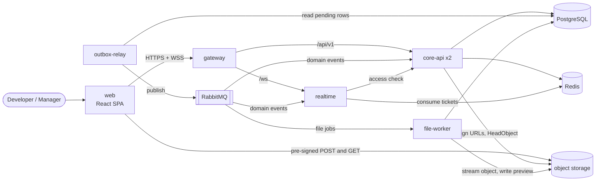
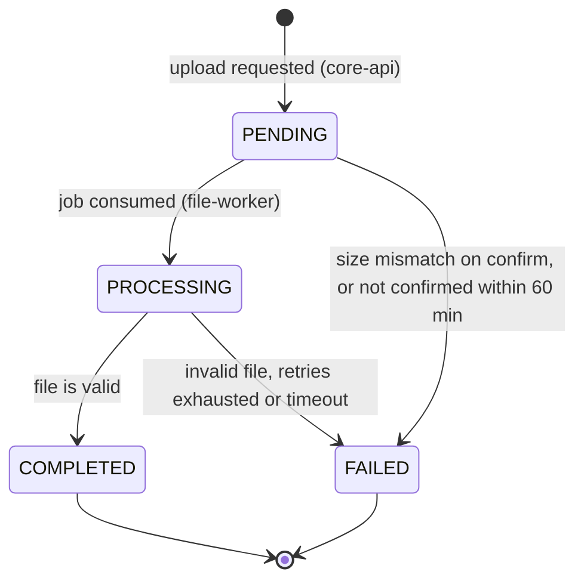

# TaskMaster — API and Contract Specification

> Contract specification for **Case 8: TaskMaster — Enterprise Kanban (Concurrency)**.
> Wave 2 source code is reviewed against this file. Contract changes are made here first, through a pull request that bumps the version and updates [§11 Change history](#11-change-history).

| | |
|---|---|
| **Team** | TS-008 |
| **Case** | Case 8: TaskMaster — Enterprise Kanban (Concurrency) |
| **Status** | Draft |
| **Version** | 0.1.0 |
| **Last updated** | 2026-10-13 |
| **Related documents** | [ADR 001](adrs/001-optimistic-concurrency-control.md) · [ADR 002](adrs/002-presigned-uploads-async-workers.md) · [ADR 003](adrs/003-transactional-outbox-realtime-notifications.md) · [C4 container diagram](assets/c4-container-diagram.png) |

The key words **MUST**, **MUST NOT**, **SHALL**, **SHALL NOT**, **SHOULD** and **MAY** are to be interpreted as described in RFC 2119.

## Contents

1. [Overview](#1-overview)
2. [Domain data schemas](#2-domain-data-schemas)
3. [REST API](#3-rest-api)
4. [Asynchronous events and integration contracts](#4-asynchronous-events-and-integration-contracts)
5. [Requirements and scenarios](#5-requirements-and-scenarios)
6. [Non-functional requirements](#6-non-functional-requirements)
7. [Edge cases and failure handling](#7-edge-cases-and-failure-handling)
8. [Constraints, assumptions and dependencies](#8-constraints-assumptions-and-dependencies)
9. [Open questions](#9-open-questions)
10. [Glossary](#10-glossary)
11. [Change history](#11-change-history)

---

## 1. Overview

### 1.1 Purpose

TaskMaster provides Trello-style Kanban boards for enterprise teams. This document is the single source of truth for the system's contracts: domain data schemas, REST endpoints, the WebSocket protocol, asynchronous events, and the verifiable requirements for the five mandatory features. Behavior not described here is out of scope for this version.

### 1.2 Problem statement

Two production failures motivate this design:

1. **Lost update.** Developer A and Manager B open the same task. A edits the technical description and saves. Two seconds later B moves the task from *To Do* to *In Progress*. B's client sends the full payload it loaded earlier, so A's description is silently overwritten.
2. **Upload memory exhaustion.** A user attaches a 150 MB design file to a card. The Node.js API buffers the whole stream in memory, fills the RAM and disconnects teammates who only wanted to read tasks.

The architecture removes both failures at the root:

- Task writes are partial, intent-based and conditional on the version the client last saw (Optimistic Concurrency Control, [ADR 001](adrs/001-optimistic-concurrency-control.md)).
- File bytes never reach the API: the browser uploads directly to object storage with a pre-signed URL and a worker processes the file asynchronously ([ADR 002](adrs/002-presigned-uploads-async-workers.md)).
- Board changes reach connected users through a transactional outbox, RabbitMQ and WebSockets, without coupling the write to the delivery ([ADR 003](adrs/003-transactional-outbox-realtime-notifications.md)).

### 1.3 Goals and non-goals

**Goals (in scope for this version)**

| # | Goal | Feature |
|---|---|---|
| G1 | Workspaces, workspace roles and per-board permissions are enforced on every request and every real-time subscription. | F1 |
| G2 | The board summary is returned without loading heavy task fields and is served from a cache. | F2 |
| G3 | No silent overwrites: every task write is conditional on the version the client last saw. | F3 |
| G4 | Files up to 250 MiB are uploaded directly to object storage and processed by workers; API memory does not depend on file size. | F4 |
| G5 | Users viewing a board receive web notifications of its modifications within seconds, and no event is lost. | F5 |

**Non-goals (explicitly out of scope)**

- Real-time co-editing of the same field (CRDT/OT), presence indicators or cursors.
- Automatic merge of concurrent changes to disjoint fields (deferred by ADR 001).
- Pessimistic locks or "being edited by" locks.
- Email, mobile push or desktop notifications; notification inbox or history.
- Comments, checklists, mentions, search, activity feed, task revision history or undo.
- Email invitations, SSO/SAML, MFA and password reset.
- Resumable or multipart uploads, files larger than 250 MiB, file versioning, previews for non-image formats, antivirus scanning (see [§9](#9-open-questions)).
- Archiving or deleting boards and workspaces, restoring archived tasks, board templates.
- Optimistic concurrency on boards and columns (they use field-level `PATCH`; see [§9](#9-open-questions)).
- Native mobile apps and offline mode.

### 1.4 Users and main use cases

| Persona | Typical role | Main use cases |
|---|---|---|
| Workspace administrator | Workspace `OWNER` or `ADMIN` | Create a workspace, add members, assign roles, create boards. |
| Manager | Board `ADMIN` or `EDITOR` | Configure columns, manage board members, move cards through the workflow. |
| Developer / designer | Board `EDITOR` | Edit task details, attach design files, follow board changes live. |
| Stakeholder | Board `VIEWER` | Read boards and tasks, download attachments. |

Main flows:

- **UC-1** Set up a workspace and a board, and grant access to the team.
- **UC-2** Open a board (summary) and receive live updates.
- **UC-3** Edit a task while other users edit or move it.
- **UC-4** Move a card between columns.
- **UC-5** Attach a large design file to a card.
- **UC-6** Revoke a user's access.

### 1.5 Services and responsibilities

Current C4 container diagram (Level 2):


Runtime view required by this specification (adds the API Gateway, Redis, `realtime` and `outbox-relay`, which are not yet drawn in the C4 diagram; see [§9](#9-open-questions)):



| Service (Compose name) | C4 container | Technology | Responsibility |
|---|---|---|---|
| `web` | Web Application | React SPA | Kanban UI. Sends intent-based writes with `If-Match`, resolves `412` conflicts, uploads files directly to object storage, holds the WebSocket connection. |
| `gateway` | *Not yet in the diagram* | Open-source API Gateway | Single entry point: TLS termination, routing, JWT validation, rate limiting, 1 MiB request-body limit, CORS, `X-Correlation-Id` injection, WebSocket proxying. |
| `core-api` | API Application | Node.js | Identity and access, workspaces, boards, columns, tasks with OCC, board summary (cache-aside on Redis), attachment metadata and pre-signed URLs. Writes outbox events and invalidates the summary cache. Stateless; at least 2 replicas. |
| `outbox-relay` | API Application (separate process) | Node.js | Publishes `outbox_events` rows to RabbitMQ with publisher confirms and marks them as published. |
| `realtime` | Notification module of the API Application (ADR 003), deployed separately | Node.js, WebSocket | Authenticates WebSocket connections, authorizes board subscriptions, consumes domain events and pushes them to authorized subscribers. |
| `file-worker` | Background Worker | Node.js | Consumes file-processing jobs, validates files, generates previews, updates attachment status, runs the upload cleanup. |
| `postgres` | Database | PostgreSQL | Source of truth: users, memberships, roles, boards, columns, tasks and their versions, attachment metadata, outbox. |
| `redis` | *Not yet in the diagram* | Redis | Board-summary cache and WebSocket tickets. Never a source of truth. |
| `rabbitmq` | Message Broker | RabbitMQ | Domain-event fan-out and file-processing job queue with retry and dead-letter queues. |
| `object-storage` | Object Storage | AWS S3 (MinIO in Docker Compose) | Original files and previews in a private bucket, accessed only through pre-signed URLs. |

Observability containers (Prometheus, Loki, Grafana; optionally Tempo or Jaeger) are described in [NFR-9](#6-non-functional-requirements).

### 1.6 Feature traceability

| Mandatory feature | Requirements | Endpoints | Events | ADR |
|---|---|---|---|---|
| **F1** Roles, workspaces and board permissions | FR-1.1 – FR-1.5 | [§3.3](#33-identity) – [§3.5](#35-boards) | `board.member.changed`, `workspace.member.changed` | — |
| **F2** Optimized board summary | FR-2.1 – FR-2.5 | `GET /boards/{boardId}/summary`, `GET /columns/{columnId}/tasks` | All board events (cache invalidation) | Pending (see [§9](#9-open-questions)) |
| **F3** Optimistic concurrency control | FR-3.1 – FR-3.6 | [§3.7](#37-tasks) | `task.*` (carry `aggregate.version`) | ADR 001 |
| **F4** Asynchronous heavy uploads | FR-4.1 – FR-4.7 | [§3.8](#38-attachments) | `attachment.process` job, `attachment.processed` | ADR 002 |
| **F5** Web notifications of board changes | FR-5.1 – FR-5.6 | [§3.9](#39-realtime) | All domain events | ADR 003 |

---

## 2. Domain data schemas

### 2.1 Bounded contexts

| Context | Type | Owns | Owner service |
|---|---|---|---|
| Board Collaboration | Core domain | Boards, columns, tasks, task versions, board summary | `core-api` |
| Identity & Access | Supporting | Users, refresh tokens, workspaces, memberships, roles | `core-api` |
| Attachments | Supporting | Attachment metadata, stored objects, processing | `core-api` (metadata, URLs), `file-worker` (processing) |
| Notifications | Supporting | WebSocket sessions and subscriptions | `realtime` |

### 2.2 Enumerations and permissions

| Enum | Values | Notes |
|---|---|---|
| `WorkspaceRole` | `OWNER`, `ADMIN`, `MEMBER` | A workspace always has at least one `OWNER`. |
| `BoardRole` | `ADMIN`, `EDITOR`, `VIEWER` | Workspace `OWNER` and `ADMIN` have an implicit board `ADMIN` role on every board of the workspace. |
| `AttachmentStatus` | `PENDING`, `PROCESSING`, `COMPLETED`, `FAILED` | See [§2.7](#27-attachment-lifecycle). |
| `AttachmentFailureReason` | `UPLOAD_NOT_CONFIRMED`, `SIZE_MISMATCH`, `CONTENT_TYPE_MISMATCH`, `PROCESSING_ERROR`, `PROCESSING_TIMEOUT` | Set only when the status is `FAILED`. |

**Effective board role** = the highest of (explicit `board_members.role`, implicit `ADMIN` when the user is workspace `OWNER` or `ADMIN`). A user without an effective role has no access to the board.

**Board permission matrix**

| Action | VIEWER | EDITOR | ADMIN |
|---|:-:|:-:|:-:|
| Read the board summary, tasks, members and attachments; subscribe to notifications | ✓ | ✓ | ✓ |
| Create, edit, move and archive tasks | | ✓ | ✓ |
| Request uploads; delete own attachments | | ✓ | ✓ |
| Delete any attachment | | | ✓ |
| Create, rename, reorder and delete columns; rename the board | | | ✓ |
| Add and remove board members; change board roles | | | ✓ |

**Workspace permission matrix**

| Action | MEMBER | ADMIN | OWNER |
|---|:-:|:-:|:-:|
| List workspace members; create boards | ✓ | ✓ | ✓ |
| Add and remove `MEMBER`s | | ✓ | ✓ |
| Grant or revoke `ADMIN` or `OWNER` | | | ✓ |
| Leave the workspace | ✓ | ✓ | ✓ (unless last `OWNER`) |

### 2.3 Relational schema (PostgreSQL)

```sql
CREATE TYPE workspace_role    AS ENUM ('OWNER', 'ADMIN', 'MEMBER');
CREATE TYPE board_role        AS ENUM ('ADMIN', 'EDITOR', 'VIEWER');
CREATE TYPE attachment_status AS ENUM ('PENDING', 'PROCESSING', 'COMPLETED', 'FAILED');

CREATE TABLE users (
  id             uuid PRIMARY KEY DEFAULT gen_random_uuid(),
  email          varchar(254) NOT NULL UNIQUE,              -- stored lower-case
  display_name   varchar(100) NOT NULL,
  password_hash  text NOT NULL,                             -- argon2id
  created_at     timestamptz NOT NULL DEFAULT now()
);

CREATE TABLE refresh_tokens (
  id          uuid PRIMARY KEY DEFAULT gen_random_uuid(),
  user_id     uuid NOT NULL REFERENCES users(id),
  token_hash  char(64) NOT NULL UNIQUE,                     -- SHA-256 (hex) of the opaque token
  expires_at  timestamptz NOT NULL,
  revoked_at  timestamptz,
  created_at  timestamptz NOT NULL DEFAULT now()
);

CREATE TABLE workspaces (
  id          uuid PRIMARY KEY DEFAULT gen_random_uuid(),
  name        varchar(100) NOT NULL,
  created_by  uuid NOT NULL REFERENCES users(id),
  created_at  timestamptz NOT NULL DEFAULT now()
);

CREATE TABLE workspace_members (
  workspace_id  uuid NOT NULL REFERENCES workspaces(id),
  user_id       uuid NOT NULL REFERENCES users(id),
  role          workspace_role NOT NULL,
  created_at    timestamptz NOT NULL DEFAULT now(),
  PRIMARY KEY (workspace_id, user_id)
);

CREATE TABLE boards (
  id            uuid PRIMARY KEY DEFAULT gen_random_uuid(),
  workspace_id  uuid NOT NULL REFERENCES workspaces(id),
  name          varchar(100) NOT NULL,
  description   varchar(2000),
  created_by    uuid NOT NULL REFERENCES users(id),
  created_at    timestamptz NOT NULL DEFAULT now(),
  updated_at    timestamptz NOT NULL DEFAULT now()
);

CREATE TABLE board_members (
  board_id    uuid NOT NULL REFERENCES boards(id),
  user_id     uuid NOT NULL REFERENCES users(id),
  role        board_role NOT NULL,
  created_at  timestamptz NOT NULL DEFAULT now(),
  PRIMARY KEY (board_id, user_id)
);

CREATE TABLE board_columns (
  id          uuid PRIMARY KEY DEFAULT gen_random_uuid(),
  board_id    uuid NOT NULL REFERENCES boards(id),
  name        varchar(100) NOT NULL,
  position    double precision NOT NULL,
  created_at  timestamptz NOT NULL DEFAULT now(),
  updated_at  timestamptz NOT NULL DEFAULT now(),
  deleted_at  timestamptz                                   -- soft delete; archived tasks keep their column
);

CREATE TABLE tasks (
  id            uuid PRIMARY KEY DEFAULT gen_random_uuid(),
  board_id      uuid NOT NULL REFERENCES boards(id),
  column_id     uuid NOT NULL REFERENCES board_columns(id),
  title         varchar(200) NOT NULL,
  description   text NOT NULL DEFAULT '' CHECK (char_length(description) <= 20000),
  assignee_ids  uuid[] NOT NULL DEFAULT '{}',
  labels        varchar(30)[] NOT NULL DEFAULT '{}',
  due_date      date,
  position      double precision NOT NULL,
  version       integer NOT NULL DEFAULT 1 CHECK (version >= 1),   -- OCC token (ADR 001)
  created_by    uuid NOT NULL REFERENCES users(id),
  updated_by    uuid NOT NULL REFERENCES users(id),
  created_at    timestamptz NOT NULL DEFAULT now(),
  updated_at    timestamptz NOT NULL DEFAULT now(),
  archived_at   timestamptz
);
CREATE INDEX tasks_board_column_position_idx
  ON tasks (board_id, column_id, position) WHERE archived_at IS NULL;

CREATE TABLE attachments (
  id                   uuid PRIMARY KEY DEFAULT gen_random_uuid(),
  task_id              uuid NOT NULL REFERENCES tasks(id),
  board_id             uuid NOT NULL REFERENCES boards(id),
  uploaded_by          uuid NOT NULL REFERENCES users(id),
  file_name            varchar(255) NOT NULL,
  content_type         varchar(127) NOT NULL,
  size_bytes           bigint NOT NULL CHECK (size_bytes BETWEEN 1 AND 262144000),  -- 250 MiB
  storage_key          text NOT NULL UNIQUE,
  preview_key          text,
  status               attachment_status NOT NULL DEFAULT 'PENDING',
  failure_reason       varchar(32),
  upload_expires_at    timestamptz NOT NULL,
  upload_confirmed_at  timestamptz,
  processing_attempts  integer NOT NULL DEFAULT 0,
  created_at           timestamptz NOT NULL DEFAULT now(),
  updated_at           timestamptz NOT NULL DEFAULT now()
);
CREATE INDEX attachments_task_idx  ON attachments (task_id);
CREATE INDEX attachments_stale_idx ON attachments (status, updated_at)
  WHERE status IN ('PENDING', 'PROCESSING');

CREATE TABLE outbox_events (
  seq           bigint GENERATED ALWAYS AS IDENTITY PRIMARY KEY,
  event_id      uuid NOT NULL UNIQUE,
  exchange      varchar(100) NOT NULL,
  routing_key   varchar(100) NOT NULL,
  payload       jsonb NOT NULL,                             -- full event envelope (§4.2)
  occurred_at   timestamptz NOT NULL DEFAULT now(),
  published_at  timestamptz,
  attempts      integer NOT NULL DEFAULT 0,
  last_error    text
);
CREATE INDEX outbox_pending_idx ON outbox_events (seq) WHERE published_at IS NULL;
```

Schema rules:

- `tasks.version` changes only through a conditional update (ADR 001). If the update affects 0 rows, `core-api` reads the task to decide between `404`, `409 TASK_ARCHIVED` and `412 VERSION_CONFLICT`.

  ```sql
  UPDATE tasks
  SET    description = $3, updated_by = $4, updated_at = now(), version = version + 1
  WHERE  id = $1 AND version = $2 AND archived_at IS NULL
  RETURNING *;
  ```

- `position` is an opaque sort key. The server computes it: an empty column starts at `1024`, the top is `first − 1024`, the bottom is `last + 1024`, and a slot between two tasks is their midpoint. If the gap becomes smaller than `1e-6`, the server renumbers the column in the same transaction; renumbering never changes task versions.
- All `*_at` columns are UTC.

### 2.4 API resource representations

```ts
type UUID = string;       // RFC 4122 v4
type Timestamp = string;  // RFC 3339 in UTC with milliseconds, e.g. "2026-10-13T14:05:09.123Z"
type LocalDate = string;  // "YYYY-MM-DD"

interface User {
  id: UUID;
  email: string;
  displayName: string;
  createdAt: Timestamp;
}

interface Workspace {
  id: UUID;
  name: string;
  myRole: WorkspaceRole;
  createdAt: Timestamp;
}

interface Member {
  userId: UUID;
  email: string;
  displayName: string;
  role: WorkspaceRole | BoardRole;
  implicit: boolean;          // true for workspace OWNER/ADMIN listed on a board without an explicit membership
  addedAt: Timestamp | null;  // null when implicit
}

interface Board {
  id: UUID;
  workspaceId: UUID;
  name: string;
  description: string | null;
  myRole: BoardRole;          // effective role of the caller; computed per request
  createdAt: Timestamp;
  updatedAt: Timestamp;
}

interface Column {
  id: UUID;
  boardId: UUID;
  name: string;
  position: number;
}

interface TaskCard {          // lightweight projection used by the board summary and events
  id: UUID;
  columnId: UUID;
  title: string;
  position: number;
  version: number;
  assigneeIds: UUID[];
  labels: string[];
  dueDate: LocalDate | null;
  attachmentCount: number;    // attachments with status COMPLETED
  updatedAt: Timestamp;
}

interface TaskDetail extends TaskCard {
  boardId: UUID;
  description: string;        // Markdown
  attachments: Attachment[];
  createdBy: UUID;
  createdAt: Timestamp;
  updatedBy: UUID;
  archivedAt: Timestamp | null;
}

interface Attachment {
  id: UUID;
  taskId: UUID;
  boardId: UUID;
  fileName: string;
  contentType: string;
  sizeBytes: number;
  status: AttachmentStatus;
  failureReason: AttachmentFailureReason | null;
  hasPreview: boolean;
  uploadedBy: UUID;
  uploadConfirmedAt: Timestamp | null;
  createdAt: Timestamp;
  updatedAt: Timestamp;
}

interface BoardSummary {
  board: Board;
  columns: Array<Column & {
    taskCount: number;          // active (non-archived) tasks in the column
    tasks: TaskCard[];          // first 50 active tasks by position
    nextCursor: string | null;  // continue with GET /columns/{columnId}/tasks
  }>;
  generatedAt: Timestamp;       // when the cached projection was built
}

interface Page<T> {
  items: T[];
  nextCursor: string | null;
}

interface Problem {             // RFC 9457, media type application/problem+json
  type: string;                 // "/problems/<code-in-kebab-case>"
  title: string;
  status: number;
  code: string;                 // see §3.2
  detail: string;
  instance: string;             // request path
  correlationId: string;
  errors?: Array<{ field: string; message: string }>;  // validation errors only
}
```

**Field constraints**

| Field | Constraint |
|---|---|
| `email` | Valid address, at most 254 characters, compared case-insensitively. |
| `password` | 12 to 128 characters. |
| `displayName`, workspace/board/column `name` | 1 to 100 characters after trimming. |
| Board `description` | At most 2,000 characters. |
| Task `title` | 1 to 200 characters after trimming. |
| Task `description` | Markdown, at most 20,000 characters. |
| Task `labels` | At most 10 labels, each 1 to 30 characters. |
| Task `assigneeIds` | At most 10 users; each newly added id must have an effective role on the board. |
| `fileName` | 1 to 255 characters, no `/`, `\` or control characters. |
| Columns per board | At most 20. |

### 2.5 Cache keys (Redis)

| Key | Value | TTL | Writer | Invalidated by |
|---|---|---|---|---|
| `board-summary:{boardId}` | JSON `BoardSummary` without `board.myRole` | 300 s | `core-api` (cache-aside on a miss) | `core-api` right after the commit of any write on the board, and the `core-api.summary-cache` consumer on domain events ([FR-2.4](#requirement-fr-24-cache-invalidation)) |
| `ws-ticket:{ticket}` | `{"userId": "<UUID>"}` | 30 s | `core-api` | Consumed atomically (`GETDEL`) by `realtime` |

### 2.6 Object storage layout

- Bucket `taskmaster-attachments`: private (no public ACLs), CORS allows `POST` from the web origin.
- Original file: `boards/{boardId}/tasks/{taskId}/attachments/{attachmentId}/original`
- Preview: `boards/{boardId}/tasks/{taskId}/attachments/{attachmentId}/preview.webp`
- The user-supplied file name is stored only in PostgreSQL and returned through `Content-Disposition` on download URLs.

### 2.7 Attachment lifecycle



| From | To | Actor | Condition |
|---|---|---|---|
| — | `PENDING` | `core-api` | `POST /tasks/{taskId}/attachments` accepted. |
| `PENDING` | `PENDING` (confirmed) | `core-api` | `POST /attachments/{id}/confirm` verified the object; `uploadConfirmedAt` is set and the job is queued. |
| `PENDING` | `PROCESSING` | `file-worker` | Job received for a confirmed attachment. |
| `PROCESSING` | `COMPLETED` | `file-worker` | Signature matches the declared type; preview generated when applicable. |
| `PROCESSING` | `FAILED` | `file-worker` | `CONTENT_TYPE_MISMATCH`, `SIZE_MISMATCH`, or `PROCESSING_ERROR` after the last retry. |
| `PENDING` | `FAILED` | `core-api` | Confirmation found an object whose size differs from `sizeBytes` (`SIZE_MISMATCH`). |
| `PENDING` | `FAILED` | `file-worker` cleanup | Not confirmed 60 min after creation (`UPLOAD_NOT_CONFIRMED`). |
| `PROCESSING` | `FAILED` | `file-worker` cleanup | No update for 30 min (`PROCESSING_TIMEOUT`). |

Status transitions are guarded in SQL (`WHERE status IN (...)`), so duplicate or late jobs cannot move a terminal attachment.

---
