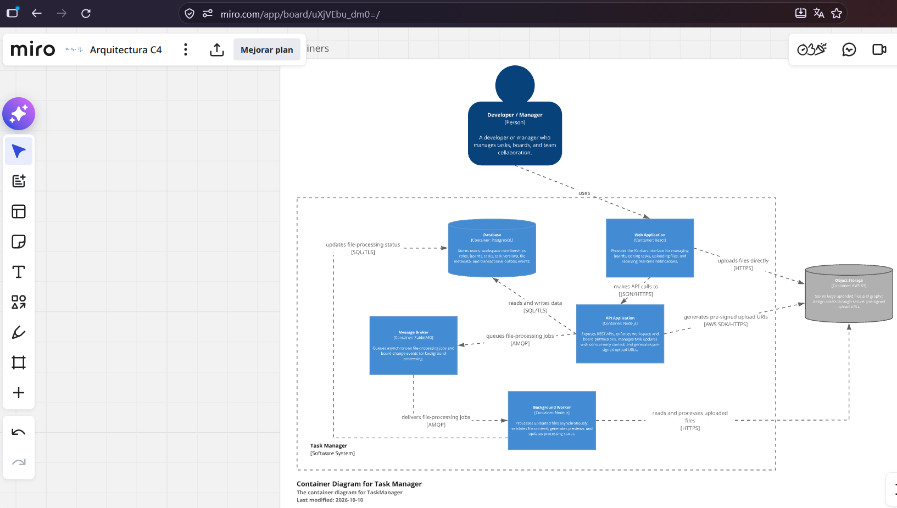
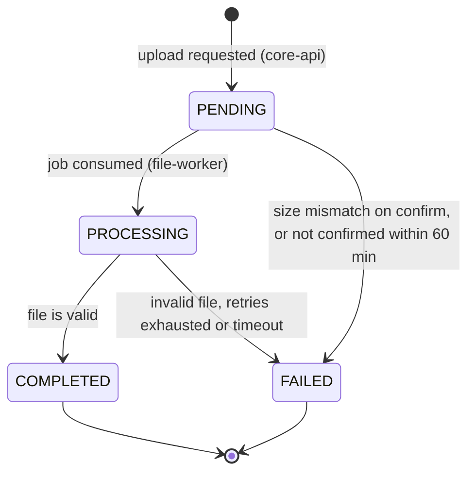
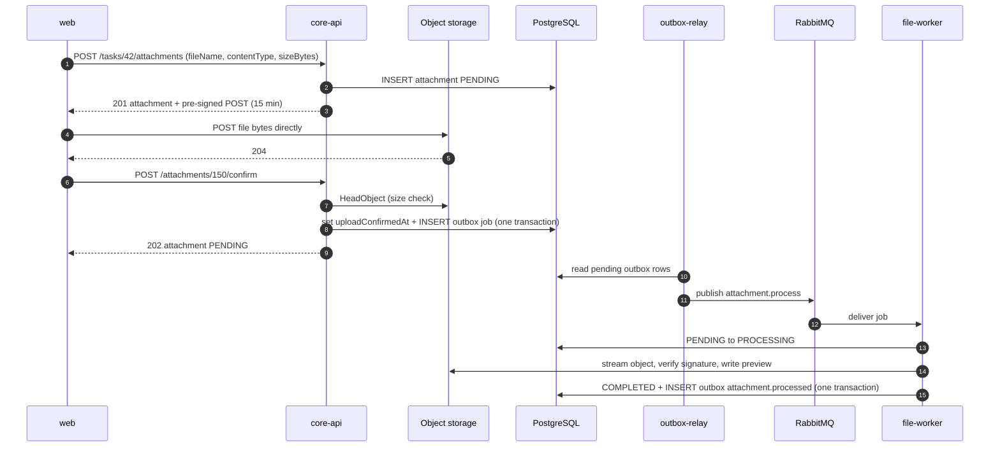
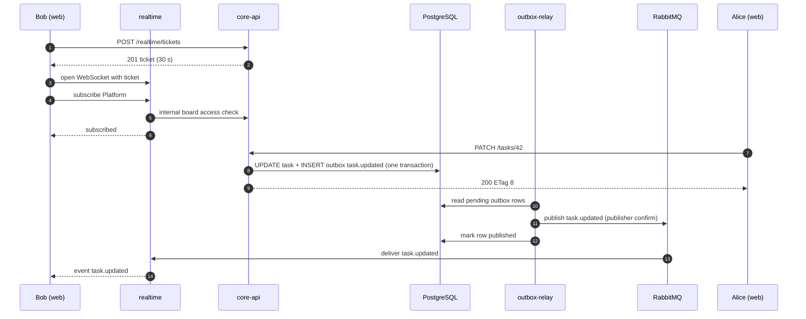
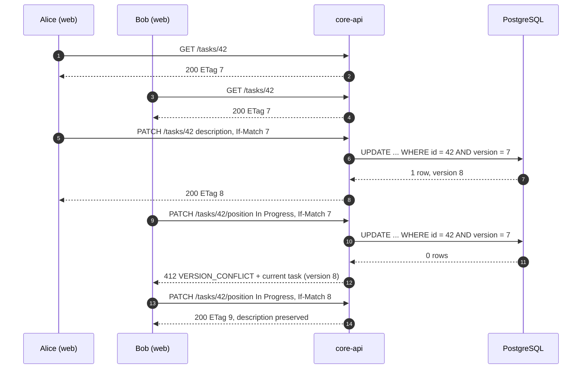

# TaskMaster — API and Contract Specification

> Contract specification for **Case 8: TaskMaster — Enterprise Kanban (Concurrency)**.
> Wave 2 source code is reviewed against this file. Contract changes are made here first, through a pull request that bumps the version and updates [§11 Change history](#11-change-history).

| | |
|---|---|
| **Team** | TS-008 |
| **Case** | Case 8: TaskMaster — Enterprise Kanban (Concurrency) |
| **Status** | Draft |
| **Version** | 0.1.0 |
| **Last updated** | 2026-10-13 |
| **Related documents** | [ADR 001](adrs/001-optimistic-concurrency-control.md) · [ADR 002](adrs/002-presigned-uploads-async-workers.md) · [ADR 003](adrs/003-transactional-outbox-realtime-notifications.md) · [C4 container diagram](assets/c4-container-diagram.png) |

The key words **MUST**, **MUST NOT**, **SHALL**, **SHALL NOT**, **SHOULD** and **MAY** are to be interpreted as described in RFC 2119.

## Contents

1. [Overview](#1-overview)
2. [Domain data schemas](#2-domain-data-schemas)
3. [REST API](#3-rest-api)
4. [Asynchronous events and integration contracts](#4-asynchronous-events-and-integration-contracts)
5. [Requirements and scenarios](#5-requirements-and-scenarios)
6. [Non-functional requirements](#6-non-functional-requirements)
7. [Edge cases and failure handling](#7-edge-cases-and-failure-handling)
8. [Constraints, assumptions and dependencies](#8-constraints-assumptions-and-dependencies)
9. [Open questions](#9-open-questions)
10. [Glossary](#10-glossary)
11. [Change history](#11-change-history)

---

## 1. Overview

### 1.1 Purpose

TaskMaster provides Trello-style Kanban boards for enterprise teams. This document is the single source of truth for the system's contracts: domain data schemas, REST endpoints, the WebSocket protocol, asynchronous events, and the verifiable requirements for the five mandatory features. Behavior not described here is out of scope for this version.

### 1.2 Problem statement

Two production failures motivate this design:

1. **Lost update.** Developer A and Manager B open the same task. A edits the technical description and saves. Two seconds later B moves the task from *To Do* to *In Progress*. B's client sends the full payload it loaded earlier, so A's description is silently overwritten.
2. **Upload memory exhaustion.** A user attaches a 150 MB design file to a card. The Node.js API buffers the whole stream in memory, fills the RAM and disconnects teammates who only wanted to read tasks.

The architecture removes both failures at the root:

- Task writes are partial, intent-based and conditional on the version the client last saw (Optimistic Concurrency Control, [ADR 001](adrs/001-optimistic-concurrency-control.md)).
- File bytes never reach the API: the browser uploads directly to object storage with a pre-signed URL and a worker processes the file asynchronously ([ADR 002](adrs/002-presigned-uploads-async-workers.md)).
- Board changes reach connected users through a transactional outbox, RabbitMQ and WebSockets, without coupling the write to the delivery ([ADR 003](adrs/003-transactional-outbox-realtime-notifications.md)).

### 1.3 Goals and non-goals

**Goals (in scope for this version)**

| # | Goal | Feature |
|---|---|---|
| G1 | Workspaces, workspace roles and per-board permissions are enforced on every request and every real-time subscription. | F1 |
| G2 | The board summary is returned without loading heavy task fields and is served from a cache. | F2 |
| G3 | No silent overwrites: every task write is conditional on the version the client last saw. | F3 |
| G4 | Files up to 250 MiB are uploaded directly to object storage and processed by workers; API memory does not depend on file size. | F4 |
| G5 | Users viewing a board receive web notifications of its modifications within seconds, and no event is lost. | F5 |

**Non-goals (explicitly out of scope)**

- Real-time co-editing of the same field (CRDT/OT), presence indicators or cursors.
- Automatic merge of concurrent changes to disjoint fields (deferred by ADR 001).
- Pessimistic locks or "being edited by" locks.
- Email, mobile push or desktop notifications; notification inbox or history.
- Comments, checklists, mentions, search, activity feed, task revision history or undo.
- Email invitations, SSO/SAML, MFA and password reset.
- Resumable or multipart uploads, files larger than 250 MiB, file versioning, previews for non-image formats, antivirus scanning (see [§9](#9-open-questions)).
- Archiving or deleting boards and workspaces, restoring archived tasks, board templates.
- Optimistic concurrency on boards and columns (they use field-level `PATCH`; see [§9](#9-open-questions)).
- Native mobile apps and offline mode.

### 1.4 Users and main use cases

| Persona | Typical role | Main use cases |
|---|---|---|
| Workspace administrator | Workspace `OWNER` or `ADMIN` | Create a workspace, add members, assign roles, create boards. |
| Manager | Board `ADMIN` or `EDITOR` | Configure columns, manage board members, move cards through the workflow. |
| Developer / designer | Board `EDITOR` | Edit task details, attach design files, follow board changes live. |
| Stakeholder | Board `VIEWER` | Read boards and tasks, download attachments. |

Main flows:

- **UC-1** Set up a workspace and a board, and grant access to the team.
- **UC-2** Open a board (summary) and receive live updates.
- **UC-3** Edit a task while other users edit or move it.
- **UC-4** Move a card between columns.
- **UC-5** Attach a large design file to a card.
- **UC-6** Revoke a user's access.

### 1.5 Services and responsibilities

Current C4 container diagram (Level 2):



Runtime view required by this specification (adds the API Gateway, Redis, `realtime` and `outbox-relay`, which are not yet drawn in the C4 diagram; see [§9](#9-open-questions)):


| Service (Compose name) | C4 container | Technology | Responsibility |
|---|---|---|---|
| `web` | Web Application | React SPA | Kanban UI. Sends intent-based writes with `If-Match`, resolves `412` conflicts, uploads files directly to object storage, holds the WebSocket connection. |
| `gateway` | *Not yet in the diagram* | Open-source API Gateway | Single entry point: TLS termination, routing, JWT validation, rate limiting, 1 MiB request-body limit, CORS, `X-Correlation-Id` injection, WebSocket proxying. |
| `core-api` | API Application | Node.js | Identity and access, workspaces, boards, columns, tasks with OCC, board summary (cache-aside on Redis), attachment metadata and pre-signed URLs. Writes outbox events and invalidates the summary cache. Stateless; at least 2 replicas. |
| `outbox-relay` | API Application (separate process) | Node.js | Publishes `outbox_events` rows to RabbitMQ with publisher confirms and marks them as published. |
| `realtime` | Notification module of the API Application (ADR 003), deployed separately | Node.js, WebSocket | Authenticates WebSocket connections, authorizes board subscriptions, consumes domain events and pushes them to authorized subscribers. |
| `file-worker` | Background Worker | Node.js | Consumes file-processing jobs, validates files, generates previews, updates attachment status, runs the upload cleanup. |
| `postgres` | Database | PostgreSQL | Source of truth: users, memberships, roles, boards, columns, tasks and their versions, attachment metadata, outbox. |
| `redis` | *Not yet in the diagram* | Redis | Board-summary cache and WebSocket tickets. Never a source of truth. |
| `rabbitmq` | Message Broker | RabbitMQ | Domain-event fan-out and file-processing job queue with retry and dead-letter queues. |
| `object-storage` | Object Storage | AWS S3 (MinIO in Docker Compose) | Original files and previews in a private bucket, accessed only through pre-signed URLs. |

Observability containers (Prometheus, Loki, Grafana; optionally Tempo or Jaeger) are described in [NFR-9](#6-non-functional-requirements).

### 1.6 Feature traceability

| Mandatory feature | Requirements | Endpoints | Events | ADR |
|---|---|---|---|---|
| **F1** Roles, workspaces and board permissions | FR-1.1 – FR-1.5 | [§3.3](#33-identity) – [§3.5](#35-boards) | `board.member.changed`, `workspace.member.changed` | — |
| **F2** Optimized board summary | FR-2.1 – FR-2.5 | `GET /boards/{boardId}/summary`, `GET /columns/{columnId}/tasks` | All board events (cache invalidation) | Pending (see [§9](#9-open-questions)) |
| **F3** Optimistic concurrency control | FR-3.1 – FR-3.6 | [§3.7](#37-tasks) | `task.*` (carry `aggregate.version`) | ADR 001 |
| **F4** Asynchronous heavy uploads | FR-4.1 – FR-4.7 | [§3.8](#38-attachments) | `attachment.process` job, `attachment.processed` | ADR 002 |
| **F5** Web notifications of board changes | FR-5.1 – FR-5.6 | [§3.9](#39-realtime) | All domain events | ADR 003 |

---

## 2. Domain data schemas

### 2.1 Bounded contexts

| Context | Type | Owns | Owner service |
|---|---|---|---|
| Board Collaboration | Core domain | Boards, columns, tasks, task versions, board summary | `core-api` |
| Identity & Access | Supporting | Users, refresh tokens, workspaces, memberships, roles | `core-api` |
| Attachments | Supporting | Attachment metadata, stored objects, processing | `core-api` (metadata, URLs), `file-worker` (processing) |
| Notifications | Supporting | WebSocket sessions and subscriptions | `realtime` |

### 2.2 Enumerations and permissions

| Enum | Values | Notes |
|---|---|---|
| `WorkspaceRole` | `OWNER`, `ADMIN`, `MEMBER` | A workspace always has at least one `OWNER`. |
| `BoardRole` | `ADMIN`, `EDITOR`, `VIEWER` | Workspace `OWNER` and `ADMIN` have an implicit board `ADMIN` role on every board of the workspace. |
| `AttachmentStatus` | `PENDING`, `PROCESSING`, `COMPLETED`, `FAILED` | See [§2.7](#27-attachment-lifecycle). |
| `AttachmentFailureReason` | `UPLOAD_NOT_CONFIRMED`, `SIZE_MISMATCH`, `CONTENT_TYPE_MISMATCH`, `PROCESSING_ERROR`, `PROCESSING_TIMEOUT` | Set only when the status is `FAILED`. |

**Effective board role** = the highest of (explicit `board_members.role`, implicit `ADMIN` when the user is workspace `OWNER` or `ADMIN`). A user without an effective role has no access to the board.

**Board permission matrix**

| Action | VIEWER | EDITOR | ADMIN |
|---|:-:|:-:|:-:|
| Read the board summary, tasks, members and attachments; subscribe to notifications | ✓ | ✓ | ✓ |
| Create, edit, move and archive tasks | | ✓ | ✓ |
| Request uploads; delete own attachments | | ✓ | ✓ |
| Delete any attachment | | | ✓ |
| Create, rename, reorder and delete columns; rename the board | | | ✓ |
| Add and remove board members; change board roles | | | ✓ |

**Workspace permission matrix**

| Action | MEMBER | ADMIN | OWNER |
|---|:-:|:-:|:-:|
| List workspace members; create boards | ✓ | ✓ | ✓ |
| Add and remove `MEMBER`s | | ✓ | ✓ |
| Grant or revoke `ADMIN` or `OWNER` | | | ✓ |
| Leave the workspace | ✓ | ✓ | ✓ (unless last `OWNER`) |

### 2.3 Relational schema (PostgreSQL)

```sql
CREATE TYPE workspace_role    AS ENUM ('OWNER', 'ADMIN', 'MEMBER');
CREATE TYPE board_role        AS ENUM ('ADMIN', 'EDITOR', 'VIEWER');
CREATE TYPE attachment_status AS ENUM ('PENDING', 'PROCESSING', 'COMPLETED', 'FAILED');

CREATE TABLE users (
  id             uuid PRIMARY KEY DEFAULT gen_random_uuid(),
  email          varchar(254) NOT NULL UNIQUE,              -- stored lower-case
  display_name   varchar(100) NOT NULL,
  password_hash  text NOT NULL,                             -- argon2id
  created_at     timestamptz NOT NULL DEFAULT now()
);

CREATE TABLE refresh_tokens (
  id          uuid PRIMARY KEY DEFAULT gen_random_uuid(),
  user_id     uuid NOT NULL REFERENCES users(id),
  token_hash  char(64) NOT NULL UNIQUE,                     -- SHA-256 (hex) of the opaque token
  expires_at  timestamptz NOT NULL,
  revoked_at  timestamptz,
  created_at  timestamptz NOT NULL DEFAULT now()
);

CREATE TABLE workspaces (
  id          uuid PRIMARY KEY DEFAULT gen_random_uuid(),
  name        varchar(100) NOT NULL,
  created_by  uuid NOT NULL REFERENCES users(id),
  created_at  timestamptz NOT NULL DEFAULT now()
);

CREATE TABLE workspace_members (
  workspace_id  uuid NOT NULL REFERENCES workspaces(id),
  user_id       uuid NOT NULL REFERENCES users(id),
  role          workspace_role NOT NULL,
  created_at    timestamptz NOT NULL DEFAULT now(),
  PRIMARY KEY (workspace_id, user_id)
);

CREATE TABLE boards (
  id            uuid PRIMARY KEY DEFAULT gen_random_uuid(),
  workspace_id  uuid NOT NULL REFERENCES workspaces(id),
  name          varchar(100) NOT NULL,
  description   varchar(2000),
  created_by    uuid NOT NULL REFERENCES users(id),
  created_at    timestamptz NOT NULL DEFAULT now(),
  updated_at    timestamptz NOT NULL DEFAULT now()
);

CREATE TABLE board_members (
  board_id    uuid NOT NULL REFERENCES boards(id),
  user_id     uuid NOT NULL REFERENCES users(id),
  role        board_role NOT NULL,
  created_at  timestamptz NOT NULL DEFAULT now(),
  PRIMARY KEY (board_id, user_id)
);

CREATE TABLE board_columns (
  id          uuid PRIMARY KEY DEFAULT gen_random_uuid(),
  board_id    uuid NOT NULL REFERENCES boards(id),
  name        varchar(100) NOT NULL,
  position    double precision NOT NULL,
  created_at  timestamptz NOT NULL DEFAULT now(),
  updated_at  timestamptz NOT NULL DEFAULT now(),
  deleted_at  timestamptz                                   -- soft delete; archived tasks keep their column
);

CREATE TABLE tasks (
  id            uuid PRIMARY KEY DEFAULT gen_random_uuid(),
  board_id      uuid NOT NULL REFERENCES boards(id),
  column_id     uuid NOT NULL REFERENCES board_columns(id),
  title         varchar(200) NOT NULL,
  description   text NOT NULL DEFAULT '' CHECK (char_length(description) <= 20000),
  assignee_ids  uuid[] NOT NULL DEFAULT '{}',
  labels        varchar(30)[] NOT NULL DEFAULT '{}',
  due_date      date,
  position      double precision NOT NULL,
  version       integer NOT NULL DEFAULT 1 CHECK (version >= 1),   -- OCC token (ADR 001)
  created_by    uuid NOT NULL REFERENCES users(id),
  updated_by    uuid NOT NULL REFERENCES users(id),
  created_at    timestamptz NOT NULL DEFAULT now(),
  updated_at    timestamptz NOT NULL DEFAULT now(),
  archived_at   timestamptz
);
CREATE INDEX tasks_board_column_position_idx
  ON tasks (board_id, column_id, position) WHERE archived_at IS NULL;

CREATE TABLE attachments (
  id                   uuid PRIMARY KEY DEFAULT gen_random_uuid(),
  task_id              uuid NOT NULL REFERENCES tasks(id),
  board_id             uuid NOT NULL REFERENCES boards(id),
  uploaded_by          uuid NOT NULL REFERENCES users(id),
  file_name            varchar(255) NOT NULL,
  content_type         varchar(127) NOT NULL,
  size_bytes           bigint NOT NULL CHECK (size_bytes BETWEEN 1 AND 262144000),  -- 250 MiB
  storage_key          text NOT NULL UNIQUE,
  preview_key          text,
  status               attachment_status NOT NULL DEFAULT 'PENDING',
  failure_reason       varchar(32),
  upload_expires_at    timestamptz NOT NULL,
  upload_confirmed_at  timestamptz,
  processing_attempts  integer NOT NULL DEFAULT 0,
  created_at           timestamptz NOT NULL DEFAULT now(),
  updated_at           timestamptz NOT NULL DEFAULT now()
);
CREATE INDEX attachments_task_idx  ON attachments (task_id);
CREATE INDEX attachments_stale_idx ON attachments (status, updated_at)
  WHERE status IN ('PENDING', 'PROCESSING');

CREATE TABLE outbox_events (
  seq           bigint GENERATED ALWAYS AS IDENTITY PRIMARY KEY,
  event_id      uuid NOT NULL UNIQUE,
  exchange      varchar(100) NOT NULL,
  routing_key   varchar(100) NOT NULL,
  payload       jsonb NOT NULL,                             -- full event envelope (§4.2)
  occurred_at   timestamptz NOT NULL DEFAULT now(),
  published_at  timestamptz,
  attempts      integer NOT NULL DEFAULT 0,
  last_error    text
);
CREATE INDEX outbox_pending_idx ON outbox_events (seq) WHERE published_at IS NULL;
```

Schema rules:

- `tasks.version` changes only through a conditional update (ADR 001). If the update affects 0 rows, `core-api` reads the task to decide between `404`, `409 TASK_ARCHIVED` and `412 VERSION_CONFLICT`.

  ```sql
  UPDATE tasks
  SET    description = $3, updated_by = $4, updated_at = now(), version = version + 1
  WHERE  id = $1 AND version = $2 AND archived_at IS NULL
  RETURNING *;
  ```

- `position` is an opaque sort key. The server computes it: an empty column starts at `1024`, the top is `first − 1024`, the bottom is `last + 1024`, and a slot between two tasks is their midpoint. If the gap becomes smaller than `1e-6`, the server renumbers the column in the same transaction; renumbering never changes task versions.
- All `*_at` columns are UTC.

### 2.4 API resource representations

```ts
type UUID = string;       // RFC 4122 v4
type Timestamp = string;  // RFC 3339 in UTC with milliseconds, e.g. "2026-10-13T14:05:09.123Z"
type LocalDate = string;  // "YYYY-MM-DD"

interface User {
  id: UUID;
  email: string;
  displayName: string;
  createdAt: Timestamp;
}

interface Workspace {
  id: UUID;
  name: string;
  myRole: WorkspaceRole;
  createdAt: Timestamp;
}

interface Member {
  userId: UUID;
  email: string;
  displayName: string;
  role: WorkspaceRole | BoardRole;
  implicit: boolean;          // true for workspace OWNER/ADMIN listed on a board without an explicit membership
  addedAt: Timestamp | null;  // null when implicit
}

interface Board {
  id: UUID;
  workspaceId: UUID;
  name: string;
  description: string | null;
  myRole: BoardRole;          // effective role of the caller; computed per request
  createdAt: Timestamp;
  updatedAt: Timestamp;
}

interface Column {
  id: UUID;
  boardId: UUID;
  name: string;
  position: number;
}

interface TaskCard {          // lightweight projection used by the board summary and events
  id: UUID;
  columnId: UUID;
  title: string;
  position: number;
  version: number;
  assigneeIds: UUID[];
  labels: string[];
  dueDate: LocalDate | null;
  attachmentCount: number;    // attachments with status COMPLETED
  updatedAt: Timestamp;
}

interface TaskDetail extends TaskCard {
  boardId: UUID;
  description: string;        // Markdown
  attachments: Attachment[];
  createdBy: UUID;
  createdAt: Timestamp;
  updatedBy: UUID;
  archivedAt: Timestamp | null;
}

interface Attachment {
  id: UUID;
  taskId: UUID;
  boardId: UUID;
  fileName: string;
  contentType: string;
  sizeBytes: number;
  status: AttachmentStatus;
  failureReason: AttachmentFailureReason | null;
  hasPreview: boolean;
  uploadedBy: UUID;
  uploadConfirmedAt: Timestamp | null;
  createdAt: Timestamp;
  updatedAt: Timestamp;
}

interface BoardSummary {
  board: Board;
  columns: Array<Column & {
    taskCount: number;          // active (non-archived) tasks in the column
    tasks: TaskCard[];          // first 50 active tasks by position
    nextCursor: string | null;  // continue with GET /columns/{columnId}/tasks
  }>;
  generatedAt: Timestamp;       // when the cached projection was built
}

interface Page<T> {
  items: T[];
  nextCursor: string | null;
}

interface Problem {             // RFC 9457, media type application/problem+json
  type: string;                 // "/problems/<code-in-kebab-case>"
  title: string;
  status: number;
  code: string;                 // see §3.2
  detail: string;
  instance: string;             // request path
  correlationId: string;
  errors?: Array<{ field: string; message: string }>;  // validation errors only
}
```

**Field constraints**

| Field | Constraint |
|---|---|
| `email` | Valid address, at most 254 characters, compared case-insensitively. |
| `password` | 12 to 128 characters. |
| `displayName`, workspace/board/column `name` | 1 to 100 characters after trimming. |
| Board `description` | At most 2,000 characters. |
| Task `title` | 1 to 200 characters after trimming. |
| Task `description` | Markdown, at most 20,000 characters. |
| Task `labels` | At most 10 labels, each 1 to 30 characters. |
| Task `assigneeIds` | At most 10 users; each newly added id must have an effective role on the board. |
| `fileName` | 1 to 255 characters, no `/`, `\` or control characters. |
| Columns per board | At most 20. |

### 2.5 Cache keys (Redis)

| Key | Value | TTL | Writer | Invalidated by |
|---|---|---|---|---|
| `board-summary:{boardId}` | JSON `BoardSummary` without `board.myRole` | 300 s | `core-api` (cache-aside on a miss) | `core-api` right after the commit of any write on the board, and the `core-api.summary-cache` consumer on domain events ([FR-2.4](#requirement-fr-24-cache-invalidation)) |
| `ws-ticket:{ticket}` | `{"userId": "<UUID>"}` | 30 s | `core-api` | Consumed atomically (`GETDEL`) by `realtime` |

### 2.6 Object storage layout

- Bucket `taskmaster-attachments`: private (no public ACLs), CORS allows `POST` from the web origin.
- Original file: `boards/{boardId}/tasks/{taskId}/attachments/{attachmentId}/original`
- Preview: `boards/{boardId}/tasks/{taskId}/attachments/{attachmentId}/preview.webp`
- The user-supplied file name is stored only in PostgreSQL and returned through `Content-Disposition` on download URLs.

### 2.7 Attachment lifecycle



| From | To | Actor | Condition |
|---|---|---|---|
| — | `PENDING` | `core-api` | `POST /tasks/{taskId}/attachments` accepted. |
| `PENDING` | `PENDING` (confirmed) | `core-api` | `POST /attachments/{id}/confirm` verified the object; `uploadConfirmedAt` is set and the job is queued. |
| `PENDING` | `PROCESSING` | `file-worker` | Job received for a confirmed attachment. |
| `PROCESSING` | `COMPLETED` | `file-worker` | Signature matches the declared type; preview generated when applicable. |
| `PROCESSING` | `FAILED` | `file-worker` | `CONTENT_TYPE_MISMATCH`, `SIZE_MISMATCH`, or `PROCESSING_ERROR` after the last retry. |
| `PENDING` | `FAILED` | `core-api` | Confirmation found an object whose size differs from `sizeBytes` (`SIZE_MISMATCH`). |
| `PENDING` | `FAILED` | `file-worker` cleanup | Not confirmed 60 min after creation (`UPLOAD_NOT_CONFIRMED`). |
| `PROCESSING` | `FAILED` | `file-worker` cleanup | No update for 30 min (`PROCESSING_TIMEOUT`). |

Status transitions are guarded in SQL (`WHERE status IN (...)`), so duplicate or late jobs cannot move a terminal attachment.

---

## 3. REST API

### 3.1 Conventions

| Topic | Rule |
|---|---|
| Base URL | `https://{host}/api/v1` through the gateway (`http://localhost:8080/api/v1` in Docker Compose). |
| Format | JSON, UTF-8. Requests with a body MUST send `Content-Type: application/json` (otherwise `415`). Errors use `application/problem+json` ([`Problem`](#24-api-resource-representations)). |
| Paths | Plural nouns. Collections are nested under their parent (`/boards/{boardId}/tasks`); items are addressed at the top level by id (`/tasks/{taskId}`). |
| Identifiers and time | UUID v4; timestamps in RFC 3339 UTC. |
| Authentication | `Authorization: Bearer <accessToken>`. Access tokens are JWT (RS256), valid 15 min, with claims `sub` (user id), `email`, `iss=taskmaster`, `aud=taskmaster-api`, `iat`, `exp`, `jti`. Roles are **not** included in the token; they are read on every request so changes take effect immediately ([FR-1.5](#requirement-fr-15-immediate-effect-of-permission-changes)). The gateway validates signature and expiry; `core-api` validates again and authorizes. |
| Correlation | `X-Correlation-Id` is generated by the gateway when absent, echoed in every response, and included in error bodies, logs and events. |
| Concurrency (tasks) | Responses carry a strong `ETag: "<version>"`. Task mutations MUST send `If-Match: "<version>"` ([§3.7](#37-tasks)). |
| Pagination | `?limit=` (1–200, default 50) and `?cursor=` (opaque). Responses use `Page<T>`. |
| Strict schemas | Unknown JSON fields are rejected with `400 VALIDATION_ERROR`. |
| Not found vs. forbidden | Resources in a workspace or board where the caller has no role respond `404` (existence is not revealed). A caller with access but an insufficient role gets `403`. |
| Limits (gateway) | Request bodies up to 1 MiB (otherwise `413`). Upstream timeout 10 s (`504`). 600 requests/min per user on `/api/v1/**`; 10 requests/min per IP on `/auth/login` and `/auth/register` (otherwise `429` with `Retry-After`). |
| Compression | Responses are gzip-compressed when the client sends `Accept-Encoding: gzip`. |

**Common errors.** In addition to the errors listed for each endpoint, any endpoint can return `400 VALIDATION_ERROR`, `401 UNAUTHENTICATED` (protected endpoints), `413 PAYLOAD_TOO_LARGE`, `415 UNSUPPORTED_MEDIA_TYPE`, `429 RATE_LIMITED`, `500 INTERNAL_ERROR`, `502 BAD_GATEWAY`, `503 SERVICE_UNAVAILABLE` and `504 GATEWAY_TIMEOUT`. Each endpoint below lists them as *common*.

Example error:

```http
HTTP/1.1 403 Forbidden
Content-Type: application/problem+json
X-Correlation-Id: c0ffee00-0000-4000-8000-000000000001

{
  "type": "/problems/forbidden",
  "title": "Forbidden",
  "status": 403,
  "code": "FORBIDDEN",
  "detail": "Role VIEWER cannot update tasks on this board.",
  "instance": "/api/v1/tasks/7a5c0000-0000-4000-8000-000000000042",
  "correlationId": "c0ffee00-0000-4000-8000-000000000001"
}
```

**Example fixture** used throughout this document:

| Name | Id | Notes |
|---|---|---|
| Workspace *Acme* | `3f1c2a9e-5b7d-4e8a-9c21-0a6b4d2e8f10` | |
| Board *Platform* | `b7e4d1c2-8a3f-4b6e-9d05-1c2e3f4a5b6c` | Columns *To Do* (`c0000000-0000-4000-8000-00000000000a`), *In Progress* (`…0b`), *Done* (`…0c`) |
| Alice | `0a11ce00-0000-4000-8000-000000000001` | Developer A. Workspace `MEMBER`, board `EDITOR`. |
| Bob | `0b0b0000-0000-4000-8000-000000000002` | Manager B. Workspace `OWNER`; created *Platform* (explicit board `ADMIN`). |
| Carol | `0ca10000-0000-4000-8000-000000000003` | Stakeholder. Workspace `MEMBER`, board `VIEWER`. |
| Dave | `0da00000-0000-4000-8000-000000000004` | Registered user without access to *Acme*. |
| Erin | `0e100000-0000-4000-8000-000000000005` | Workspace `ADMIN`, no explicit board membership. |
| Task 42 | `7a5c0000-0000-4000-8000-000000000042` | *Login page*, in *To Do*, version 7. |
| Attachment 150 | `f11e0000-0000-4000-8000-000000000150` | 150 MB design file on task 42. |

### 3.2 Error catalog

| HTTP | `code` | Meaning |
|---|---|---|
| 400 | `VALIDATION_ERROR` | Body, path or query violates the schema; `errors[]` lists each field. |
| 400 | `INVALID_IF_MATCH` | `If-Match` is not a single strong ETag such as `"7"`. |
| 400 | `INVALID_ASSIGNEE` | A newly added assignee has no effective role on the board. |
| 400 | `FILE_TOO_LARGE` | Declared `sizeBytes` is greater than 262,144,000 (250 MiB). |
| 400 | `UNSUPPORTED_CONTENT_TYPE` | Declared `contentType` is not in the allowlist ([§3.8](#38-attachments)). |
| 401 | `UNAUTHENTICATED` | Missing, invalid or expired access token (or internal token). |
| 401 | `INVALID_CREDENTIALS` | Wrong email or password (the same response for both). |
| 401 | `INVALID_REFRESH_TOKEN` | Refresh token unknown, expired, revoked or reused. |
| 403 | `FORBIDDEN` | Authenticated, with access to the resource, but the role is insufficient. |
| 404 | `NOT_FOUND` | Resource does not exist or the caller has no role on its workspace or board. |
| 404 | `USER_NOT_FOUND` | No registered user with that email (workspace member invitation). |
| 405 | `METHOD_NOT_ALLOWED` | For example `PUT /tasks/{taskId}`; the `Allow` header lists the valid methods. |
| 409 | `EMAIL_ALREADY_REGISTERED` | Registration with an existing email. |
| 409 | `ALREADY_MEMBER` | The user is already a member of the workspace or board. |
| 409 | `NOT_WORKSPACE_MEMBER` | A board member must first be a member of the workspace. |
| 409 | `LAST_OWNER` | The operation would leave the workspace without an `OWNER`. |
| 409 | `COLUMN_LIMIT_REACHED` | The board already has 20 columns. |
| 409 | `COLUMN_NOT_EMPTY` | The column still contains active tasks. |
| 409 | `INVALID_ANCHOR` | `afterTaskId` / `afterColumnId` is not (or no longer) in the target column or board. |
| 409 | `TASK_ARCHIVED` | The task is archived and cannot be modified. |
| 409 | `UPLOAD_NOT_FOUND` | Confirmation was requested but the object does not exist in storage. |
| 409 | `UPLOAD_SIZE_MISMATCH` | The stored object's size differs from the declared `sizeBytes`. |
| 409 | `ATTACHMENT_NOT_READY` | Download requested for an attachment that is not `COMPLETED`. |
| 410 | `UPLOAD_EXPIRED` | The attachment was cleaned up (`FAILED` / `UPLOAD_NOT_CONFIRMED`). |
| 412 | `VERSION_CONFLICT` | `If-Match` differs from the current task version; the body includes `current` and `currentVersion`. |
| 413 | `PAYLOAD_TOO_LARGE` | Request body larger than 1 MiB (rejected by the gateway). |
| 415 | `UNSUPPORTED_MEDIA_TYPE` | Request body is not `application/json`. |
| 428 | `PRECONDITION_REQUIRED` | Task mutation without `If-Match`, or with `If-Match: *`. |
| 429 | `RATE_LIMITED` | Rate limit exceeded; see `Retry-After`. |
| 500 | `INTERNAL_ERROR` | Unexpected error. No internal details are returned. |
| 502 | `BAD_GATEWAY` | The gateway received an invalid response from an upstream service. |
| 503 | `SERVICE_UNAVAILABLE` | A required dependency (PostgreSQL, object storage, Redis for tickets) is unavailable; see `Retry-After`. |
| 504 | `GATEWAY_TIMEOUT` | The upstream service did not respond within 10 s. |

### 3.3 Identity

#### `POST /auth/register`

| | |
|---|---|
| **Purpose** | Create a user account. |
| **Auth** | None (rate-limited per IP). |
| **Body** | `{ email, password, displayName }` |
| **Success** | `201 Created` → `User` |
| **Errors** | `409 EMAIL_ALREADY_REGISTERED`; common (`400`, `413`, `415`, `429`, `500`, `503`). |

```http
POST /api/v1/auth/register HTTP/1.1
Content-Type: application/json

{"email": "alice@acme.test", "password": "correct-horse-battery-staple", "displayName": "Alice"}
```

```http
HTTP/1.1 201 Created
Content-Type: application/json

{"id": "0a11ce00-0000-4000-8000-000000000001", "email": "alice@acme.test", "displayName": "Alice", "createdAt": "2026-10-13T14:00:00.000Z"}
```

#### `POST /auth/login`

| | |
|---|---|
| **Purpose** | Authenticate and issue an access token and a refresh token. |
| **Auth** | None (rate-limited per IP). |
| **Body** | `{ email, password }` |
| **Success** | `200 OK` → `{ accessToken, tokenType: "Bearer", expiresIn: 900, refreshToken, refreshExpiresIn: 604800, user: User }` |
| **Errors** | `401 INVALID_CREDENTIALS`; common (`400`, `413`, `415`, `429`, `500`, `503`). |

```http
POST /api/v1/auth/login HTTP/1.1
Content-Type: application/json

{"email": "alice@acme.test", "password": "correct-horse-battery-staple"}
```

```http
HTTP/1.1 200 OK
Content-Type: application/json

{
  "accessToken": "eyJhbGciOiJSUzI1NiIsInR5cCI6IkpXVCJ9...",
  "tokenType": "Bearer",
  "expiresIn": 900,
  "refreshToken": "rt_5Jx0pZ...",
  "refreshExpiresIn": 604800,
  "user": {"id": "0a11ce00-0000-4000-8000-000000000001", "email": "alice@acme.test", "displayName": "Alice", "createdAt": "2026-10-13T14:00:00.000Z"}
}
```

#### `POST /auth/refresh`

| | |
|---|---|
| **Purpose** | Exchange a refresh token for a new token pair (rotation). |
| **Auth** | None; the refresh token is the credential. |
| **Body** | `{ refreshToken }` |
| **Success** | `200 OK` → same body as `POST /auth/login`. The presented refresh token is revoked. |
| **Errors** | `401 INVALID_REFRESH_TOKEN`. Reusing a revoked refresh token also revokes every refresh token of that user. Common (`400`, `413`, `415`, `429`, `500`, `503`). |

```http
POST /api/v1/auth/refresh HTTP/1.1
Content-Type: application/json

{"refreshToken": "rt_5Jx0pZ..."}
```

```http
HTTP/1.1 200 OK
Content-Type: application/json

{"accessToken": "eyJhbGciOi...", "tokenType": "Bearer", "expiresIn": 900, "refreshToken": "rt_Q8n2Lw...", "refreshExpiresIn": 604800, "user": {"id": "0a11ce00-0000-4000-8000-000000000001", "email": "alice@acme.test", "displayName": "Alice", "createdAt": "2026-10-13T14:00:00.000Z"}}
```

#### `GET /users/me`

| | |
|---|---|
| **Purpose** | Return the authenticated user. |
| **Auth** | Bearer. |
| **Success** | `200 OK` → `User` |
| **Errors** | Common (`401`, `429`, `500`, `503`). |

```http
GET /api/v1/users/me HTTP/1.1
Authorization: Bearer <access-token>
```

```http
HTTP/1.1 200 OK
Content-Type: application/json

{"id": "0a11ce00-0000-4000-8000-000000000001", "email": "alice@acme.test", "displayName": "Alice", "createdAt": "2026-10-13T14:00:00.000Z"}
```

### 3.4 Workspaces

#### `POST /workspaces`

| | |
|---|---|
| **Purpose** | Create a workspace. The caller becomes its `OWNER`. |
| **Auth** | Bearer. |
| **Body** | `{ name }` |
| **Success** | `201 Created` → `Workspace` (`myRole: "OWNER"`) |
| **Errors** | Common (`400`, `401`, `413`, `415`, `429`, `500`, `503`). |

```http
POST /api/v1/workspaces HTTP/1.1
Authorization: Bearer <bob-access-token>
Content-Type: application/json

{"name": "Acme"}
```

```http
HTTP/1.1 201 Created
Content-Type: application/json

{"id": "3f1c2a9e-5b7d-4e8a-9c21-0a6b4d2e8f10", "name": "Acme", "myRole": "OWNER", "createdAt": "2026-10-01T08:00:00.000Z"}
```

#### `GET /workspaces`

| | |
|---|---|
| **Purpose** | List the workspaces the caller belongs to. |
| **Auth** | Bearer. |
| **Success** | `200 OK` → `{ items: Workspace[] }` |
| **Errors** | Common (`401`, `429`, `500`, `503`). |

```http
GET /api/v1/workspaces HTTP/1.1
Authorization: Bearer <alice-access-token>
```

```http
HTTP/1.1 200 OK
Content-Type: application/json

{"items": [{"id": "3f1c2a9e-5b7d-4e8a-9c21-0a6b4d2e8f10", "name": "Acme", "myRole": "MEMBER", "createdAt": "2026-10-01T08:00:00.000Z"}]}
```

#### `GET /workspaces/{workspaceId}/members`

| | |
|---|---|
| **Purpose** | List workspace members (paginated). |
| **Auth** | Bearer; any workspace role. |
| **Query** | `limit`, `cursor` |
| **Success** | `200 OK` → `Page<Member>` |
| **Errors** | `404 NOT_FOUND`; common (`400`, `401`, `429`, `500`, `503`). |

```http
GET /api/v1/workspaces/3f1c2a9e-5b7d-4e8a-9c21-0a6b4d2e8f10/members?limit=2 HTTP/1.1
Authorization: Bearer <alice-access-token>
```

```http
HTTP/1.1 200 OK
Content-Type: application/json

{
  "items": [
    {"userId": "0b0b0000-0000-4000-8000-000000000002", "email": "bob@acme.test", "displayName": "Bob", "role": "OWNER", "implicit": false, "addedAt": "2026-10-01T08:00:00.000Z"},
    {"userId": "0a11ce00-0000-4000-8000-000000000001", "email": "alice@acme.test", "displayName": "Alice", "role": "MEMBER", "implicit": false, "addedAt": "2026-10-01T08:05:00.000Z"}
  ],
  "nextCursor": "eyJvIjoyfQ"
}
```

#### `POST /workspaces/{workspaceId}/members`

| | |
|---|---|
| **Purpose** | Add a registered user to the workspace. |
| **Auth** | Bearer; `ADMIN` (only role `MEMBER`) or `OWNER` (any role). |
| **Body** | `{ email, role }` |
| **Success** | `201 Created` → `Member` |
| **Errors** | `403 FORBIDDEN`, `404 NOT_FOUND`, `404 USER_NOT_FOUND`, `409 ALREADY_MEMBER`; common (`400`, `401`, `413`, `415`, `429`, `500`, `503`). |
| **Emits** | `workspace.member.changed` (`ADDED`) |

```http
POST /api/v1/workspaces/3f1c2a9e-5b7d-4e8a-9c21-0a6b4d2e8f10/members HTTP/1.1
Authorization: Bearer <bob-access-token>
Content-Type: application/json

{"email": "carol@acme.test", "role": "MEMBER"}
```

```http
HTTP/1.1 201 Created
Content-Type: application/json

{"userId": "0ca10000-0000-4000-8000-000000000003", "email": "carol@acme.test", "displayName": "Carol", "role": "MEMBER", "implicit": false, "addedAt": "2026-10-13T14:20:00.000Z"}
```

#### `PATCH /workspaces/{workspaceId}/members/{userId}`

| | |
|---|---|
| **Purpose** | Change a member's workspace role. |
| **Auth** | Bearer; see the workspace permission matrix ([§2.2](#22-enumerations-and-permissions)). |
| **Body** | `{ role }` |
| **Success** | `200 OK` → `Member` |
| **Errors** | `403 FORBIDDEN`, `404 NOT_FOUND`, `409 LAST_OWNER`; common (`400`, `401`, `413`, `415`, `429`, `500`, `503`). |
| **Emits** | `workspace.member.changed` (`ROLE_CHANGED`) |

```http
PATCH /api/v1/workspaces/3f1c2a9e-5b7d-4e8a-9c21-0a6b4d2e8f10/members/0a11ce00-0000-4000-8000-000000000001 HTTP/1.1
Authorization: Bearer <bob-access-token>
Content-Type: application/json

{"role": "ADMIN"}
```

```http
HTTP/1.1 200 OK
Content-Type: application/json

{"userId": "0a11ce00-0000-4000-8000-000000000001", "email": "alice@acme.test", "displayName": "Alice", "role": "ADMIN", "implicit": false, "addedAt": "2026-10-01T08:05:00.000Z"}
```

#### `DELETE /workspaces/{workspaceId}/members/{userId}`

| | |
|---|---|
| **Purpose** | Remove a member, or leave the workspace (`userId` = caller). In the same transaction, the user's explicit memberships on every board of the workspace are deleted. |
| **Auth** | Bearer; `ADMIN`/`OWNER` per the matrix, or any member removing themselves. |
| **Success** | `204 No Content` |
| **Errors** | `403 FORBIDDEN`, `404 NOT_FOUND`, `409 LAST_OWNER`; common (`401`, `429`, `500`, `503`). |
| **Emits** | `workspace.member.changed` (`REMOVED`), plus `board.member.changed` (`REMOVED`) for each board where the user had an explicit membership. |

```http
DELETE /api/v1/workspaces/3f1c2a9e-5b7d-4e8a-9c21-0a6b4d2e8f10/members/0ca10000-0000-4000-8000-000000000003 HTTP/1.1
Authorization: Bearer <bob-access-token>
```

```http
HTTP/1.1 204 No Content
```

### 3.5 Boards

#### `POST /workspaces/{workspaceId}/boards`

| | |
|---|---|
| **Purpose** | Create a board. The caller gets an explicit board `ADMIN` membership. |
| **Auth** | Bearer; any workspace role. |
| **Body** | `{ name, description?, columns? }`. `columns` is a list of 1 to 20 names; default `["To Do", "In Progress", "Done"]`. |
| **Success** | `201 Created` → `Board` plus `columns: Column[]` |
| **Errors** | `404 NOT_FOUND`; common (`400`, `401`, `413`, `415`, `429`, `500`, `503`). |

```http
POST /api/v1/workspaces/3f1c2a9e-5b7d-4e8a-9c21-0a6b4d2e8f10/boards HTTP/1.1
Authorization: Bearer <bob-access-token>
Content-Type: application/json

{"name": "Platform", "description": "Platform team delivery board"}
```

```http
HTTP/1.1 201 Created
Content-Type: application/json

{
  "id": "b7e4d1c2-8a3f-4b6e-9d05-1c2e3f4a5b6c",
  "workspaceId": "3f1c2a9e-5b7d-4e8a-9c21-0a6b4d2e8f10",
  "name": "Platform",
  "description": "Platform team delivery board",
  "myRole": "ADMIN",
  "createdAt": "2026-10-01T09:00:00.000Z",
  "updatedAt": "2026-10-01T09:00:00.000Z",
  "columns": [
    {"id": "c0000000-0000-4000-8000-00000000000a", "boardId": "b7e4d1c2-8a3f-4b6e-9d05-1c2e3f4a5b6c", "name": "To Do", "position": 1024},
    {"id": "c0000000-0000-4000-8000-00000000000b", "boardId": "b7e4d1c2-8a3f-4b6e-9d05-1c2e3f4a5b6c", "name": "In Progress", "position": 2048},
    {"id": "c0000000-0000-4000-8000-00000000000c", "boardId": "b7e4d1c2-8a3f-4b6e-9d05-1c2e3f4a5b6c", "name": "Done", "position": 3072}
  ]
}
```

#### `GET /workspaces/{workspaceId}/boards`

| | |
|---|---|
| **Purpose** | List the boards of the workspace where the caller has an effective role. |
| **Auth** | Bearer; any workspace role. |
| **Success** | `200 OK` → `{ items: Board[] }` |
| **Errors** | `404 NOT_FOUND`; common (`401`, `429`, `500`, `503`). |

```http
GET /api/v1/workspaces/3f1c2a9e-5b7d-4e8a-9c21-0a6b4d2e8f10/boards HTTP/1.1
Authorization: Bearer <carol-access-token>
```

```http
HTTP/1.1 200 OK
Content-Type: application/json

{"items": [{"id": "b7e4d1c2-8a3f-4b6e-9d05-1c2e3f4a5b6c", "workspaceId": "3f1c2a9e-5b7d-4e8a-9c21-0a6b4d2e8f10", "name": "Platform", "description": "Platform team delivery board", "myRole": "VIEWER", "createdAt": "2026-10-01T09:00:00.000Z", "updatedAt": "2026-10-01T09:00:00.000Z"}]}
```

#### `GET /boards/{boardId}/summary`

Feature **F2**. Returns the board projection used to render the Kanban view ([FR-2.1](#requirement-fr-21-lightweight-summary) – [FR-2.5](#requirement-fr-25-degraded-mode-without-redis)).

| | |
|---|---|
| **Purpose** | Board, ordered columns, and per column the active task count and the first 50 `TaskCard`s. No descriptions, no attachment metadata, no archived tasks. |
| **Auth** | Bearer; board role `VIEWER` or higher. |
| **Success** | `200 OK` → `BoardSummary`. Header `X-Cache` is `HIT`, `MISS` or `BYPASS` (Redis unavailable). |
| **Errors** | `404 NOT_FOUND`; common (`401`, `429`, `500`, `503`). |

```http
GET /api/v1/boards/b7e4d1c2-8a3f-4b6e-9d05-1c2e3f4a5b6c/summary HTTP/1.1
Authorization: Bearer <carol-access-token>
```

```http
HTTP/1.1 200 OK
Content-Type: application/json
X-Cache: HIT

{
  "board": {
    "id": "b7e4d1c2-8a3f-4b6e-9d05-1c2e3f4a5b6c",
    "workspaceId": "3f1c2a9e-5b7d-4e8a-9c21-0a6b4d2e8f10",
    "name": "Platform",
    "description": "Platform team delivery board",
    "myRole": "VIEWER",
    "createdAt": "2026-10-01T09:00:00.000Z",
    "updatedAt": "2026-10-01T09:00:00.000Z"
  },
  "columns": [
    {
      "id": "c0000000-0000-4000-8000-00000000000a",
      "boardId": "b7e4d1c2-8a3f-4b6e-9d05-1c2e3f4a5b6c",
      "name": "To Do",
      "position": 1024,
      "taskCount": 1,
      "tasks": [
        {
          "id": "7a5c0000-0000-4000-8000-000000000042",
          "columnId": "c0000000-0000-4000-8000-00000000000a",
          "title": "Login page",
          "position": 1024,
          "version": 7,
          "assigneeIds": ["0a11ce00-0000-4000-8000-000000000001"],
          "labels": ["frontend"],
          "dueDate": "2026-10-30",
          "attachmentCount": 1,
          "updatedAt": "2026-10-13T14:02:11.000Z"
        }
      ],
      "nextCursor": null
    },
    {"id": "c0000000-0000-4000-8000-00000000000b", "boardId": "b7e4d1c2-8a3f-4b6e-9d05-1c2e3f4a5b6c", "name": "In Progress", "position": 2048, "taskCount": 0, "tasks": [], "nextCursor": null},
    {"id": "c0000000-0000-4000-8000-00000000000c", "boardId": "b7e4d1c2-8a3f-4b6e-9d05-1c2e3f4a5b6c", "name": "Done", "position": 3072, "taskCount": 0, "tasks": [], "nextCursor": null}
  ],
  "generatedAt": "2026-10-13T14:05:00.000Z"
}
```

#### `PATCH /boards/{boardId}`

| | |
|---|---|
| **Purpose** | Rename the board or change its description. Only the fields present are changed (no OCC; see [§9](#9-open-questions)). |
| **Auth** | Bearer; board `ADMIN`. |
| **Body** | `{ name?, description? }` (at least one field) |
| **Success** | `200 OK` → `Board` |
| **Errors** | `403 FORBIDDEN`, `404 NOT_FOUND`; common (`400`, `401`, `413`, `415`, `429`, `500`, `503`). |
| **Emits** | `board.updated` |

```http
PATCH /api/v1/boards/b7e4d1c2-8a3f-4b6e-9d05-1c2e3f4a5b6c HTTP/1.1
Authorization: Bearer <bob-access-token>
Content-Type: application/json

{"name": "Platform Q4"}
```

```http
HTTP/1.1 200 OK
Content-Type: application/json

{"id": "b7e4d1c2-8a3f-4b6e-9d05-1c2e3f4a5b6c", "workspaceId": "3f1c2a9e-5b7d-4e8a-9c21-0a6b4d2e8f10", "name": "Platform Q4", "description": "Platform team delivery board", "myRole": "ADMIN", "createdAt": "2026-10-01T09:00:00.000Z", "updatedAt": "2026-10-13T15:00:00.000Z"}
```

#### `GET /boards/{boardId}/members`

| | |
|---|---|
| **Purpose** | List users with an effective role on the board, including implicit admins (`implicit: true`). |
| **Auth** | Bearer; board role `VIEWER` or higher. |
| **Query** | `limit`, `cursor` |
| **Success** | `200 OK` → `Page<Member>` |
| **Errors** | `404 NOT_FOUND`; common (`400`, `401`, `429`, `500`, `503`). |

```http
GET /api/v1/boards/b7e4d1c2-8a3f-4b6e-9d05-1c2e3f4a5b6c/members HTTP/1.1
Authorization: Bearer <carol-access-token>
```

```http
HTTP/1.1 200 OK
Content-Type: application/json

{
  "items": [
    {"userId": "0b0b0000-0000-4000-8000-000000000002", "email": "bob@acme.test", "displayName": "Bob", "role": "ADMIN", "implicit": false, "addedAt": "2026-10-01T09:00:00.000Z"},
    {"userId": "0a11ce00-0000-4000-8000-000000000001", "email": "alice@acme.test", "displayName": "Alice", "role": "EDITOR", "implicit": false, "addedAt": "2026-10-01T09:10:00.000Z"},
    {"userId": "0ca10000-0000-4000-8000-000000000003", "email": "carol@acme.test", "displayName": "Carol", "role": "VIEWER", "implicit": false, "addedAt": "2026-10-01T09:11:00.000Z"},
    {"userId": "0e100000-0000-4000-8000-000000000005", "email": "erin@acme.test", "displayName": "Erin", "role": "ADMIN", "implicit": true, "addedAt": null}
  ],
  "nextCursor": null
}
```

#### `POST /boards/{boardId}/members`

| | |
|---|---|
| **Purpose** | Grant an explicit board role to a workspace member. |
| **Auth** | Bearer; board `ADMIN` (explicit or implicit). |
| **Body** | `{ userId, role }` |
| **Success** | `201 Created` → `Member` |
| **Errors** | `403 FORBIDDEN`, `404 NOT_FOUND`, `409 NOT_WORKSPACE_MEMBER`, `409 ALREADY_MEMBER`; common (`400`, `401`, `413`, `415`, `429`, `500`, `503`). |
| **Emits** | `board.member.changed` (`ADDED`) |

```http
POST /api/v1/boards/b7e4d1c2-8a3f-4b6e-9d05-1c2e3f4a5b6c/members HTTP/1.1
Authorization: Bearer <bob-access-token>
Content-Type: application/json

{"userId": "0ca10000-0000-4000-8000-000000000003", "role": "VIEWER"}
```

```http
HTTP/1.1 201 Created
Content-Type: application/json

{"userId": "0ca10000-0000-4000-8000-000000000003", "email": "carol@acme.test", "displayName": "Carol", "role": "VIEWER", "implicit": false, "addedAt": "2026-10-01T09:11:00.000Z"}
```

#### `PATCH /boards/{boardId}/members/{userId}`

| | |
|---|---|
| **Purpose** | Change an explicit board role. Implicit admins are not affected by this endpoint. |
| **Auth** | Bearer; board `ADMIN`. |
| **Body** | `{ role }` |
| **Success** | `200 OK` → `Member` |
| **Errors** | `403 FORBIDDEN`, `404 NOT_FOUND` (no explicit membership); common (`400`, `401`, `413`, `415`, `429`, `500`, `503`). |
| **Emits** | `board.member.changed` (`ROLE_CHANGED`) |

```http
PATCH /api/v1/boards/b7e4d1c2-8a3f-4b6e-9d05-1c2e3f4a5b6c/members/0ca10000-0000-4000-8000-000000000003 HTTP/1.1
Authorization: Bearer <bob-access-token>
Content-Type: application/json

{"role": "EDITOR"}
```

```http
HTTP/1.1 200 OK
Content-Type: application/json

{"userId": "0ca10000-0000-4000-8000-000000000003", "email": "carol@acme.test", "displayName": "Carol", "role": "EDITOR", "implicit": false, "addedAt": "2026-10-01T09:11:00.000Z"}
```

#### `DELETE /boards/{boardId}/members/{userId}`

| | |
|---|---|
| **Purpose** | Remove an explicit board membership, or leave the board (`userId` = caller). Existing task assignments are kept ([§7](#7-edge-cases-and-failure-handling)). |
| **Auth** | Bearer; board `ADMIN`, or the member themselves. |
| **Success** | `204 No Content` |
| **Errors** | `403 FORBIDDEN`, `404 NOT_FOUND`; common (`401`, `429`, `500`, `503`). |
| **Emits** | `board.member.changed` (`REMOVED`) |

```http
DELETE /api/v1/boards/b7e4d1c2-8a3f-4b6e-9d05-1c2e3f4a5b6c/members/0ca10000-0000-4000-8000-000000000003 HTTP/1.1
Authorization: Bearer <bob-access-token>
```

```http
HTTP/1.1 204 No Content
```

### 3.6 Columns

Column `afterColumnId` semantics: omitted → last position; `null` → first position; a column id → right after that column.

#### `POST /boards/{boardId}/columns`

| | |
|---|---|
| **Purpose** | Create a column. |
| **Auth** | Bearer; board `ADMIN`. |
| **Body** | `{ name, afterColumnId? }` |
| **Success** | `201 Created` → `Column` |
| **Errors** | `403 FORBIDDEN`, `404 NOT_FOUND`, `409 COLUMN_LIMIT_REACHED`, `409 INVALID_ANCHOR`; common (`400`, `401`, `413`, `415`, `429`, `500`, `503`). |
| **Emits** | `column.changed` (`CREATED`) |

```http
POST /api/v1/boards/b7e4d1c2-8a3f-4b6e-9d05-1c2e3f4a5b6c/columns HTTP/1.1
Authorization: Bearer <bob-access-token>
Content-Type: application/json

{"name": "Code Review", "afterColumnId": "c0000000-0000-4000-8000-00000000000b"}
```

```http
HTTP/1.1 201 Created
Content-Type: application/json

{"id": "c0000000-0000-4000-8000-00000000000d", "boardId": "b7e4d1c2-8a3f-4b6e-9d05-1c2e3f4a5b6c", "name": "Code Review", "position": 2560}
```

#### `PATCH /columns/{columnId}`

| | |
|---|---|
| **Purpose** | Rename or reorder a column. |
| **Auth** | Bearer; board `ADMIN`. |
| **Body** | `{ name?, afterColumnId? }` (at least one field) |
| **Success** | `200 OK` → `Column` |
| **Errors** | `403 FORBIDDEN`, `404 NOT_FOUND`, `409 INVALID_ANCHOR`; common (`400`, `401`, `413`, `415`, `429`, `500`, `503`). |
| **Emits** | `column.changed` (`UPDATED`) |

```http
PATCH /api/v1/columns/c0000000-0000-4000-8000-00000000000d HTTP/1.1
Authorization: Bearer <bob-access-token>
Content-Type: application/json

{"name": "In Review"}
```

```http
HTTP/1.1 200 OK
Content-Type: application/json

{"id": "c0000000-0000-4000-8000-00000000000d", "boardId": "b7e4d1c2-8a3f-4b6e-9d05-1c2e3f4a5b6c", "name": "In Review", "position": 2560}
```

#### `DELETE /columns/{columnId}`

| | |
|---|---|
| **Purpose** | Delete (soft delete) a column without active tasks. |
| **Auth** | Bearer; board `ADMIN`. |
| **Success** | `204 No Content` |
| **Errors** | `403 FORBIDDEN`, `404 NOT_FOUND`, `409 COLUMN_NOT_EMPTY`; common (`401`, `429`, `500`, `503`). |
| **Emits** | `column.changed` (`DELETED`) |

```http
DELETE /api/v1/columns/c0000000-0000-4000-8000-00000000000d HTTP/1.1
Authorization: Bearer <bob-access-token>
```

```http
HTTP/1.1 204 No Content
```

#### `GET /columns/{columnId}/tasks`

| | |
|---|---|
| **Purpose** | Page through the active tasks of a column beyond the 50 returned by the summary. Not cached. |
| **Auth** | Bearer; board role `VIEWER` or higher. |
| **Query** | `limit` (1–200, default 50), `cursor` (from `BoardSummary` or a previous page) |
| **Success** | `200 OK` → `Page<TaskCard>` ordered by `position` |
| **Errors** | `404 NOT_FOUND`; common (`400`, `401`, `429`, `500`, `503`). |

```http
GET /api/v1/columns/c0000000-0000-4000-8000-00000000000a/tasks?limit=50&cursor=eyJwIjo1MTIwMCwiaWQiOiIuLi4ifQ HTTP/1.1
Authorization: Bearer <carol-access-token>
```

```http
HTTP/1.1 200 OK
Content-Type: application/json

{"items": [{"id": "7a5c0000-0000-4000-8000-000000000099", "columnId": "c0000000-0000-4000-8000-00000000000a", "title": "Rate-limit login", "position": 52224, "version": 3, "assigneeIds": [], "labels": [], "dueDate": null, "attachmentCount": 0, "updatedAt": "2026-10-12T10:00:00.000Z"}], "nextCursor": null}
```

### 3.7 Tasks

Feature **F3** ([ADR 001](adrs/001-optimistic-concurrency-control.md)). Rules shared by every task endpoint:

- Every response that returns a task includes `ETag: "<version>"`.
- `PATCH /tasks/{taskId}`, `PATCH /tasks/{taskId}/position` and `DELETE /tasks/{taskId}` MUST send `If-Match: "<version>"`:
  - missing or `*` → `428 PRECONDITION_REQUIRED`;
  - not a single strong ETag → `400 INVALID_IF_MATCH`;
  - different from the current version → `412 VERSION_CONFLICT` with `current` (`TaskDetail`), `currentVersion` and `ETag` of the current version.
- A rejected request changes nothing and writes no outbox event.
- `PUT /tasks/{taskId}` is not supported (`405`, `Allow: GET, PATCH, DELETE`).

#### `POST /boards/{boardId}/tasks`

| | |
|---|---|
| **Purpose** | Create a task at the bottom of a column. |
| **Auth** | Bearer; board `EDITOR` or `ADMIN`. |
| **Body** | `{ columnId, title, description?, assigneeIds?, labels?, dueDate? }` |
| **Success** | `201 Created` → `TaskDetail`, headers `ETag: "1"` and `Location: /api/v1/tasks/{taskId}` |
| **Errors** | `400 INVALID_ASSIGNEE`, `403 FORBIDDEN`, `404 NOT_FOUND`; common (`400`, `401`, `413`, `415`, `429`, `500`, `503`). |
| **Emits** | `task.created` |

```http
POST /api/v1/boards/b7e4d1c2-8a3f-4b6e-9d05-1c2e3f4a5b6c/tasks HTTP/1.1
Authorization: Bearer <alice-access-token>
Content-Type: application/json

{"columnId": "c0000000-0000-4000-8000-00000000000a", "title": "Login page", "assigneeIds": ["0a11ce00-0000-4000-8000-000000000001"], "labels": ["frontend"], "dueDate": "2026-10-30"}
```

```http
HTTP/1.1 201 Created
Content-Type: application/json
ETag: "1"
Location: /api/v1/tasks/7a5c0000-0000-4000-8000-000000000042

{"id": "7a5c0000-0000-4000-8000-000000000042", "boardId": "b7e4d1c2-8a3f-4b6e-9d05-1c2e3f4a5b6c", "columnId": "c0000000-0000-4000-8000-00000000000a", "title": "Login page", "description": "", "position": 1024, "version": 1, "assigneeIds": ["0a11ce00-0000-4000-8000-000000000001"], "labels": ["frontend"], "dueDate": "2026-10-30", "attachmentCount": 0, "attachments": [], "createdBy": "0a11ce00-0000-4000-8000-000000000001", "createdAt": "2026-10-10T09:00:00.000Z", "updatedBy": "0a11ce00-0000-4000-8000-000000000001", "updatedAt": "2026-10-10T09:00:00.000Z", "archivedAt": null}
```

#### `GET /tasks/{taskId}`

| | |
|---|---|
| **Purpose** | Read the full task, including description and attachments. Archived tasks are returned with `archivedAt` set. |
| **Auth** | Bearer; board role `VIEWER` or higher. |
| **Success** | `200 OK` → `TaskDetail`, header `ETag: "<version>"` |
| **Errors** | `404 NOT_FOUND`; common (`401`, `429`, `500`, `503`). |

```http
GET /api/v1/tasks/7a5c0000-0000-4000-8000-000000000042 HTTP/1.1
Authorization: Bearer <alice-access-token>
```

```http
HTTP/1.1 200 OK
Content-Type: application/json
ETag: "7"

{"id": "7a5c0000-0000-4000-8000-000000000042", "boardId": "b7e4d1c2-8a3f-4b6e-9d05-1c2e3f4a5b6c", "columnId": "c0000000-0000-4000-8000-00000000000a", "title": "Login page", "description": "Build the login form.", "position": 1024, "version": 7, "assigneeIds": ["0a11ce00-0000-4000-8000-000000000001"], "labels": ["frontend"], "dueDate": "2026-10-30", "attachmentCount": 0, "attachments": [], "createdBy": "0a11ce00-0000-4000-8000-000000000001", "createdAt": "2026-10-10T09:00:00.000Z", "updatedBy": "0b0b0000-0000-4000-8000-000000000002", "updatedAt": "2026-10-13T14:02:11.000Z", "archivedAt": null}
```

#### `PATCH /tasks/{taskId}`

| | |
|---|---|
| **Purpose** | Change task content. Only the fields present in the body are changed. Column and position cannot be changed here. |
| **Auth** | Bearer; board `EDITOR` or `ADMIN`. |
| **Headers** | `If-Match: "<version>"` (required) |
| **Body** | At least one of `{ title, description, assigneeIds, labels, dueDate }`. `dueDate: null` clears the due date. Any other field → `400 VALIDATION_ERROR`. |
| **Success** | `200 OK` → `TaskDetail`, `ETag: "<version + 1>"`. If no value actually changes: `200 OK` with the same version and no event. |
| **Errors** | `400 INVALID_IF_MATCH`, `400 INVALID_ASSIGNEE`, `403 FORBIDDEN`, `404 NOT_FOUND`, `409 TASK_ARCHIVED`, `412 VERSION_CONFLICT`, `428 PRECONDITION_REQUIRED`; common (`400`, `401`, `413`, `415`, `429`, `500`, `503`). |
| **Emits** | `task.updated` |

Alice saves her description (case scenario, step 1):

```http
PATCH /api/v1/tasks/7a5c0000-0000-4000-8000-000000000042 HTTP/1.1
Authorization: Bearer <alice-access-token>
If-Match: "7"
Content-Type: application/json

{"description": "Use the OAuth2 authorization code flow with PKCE. Tokens stay in memory, never in localStorage."}
```

```http
HTTP/1.1 200 OK
Content-Type: application/json
ETag: "8"

{"id": "7a5c0000-0000-4000-8000-000000000042", "boardId": "b7e4d1c2-8a3f-4b6e-9d05-1c2e3f4a5b6c", "columnId": "c0000000-0000-4000-8000-00000000000a", "title": "Login page", "description": "Use the OAuth2 authorization code flow with PKCE. Tokens stay in memory, never in localStorage.", "position": 1024, "version": 8, "assigneeIds": ["0a11ce00-0000-4000-8000-000000000001"], "labels": ["frontend"], "dueDate": "2026-10-30", "attachmentCount": 0, "attachments": [], "createdBy": "0a11ce00-0000-4000-8000-000000000001", "createdAt": "2026-10-10T09:00:00.000Z", "updatedBy": "0a11ce00-0000-4000-8000-000000000001", "updatedAt": "2026-10-13T14:10:00.000Z", "archivedAt": null}
```

#### `PATCH /tasks/{taskId}/position`

| | |
|---|---|
| **Purpose** | Move a task to a column and position. Only `column_id` and `position` change (plus `version`, `updated_by`, `updated_at`). |
| **Auth** | Bearer; board `EDITOR` or `ADMIN`. |
| **Headers** | `If-Match: "<version>"` (required) |
| **Body** | `{ columnId, afterTaskId }`. `afterTaskId` is required and nullable: `null` → top of the column; a task id → right after that task, which must be active in `columnId`. `columnId` must belong to the task's board. |
| **Success** | `200 OK` → `TaskDetail`, `ETag: "<version + 1>"`. Moving to the current place is a no-op (`200`, same version, no event). |
| **Errors** | `400 INVALID_IF_MATCH`, `403 FORBIDDEN`, `404 NOT_FOUND`, `409 INVALID_ANCHOR`, `409 TASK_ARCHIVED`, `412 VERSION_CONFLICT`, `428 PRECONDITION_REQUIRED`; common (`400`, `401`, `413`, `415`, `429`, `500`, `503`). |
| **Emits** | `task.moved` |

Bob moves the task with the version he loaded before Alice saved (case scenario, step 2):

```http
PATCH /api/v1/tasks/7a5c0000-0000-4000-8000-000000000042/position HTTP/1.1
Authorization: Bearer <bob-access-token>
If-Match: "7"
Content-Type: application/json

{"columnId": "c0000000-0000-4000-8000-00000000000b", "afterTaskId": null}
```

```http
HTTP/1.1 412 Precondition Failed
Content-Type: application/problem+json
ETag: "8"

{
  "type": "/problems/version-conflict",
  "title": "Version conflict",
  "status": 412,
  "code": "VERSION_CONFLICT",
  "detail": "The task was modified by another user. Review the current state and retry with If-Match: \"8\".",
  "instance": "/api/v1/tasks/7a5c0000-0000-4000-8000-000000000042/position",
  "correlationId": "c0ffee00-0000-4000-8000-000000000002",
  "currentVersion": 8,
  "current": {
    "id": "7a5c0000-0000-4000-8000-000000000042",
    "boardId": "b7e4d1c2-8a3f-4b6e-9d05-1c2e3f4a5b6c",
    "columnId": "c0000000-0000-4000-8000-00000000000a",
    "title": "Login page",
    "description": "Use the OAuth2 authorization code flow with PKCE. Tokens stay in memory, never in localStorage.",
    "position": 1024,
    "version": 8,
    "assigneeIds": ["0a11ce00-0000-4000-8000-000000000001"],
    "labels": ["frontend"],
    "dueDate": "2026-10-30",
    "attachmentCount": 0,
    "attachments": [],
    "createdBy": "0a11ce00-0000-4000-8000-000000000001",
    "createdAt": "2026-10-10T09:00:00.000Z",
    "updatedBy": "0a11ce00-0000-4000-8000-000000000001",
    "updatedAt": "2026-10-13T14:10:00.000Z",
    "archivedAt": null
  }
}
```

Bob's client refreshes and retries with `If-Match: "8"` → `200 OK`, `ETag: "9"`; the task is in *In Progress* and Alice's description is preserved.

#### `DELETE /tasks/{taskId}`

| | |
|---|---|
| **Purpose** | Archive (soft delete) a task. Archived tasks disappear from the summary and cannot be modified. |
| **Auth** | Bearer; board `EDITOR` or `ADMIN`. |
| **Headers** | `If-Match: "<version>"` (required) |
| **Success** | `204 No Content`, `ETag: "<version + 1>"` |
| **Errors** | `400 INVALID_IF_MATCH`, `403 FORBIDDEN`, `404 NOT_FOUND`, `409 TASK_ARCHIVED`, `412 VERSION_CONFLICT`, `428 PRECONDITION_REQUIRED`; common (`401`, `429`, `500`, `503`). |
| **Emits** | `task.archived` |

```http
DELETE /api/v1/tasks/7a5c0000-0000-4000-8000-000000000042 HTTP/1.1
Authorization: Bearer <bob-access-token>
If-Match: "9"
```

```http
HTTP/1.1 204 No Content
ETag: "10"
```

### 3.8 Attachments

Feature **F4** ([ADR 002](adrs/002-presigned-uploads-async-workers.md)). File bytes never pass through the gateway or `core-api`. Attachment operations never change the task's `version`.

**Content-type allowlist** (configurable; maximum size 262,144,000 bytes = 250 MiB):

| Content type | Typical extensions | Preview |
|---|---|---|
| `image/png` | `.png` | Yes |
| `image/jpeg` | `.jpg`, `.jpeg` | Yes |
| `image/webp` | `.webp` | Yes |
| `image/gif` | `.gif` | Yes (first frame) |
| `application/pdf` | `.pdf` | No |
| `image/vnd.adobe.photoshop` | `.psd` | No |
| `application/postscript` | `.ai`, `.eps` | No |
| `application/zip` | `.zip`, `.sketch` | No |

`image/svg+xml`, `text/html` and executables are never accepted.

**Upload flow**



#### `POST /tasks/{taskId}/attachments`

| | |
|---|---|
| **Purpose** | Authorize an upload: create a `PENDING` attachment and return a pre-signed POST. The policy fixes bucket, object key, `Content-Type` and `content-length-range [sizeBytes, sizeBytes]`, and expires after 15 min. |
| **Auth** | Bearer; board `EDITOR` or `ADMIN`. |
| **Body** | `{ fileName, contentType, sizeBytes }` |
| **Success** | `201 Created` → `{ attachment: Attachment, upload: { method: "POST", url, fields, expiresAt } }` |
| **Errors** | `400 FILE_TOO_LARGE`, `400 UNSUPPORTED_CONTENT_TYPE`, `403 FORBIDDEN`, `404 NOT_FOUND`, `409 TASK_ARCHIVED`; common (`400`, `401`, `413`, `415`, `429`, `500`, `503`). |
| **Emits** | Nothing (the attachment is not visible to other users until processed). |

```http
POST /api/v1/tasks/7a5c0000-0000-4000-8000-000000000042/attachments HTTP/1.1
Authorization: Bearer <alice-access-token>
Content-Type: application/json

{"fileName": "homepage-v3.psd", "contentType": "image/vnd.adobe.photoshop", "sizeBytes": 157286400}
```

```http
HTTP/1.1 201 Created
Content-Type: application/json

{
  "attachment": {
    "id": "f11e0000-0000-4000-8000-000000000150",
    "taskId": "7a5c0000-0000-4000-8000-000000000042",
    "boardId": "b7e4d1c2-8a3f-4b6e-9d05-1c2e3f4a5b6c",
    "fileName": "homepage-v3.psd",
    "contentType": "image/vnd.adobe.photoshop",
    "sizeBytes": 157286400,
    "status": "PENDING",
    "failureReason": null,
    "hasPreview": false,
    "uploadedBy": "0a11ce00-0000-4000-8000-000000000001",
    "uploadConfirmedAt": null,
    "createdAt": "2026-10-13T14:30:00.000Z",
    "updatedAt": "2026-10-13T14:30:00.000Z"
  },
  "upload": {
    "method": "POST",
    "url": "https://taskmaster-attachments.s3.amazonaws.com/",
    "fields": {
      "key": "boards/b7e4d1c2-8a3f-4b6e-9d05-1c2e3f4a5b6c/tasks/7a5c0000-0000-4000-8000-000000000042/attachments/f11e0000-0000-4000-8000-000000000150/original",
      "Content-Type": "image/vnd.adobe.photoshop",
      "x-amz-algorithm": "AWS4-HMAC-SHA256",
      "x-amz-credential": "<access-key-id>/20261013/us-east-1/s3/aws4_request",
      "x-amz-date": "20261013T143000Z",
      "policy": "<base64-policy>",
      "x-amz-signature": "<signature>"
    },
    "expiresAt": "2026-10-13T14:45:00.000Z"
  }
}
```

**Direct upload (not an API endpoint).** The browser sends `POST {upload.url}` as `multipart/form-data` with every entry of `fields` followed by the `file` part. Object storage responds `204` on success and rejects (`4xx`) expired policies, a different key or content type, and files whose size differs from `sizeBytes`.

#### `POST /attachments/{attachmentId}/confirm`

| | |
|---|---|
| **Purpose** | Tell the API the upload finished. `core-api` checks the object with `HeadObject`, then in one transaction sets `uploadConfirmedAt` and inserts the `attachment.process` job into the outbox. Idempotent: confirming an already confirmed (or later) attachment returns its current state and creates no new job. |
| **Auth** | Bearer; the uploader. |
| **Body** | None. |
| **Success** | `202 Accepted` → `Attachment` |
| **Errors** | `403 FORBIDDEN` (not the uploader), `404 NOT_FOUND`, `409 UPLOAD_NOT_FOUND`, `409 UPLOAD_SIZE_MISMATCH` (attachment becomes `FAILED`), `410 UPLOAD_EXPIRED`; `503 SERVICE_UNAVAILABLE` when object storage is unreachable; common (`401`, `429`, `500`, `503`). |

```http
POST /api/v1/attachments/f11e0000-0000-4000-8000-000000000150/confirm HTTP/1.1
Authorization: Bearer <alice-access-token>
```

```http
HTTP/1.1 202 Accepted
Content-Type: application/json

{"id": "f11e0000-0000-4000-8000-000000000150", "taskId": "7a5c0000-0000-4000-8000-000000000042", "boardId": "b7e4d1c2-8a3f-4b6e-9d05-1c2e3f4a5b6c", "fileName": "homepage-v3.psd", "contentType": "image/vnd.adobe.photoshop", "sizeBytes": 157286400, "status": "PENDING", "failureReason": null, "hasPreview": false, "uploadedBy": "0a11ce00-0000-4000-8000-000000000001", "uploadConfirmedAt": "2026-10-13T14:33:10.000Z", "createdAt": "2026-10-13T14:30:00.000Z", "updatedAt": "2026-10-13T14:33:10.000Z"}
```

#### `GET /attachments/{attachmentId}`

| | |
|---|---|
| **Purpose** | Read the attachment metadata and processing status. |
| **Auth** | Bearer; board role `VIEWER` or higher. |
| **Success** | `200 OK` → `Attachment` |
| **Errors** | `404 NOT_FOUND`; common (`401`, `429`, `500`, `503`). |

```http
GET /api/v1/attachments/f11e0000-0000-4000-8000-000000000150 HTTP/1.1
Authorization: Bearer <carol-access-token>
```

```http
HTTP/1.1 200 OK
Content-Type: application/json

{"id": "f11e0000-0000-4000-8000-000000000150", "taskId": "7a5c0000-0000-4000-8000-000000000042", "boardId": "b7e4d1c2-8a3f-4b6e-9d05-1c2e3f4a5b6c", "fileName": "homepage-v3.psd", "contentType": "image/vnd.adobe.photoshop", "sizeBytes": 157286400, "status": "COMPLETED", "failureReason": null, "hasPreview": false, "uploadedBy": "0a11ce00-0000-4000-8000-000000000001", "uploadConfirmedAt": "2026-10-13T14:33:10.000Z", "createdAt": "2026-10-13T14:30:00.000Z", "updatedAt": "2026-10-13T14:33:41.000Z"}
```

#### `GET /attachments/{attachmentId}/download-url`

| | |
|---|---|
| **Purpose** | Return pre-signed GET URLs valid for 5 min. Downloads are served with `Content-Disposition: attachment` and the original file name. |
| **Auth** | Bearer; board role `VIEWER` or higher. |
| **Success** | `200 OK` → `{ url, previewUrl, expiresAt }` (`previewUrl` is `null` when there is no preview) |
| **Errors** | `404 NOT_FOUND`, `409 ATTACHMENT_NOT_READY`; common (`401`, `429`, `500`, `503`). |

```http
GET /api/v1/attachments/f11e0000-0000-4000-8000-000000000150/download-url HTTP/1.1
Authorization: Bearer <carol-access-token>
```

```http
HTTP/1.1 200 OK
Content-Type: application/json

{"url": "https://taskmaster-attachments.s3.amazonaws.com/boards/.../original?X-Amz-Algorithm=AWS4-HMAC-SHA256&X-Amz-Expires=300&...", "previewUrl": null, "expiresAt": "2026-10-13T15:05:00.000Z"}
```

#### `DELETE /attachments/{attachmentId}`

| | |
|---|---|
| **Purpose** | Delete an attachment: `core-api` deletes the original and preview objects, then the row. If object storage is unavailable, nothing is deleted. |
| **Auth** | Bearer; the uploader (`EDITOR` or higher) or a board `ADMIN`. |
| **Success** | `204 No Content` |
| **Errors** | `403 FORBIDDEN`, `404 NOT_FOUND`, `503 SERVICE_UNAVAILABLE`; common (`401`, `429`, `500`, `503`). |
| **Emits** | `attachment.deleted` |

```http
DELETE /api/v1/attachments/f11e0000-0000-4000-8000-000000000150 HTTP/1.1
Authorization: Bearer <alice-access-token>
```

```http
HTTP/1.1 204 No Content
```

### 3.9 Realtime

Feature **F5** ([ADR 003](adrs/003-transactional-outbox-realtime-notifications.md)).

#### `POST /realtime/tickets`

| | |
|---|---|
| **Purpose** | Issue a single-use ticket to open a WebSocket connection (browsers cannot set `Authorization` headers on WebSockets, and tokens must not appear in URLs). The ticket is stored in Redis for 30 s. |
| **Auth** | Bearer. |
| **Success** | `201 Created` → `{ ticket, expiresAt, url }` |
| **Errors** | `503 SERVICE_UNAVAILABLE` (Redis unavailable); common (`401`, `429`, `500`, `503`). |

```http
POST /api/v1/realtime/tickets HTTP/1.1
Authorization: Bearer <bob-access-token>
```

```http
HTTP/1.1 201 Created
Content-Type: application/json

{"ticket": "wst_8Jf2kQ0mZr6Yb1Xc", "expiresAt": "2026-10-13T14:00:30.000Z", "url": "wss://taskmaster.example/ws"}
```

#### WebSocket `GET /ws?ticket={ticket}`

**Connection.** The gateway proxies the upgrade to `realtime`, which consumes the ticket with `GETDEL`. If the ticket is missing, expired or already used, the server accepts the upgrade and immediately closes with code `4401`.

**Client → server messages**

| `type` | Fields | Effect |
|---|---|---|
| `subscribe` | `requestId`, `boardId` | Authorizes the user on the board ([FR-5.4](#requirement-fr-54-authorized-subscriptions-and-delivery)). Replies `subscribed` or `error`. At most 20 subscriptions per connection. |
| `unsubscribe` | `requestId`, `boardId` | Replies `unsubscribed`. |

**Server → client messages**

| `type` | Fields | Meaning |
|---|---|---|
| `subscribed` / `unsubscribed` | `requestId`, `boardId` | Acknowledgement. |
| `event` | `boardId`, `event` (full envelope, [§4.2](#42-event-envelope)) | A domain event for a subscribed board. |
| `subscription.revoked` | `boardId`, `reason: "ACCESS_REVOKED"` | The user lost access; no further events for that board. |
| `error` | `requestId`, `code` (`FORBIDDEN`, `VALIDATION_ERROR`, `RATE_LIMITED`), `message` | The request failed. `FORBIDDEN` is also used for nonexistent boards. |

**Keep-alive and close codes.** The server sends WebSocket ping frames every 30 s and closes connections that do not answer within 10 s. Close codes: `4401` unauthenticated, `1001` server shutting down, `1008` policy violation (malformed message, more than 20 subscriptions, message larger than 4 KiB), `1011` internal error.

**Client obligations.** Reconnect with exponential backoff from 1 s to 30 s with jitter; request a new ticket; re-subscribe; refetch the summaries of open boards; ignore events whose `eventId` was already processed or whose `aggregate.version` is less than or equal to the local version ([FR-5.5](#requirement-fr-55-idempotent-order-tolerant-consumption), [FR-5.6](#requirement-fr-56-reconnection-and-resynchronization)).

```jsonc
// client → server
{"type": "subscribe", "requestId": "1", "boardId": "b7e4d1c2-8a3f-4b6e-9d05-1c2e3f4a5b6c"}

// server → client
{"type": "subscribed", "requestId": "1", "boardId": "b7e4d1c2-8a3f-4b6e-9d05-1c2e3f4a5b6c"}

// server → client, after Alice saves the description of task 42
{
  "type": "event",
  "boardId": "b7e4d1c2-8a3f-4b6e-9d05-1c2e3f4a5b6c",
  "event": {
    "eventId": "e0000000-0000-4000-8000-000000000001",
    "eventType": "task.updated",
    "eventVersion": 1,
    "occurredAt": "2026-10-13T14:10:00.000Z",
    "producer": "core-api",
    "correlationId": "c0ffee00-0000-4000-8000-000000000001",
    "actorId": "0a11ce00-0000-4000-8000-000000000001",
    "workspaceId": "3f1c2a9e-5b7d-4e8a-9c21-0a6b4d2e8f10",
    "boardId": "b7e4d1c2-8a3f-4b6e-9d05-1c2e3f4a5b6c",
    "aggregate": {"type": "task", "id": "7a5c0000-0000-4000-8000-000000000042", "version": 8},
    "data": {
      "changedFields": ["description"],
      "task": {"id": "7a5c0000-0000-4000-8000-000000000042", "columnId": "c0000000-0000-4000-8000-00000000000a", "title": "Login page", "position": 1024, "version": 8, "assigneeIds": ["0a11ce00-0000-4000-8000-000000000001"], "labels": ["frontend"], "dueDate": "2026-10-30", "attachmentCount": 0, "updatedAt": "2026-10-13T14:10:00.000Z"}
    }
  }
}

// server → client, after Bob removes Carol from the board
{"type": "subscription.revoked", "boardId": "b7e4d1c2-8a3f-4b6e-9d05-1c2e3f4a5b6c", "reason": "ACCESS_REVOKED"}
```

**Notification flow**



### 3.10 Internal and operational endpoints

Not routed by the gateway; reachable only on the internal Docker network.

#### `GET /internal/v1/boards/{boardId}/access/{userId}` (core-api)

| | |
|---|---|
| **Purpose** | Return the effective board role of a user. Used by `realtime` to authorize subscriptions (results cached in memory for up to 60 s and evicted on membership events). |
| **Auth** | Header `X-Internal-Token` (shared secret from the environment). |
| **Success** | `200 OK` → `{ boardId, workspaceId, userId, role }` |
| **Errors** | `401 UNAUTHENTICATED`, `404 NOT_FOUND` (no effective role), `500 INTERNAL_ERROR`, `503 SERVICE_UNAVAILABLE`. |

```http
GET /internal/v1/boards/b7e4d1c2-8a3f-4b6e-9d05-1c2e3f4a5b6c/access/0ca10000-0000-4000-8000-000000000003 HTTP/1.1
X-Internal-Token: <internal-token>
```

```http
HTTP/1.1 200 OK
Content-Type: application/json

{"boardId": "b7e4d1c2-8a3f-4b6e-9d05-1c2e3f4a5b6c", "workspaceId": "3f1c2a9e-5b7d-4e8a-9c21-0a6b4d2e8f10", "userId": "0ca10000-0000-4000-8000-000000000003", "role": "VIEWER"}
```

#### Health and metrics (every service)

| Method and path | Success | Failure |
|---|---|---|
| `GET /health/live` | `200 {"status": "UP"}` while the process runs | — |
| `GET /health/ready` | `200 {"status": "UP", "checks": {...}}` when required dependencies are reachable | `503 {"status": "DOWN", "checks": {...}}` |
| `GET /metrics` | `200` Prometheus text format ([NFR-9](#6-non-functional-requirements)) | `500` |

---

## 4. Asynchronous events and integration contracts

### 4.1 Broker topology (RabbitMQ)

**Exchanges**

| Exchange | Type | Purpose |
|---|---|---|
| `taskmaster.domain-events` | topic, durable | Domain events. Routing key = `eventType`. |
| `taskmaster.file-jobs` | direct, durable | File-processing jobs. |
| `taskmaster.file-jobs.retry` | direct, durable | Delayed retries of file jobs. |
| `taskmaster.dlx` | direct, durable | Dead letters. |

**Queues**

| Queue | Kind | Binding | Consumer | Notes |
|---|---|---|---|---|
| `realtime.{instanceId}` | classic, exclusive, auto-delete | `taskmaster.domain-events`, `#` | One `realtime` instance | One queue per instance (fan-out). Removed when the instance stops; its clients reconnect and resynchronize ([FR-5.6](#requirement-fr-56-reconnection-and-resynchronization)). |
| `core-api.summary-cache` | quorum, durable | `taskmaster.domain-events`, `task.*`, `column.*`, `board.updated`, `attachment.*` | `core-api` | Delivery limit 5, then dead-lettered to `core-api.summary-cache.dlq`. |
| `file-worker.attachment-process` | quorum, durable | `taskmaster.file-jobs`, `attachment.process` | `file-worker` (prefetch 2) | Manual ack after the database update. |
| `file-worker.attachment-process.retry.10s`, `.retry.60s`, `.retry.300s` | classic, durable, per-queue message TTL | `taskmaster.file-jobs.retry`, `retry.10s` / `retry.60s` / `retry.300s` | None | Expired messages dead-letter back to `taskmaster.file-jobs` with routing key `attachment.process`. |
| `file-worker.attachment-process.dlq`, `core-api.summary-cache.dlq` | quorum, durable | `taskmaster.dlx` | Operators | Alert when depth > 0. |

### 4.2 Event envelope

Every message (domain events and jobs) uses this envelope:

```ts
interface EventEnvelope<T> {
  eventId: UUID;            // unique; equals the AMQP message_id; idempotency key
  eventType: string;        // e.g. "task.updated"; equals the routing key
  eventVersion: 1;          // schema version of `data`
  occurredAt: Timestamp;    // time of the producing transaction
  producer: "core-api" | "file-worker";
  correlationId: string;    // X-Correlation-Id of the originating request
  actorId: UUID | null;     // user who caused the change; null for system actions (cleanup)
  workspaceId: UUID;
  boardId: UUID | null;     // null only for workspace.member.changed
  aggregate: {
    type: "task" | "column" | "board" | "attachment" | "workspace";
    id: UUID;
    version: number | null; // task version after the change; null for other aggregates
  };
  data: T;
}
```

AMQP properties: `message_id` = `eventId`, `type` = `eventType`, `content_type` = `application/json`, `delivery_mode` = 2 (persistent), `timestamp` = `occurredAt`, header `x-correlation-id`. File jobs also carry the header `x-attempt` (1–4).

### 4.3 Transactional outbox and relay

- The producing transaction inserts the envelope into `outbox_events` together with the data change. If the transaction rolls back, no event exists.
- `outbox-relay` polls every 200 ms. It selects up to 100 rows with `published_at IS NULL ORDER BY seq FOR UPDATE SKIP LOCKED`, publishes them with publisher confirms, and sets `published_at` only after the broker confirms.
- If publishing fails, the rows stay pending, `attempts` and `last_error` are updated, and the relay retries with exponential backoff (1 s doubling up to 30 s) until the broker recovers.
- A crash between publishing and marking causes a duplicate publication. Consumers deduplicate by `eventId` ([§4.6](#46-delivery-guarantees-summary)).
- Published rows older than 7 days are purged daily.
- Metrics: `outbox_pending_events` (gauge) and `outbox_publish_lag_seconds` (histogram, commit to confirm).

### 4.4 Domain event catalog

All domain events are published to `taskmaster.domain-events` with routing key = `eventType`, by `outbox-relay` on behalf of the producer. Common delivery guarantees are summarized in [§4.6](#46-delivery-guarantees-summary).

| Event | Producer | Trigger | Consumers (queue) | `aggregate` |
|---|---|---|---|---|
| `task.created` | `core-api` | `POST /boards/{boardId}/tasks` | `realtime.{instanceId}`, `core-api.summary-cache` | task, version 1 |
| `task.updated` | `core-api` | `PATCH /tasks/{taskId}` with a real change | `realtime.{instanceId}`, `core-api.summary-cache` | task, new version |
| `task.moved` | `core-api` | `PATCH /tasks/{taskId}/position` with a real change | `realtime.{instanceId}`, `core-api.summary-cache` | task, new version |
| `task.archived` | `core-api` | `DELETE /tasks/{taskId}` | `realtime.{instanceId}`, `core-api.summary-cache` | task, new version |
| `column.changed` | `core-api` | Column create, update, delete | `realtime.{instanceId}`, `core-api.summary-cache` | column, `null` |
| `board.updated` | `core-api` | `PATCH /boards/{boardId}` | `realtime.{instanceId}`, `core-api.summary-cache` | board, `null` |
| `board.member.changed` | `core-api` | Board membership add, role change, remove (including workspace removal cascade) | `realtime.{instanceId}` | board, `null` |
| `workspace.member.changed` | `core-api` | Workspace membership add, role change, remove | `realtime.{instanceId}` (not forwarded to clients) | workspace, `null` |
| `attachment.processed` | `file-worker` | Attachment reaches `COMPLETED` or `FAILED` | `realtime.{instanceId}`, `core-api.summary-cache` | attachment, `null` |
| `attachment.deleted` | `core-api` | `DELETE /attachments/{attachmentId}` | `realtime.{instanceId}`, `core-api.summary-cache` | attachment, `null` |

**`data` schemas**

```ts
// task.created
{ task: TaskCard }

// task.updated — the description value is never included; clients with the task open refetch GET /tasks/{taskId}
{ changedFields: Array<"title" | "description" | "assigneeIds" | "labels" | "dueDate">; task: TaskCard }

// task.moved
{ fromColumnId: UUID; toColumnId: UUID; task: TaskCard }

// task.archived
{ taskId: UUID; columnId: UUID }

// column.changed
{ change: "CREATED" | "UPDATED" | "DELETED"; column: Column }

// board.updated
{ name: string; description: string | null }

// board.member.changed
{ change: "ADDED" | "ROLE_CHANGED" | "REMOVED"; userId: UUID; role: BoardRole | null }  // role is null when REMOVED

// workspace.member.changed
{ change: "ADDED" | "ROLE_CHANGED" | "REMOVED"; userId: UUID; role: WorkspaceRole | null }

// attachment.processed
{ taskId: UUID; attachment: Attachment }  // attachment.status is COMPLETED or FAILED

// attachment.deleted
{ taskId: UUID; attachmentId: UUID }
```

Example (`task.moved`, after Bob's successful retry):

```json
{
  "eventId": "e0000000-0000-4000-8000-000000000002",
  "eventType": "task.moved",
  "eventVersion": 1,
  "occurredAt": "2026-10-13T14:10:05.000Z",
  "producer": "core-api",
  "correlationId": "c0ffee00-0000-4000-8000-000000000003",
  "actorId": "0b0b0000-0000-4000-8000-000000000002",
  "workspaceId": "3f1c2a9e-5b7d-4e8a-9c21-0a6b4d2e8f10",
  "boardId": "b7e4d1c2-8a3f-4b6e-9d05-1c2e3f4a5b6c",
  "aggregate": {"type": "task", "id": "7a5c0000-0000-4000-8000-000000000042", "version": 9},
  "data": {
    "fromColumnId": "c0000000-0000-4000-8000-00000000000a",
    "toColumnId": "c0000000-0000-4000-8000-00000000000b",
    "task": {"id": "7a5c0000-0000-4000-8000-000000000042", "columnId": "c0000000-0000-4000-8000-00000000000b", "title": "Login page", "position": 1024, "version": 9, "assigneeIds": ["0a11ce00-0000-4000-8000-000000000001"], "labels": ["frontend"], "dueDate": "2026-10-30", "attachmentCount": 0, "updatedAt": "2026-10-13T14:10:05.000Z"}
  }
}
```

**Consumer behavior**

- `realtime`: forwards events with a `boardId` to the sockets subscribed to that board. On `board.member.changed` (`REMOVED`, `ROLE_CHANGED`) and `workspace.member.changed`, it evicts the cached access of the affected user, re-checks their subscriptions and sends `subscription.revoked` where access was lost.
- `core-api.summary-cache`: deletes `board-summary:{boardId}`. The operation is idempotent; on failure the message is requeued (up to 5 deliveries, then DLQ). The 300 s TTL bounds staleness in any case.

### 4.5 File-processing job: `attachment.process`

| | |
|---|---|
| **Producer** | `core-api`, through the outbox, in the `POST /attachments/{attachmentId}/confirm` transaction. |
| **Consumer** | `file-worker` (queue `file-worker.attachment-process`). |
| **Exchange / routing key** | `taskmaster.file-jobs` / `attachment.process` |
| **Ordering** | Not required; jobs are independent. |
| **Idempotency** | Per `attachmentId`. Transitions are guarded in SQL; a job for an attachment that is already `COMPLETED` or `FAILED`, or that no longer exists, is acknowledged without work (the worker deletes any preview it wrote for a deleted attachment). |
| **Retries** | Transient errors (storage or database timeouts): up to 3 retries after 10 s, 60 s and 300 s (via the retry queues, header `x-attempt`). After the 4th failed attempt the message goes to `file-worker.attachment-process.dlq` and the attachment becomes `FAILED` / `PROCESSING_ERROR`. Permanent errors (signature mismatch, size mismatch) are not retried. |
| **Result** | Status update plus `attachment.processed` written to the outbox in the same transaction. |

`data` schema and example:

```ts
{ attachmentId: UUID; taskId: UUID; storageKey: string; declaredContentType: string; declaredSizeBytes: number }
```

```json
{
  "eventId": "e0000000-0000-4000-8000-000000000150",
  "eventType": "attachment.process",
  "eventVersion": 1,
  "occurredAt": "2026-10-13T14:33:10.000Z",
  "producer": "core-api",
  "correlationId": "c0ffee00-0000-4000-8000-000000000004",
  "actorId": "0a11ce00-0000-4000-8000-000000000001",
  "workspaceId": "3f1c2a9e-5b7d-4e8a-9c21-0a6b4d2e8f10",
  "boardId": "b7e4d1c2-8a3f-4b6e-9d05-1c2e3f4a5b6c",
  "aggregate": {"type": "attachment", "id": "f11e0000-0000-4000-8000-000000000150", "version": null},
  "data": {
    "attachmentId": "f11e0000-0000-4000-8000-000000000150",
    "taskId": "7a5c0000-0000-4000-8000-000000000042",
    "storageKey": "boards/b7e4d1c2-8a3f-4b6e-9d05-1c2e3f4a5b6c/tasks/7a5c0000-0000-4000-8000-000000000042/attachments/f11e0000-0000-4000-8000-000000000150/original",
    "declaredContentType": "image/vnd.adobe.photoshop",
    "declaredSizeBytes": 157286400
  }
}
```

**Upload cleanup** (scheduled in `file-worker` every 10 min, not an event): `PENDING` attachments not confirmed 60 min after creation → delete the object if present, set `FAILED` / `UPLOAD_NOT_CONFIRMED`. `PROCESSING` attachments without an update for 30 min → `FAILED` / `PROCESSING_TIMEOUT`. Both write `attachment.processed` to the outbox.

### 4.6 Delivery guarantees summary

| Flow | Delivery | Ordering | Idempotency | Retries / failure handling |
|---|---|---|---|---|
| Outbox → RabbitMQ (`outbox-relay`) | At-least-once (publisher confirms, persistent messages) | Published in `seq` order; no global order guaranteed to consumers | `eventId` is unique in `outbox_events` | Exponential backoff 1–30 s while the broker is down; rows are never lost. |
| Domain events → `realtime` | At-least-once while the instance runs; events for a stopped instance are dropped and clients resynchronize | Per task, reconstructed with `aggregate.version` | Clients deduplicate by `eventId` and ignore stale versions | No redelivery to clients; reconnect + summary refetch. |
| Domain events → `core-api.summary-cache` | At-least-once | Not required | `DEL` is idempotent | Requeue up to 5 deliveries, then DLQ; TTL 300 s bounds staleness. |
| `attachment.process` → `file-worker` | At-least-once (manual ack) | Not required | Status guards per `attachmentId` | 3 retries (10 s, 60 s, 300 s), then DLQ and `FAILED`. |

---

## 5. Requirements and scenarios

Each requirement is stated with **SHALL** and verified by its scenarios. Each scenario is an acceptance criterion written to be automated as an integration test. Headings follow the OpenSpec conventions (`### Requirement:` and `#### Scenario:` with **WHEN** / **THEN** bullets; **GIVEN** states the preconditions). Scenarios use the fixture from [§3.1](#31-conventions).

## 5.1 F1 — Roles, workspaces and board permissions

### Requirement: FR-1.1 Authenticated access

Every `/api/v1` endpoint except `POST /auth/register`, `POST /auth/login` and `POST /auth/refresh` SHALL require a valid, unexpired access token. The gateway SHALL reject requests without one before they reach `core-api`.

#### Scenario: Request without a token

- **WHEN** a client calls `GET /api/v1/boards/{boardId}/summary` without an `Authorization` header
- **THEN** the gateway responds `401 UNAUTHENTICATED`
- **AND** `core-api` does not receive the request

#### Scenario: Expired token

- **GIVEN** an access token whose `exp` is in the past
- **WHEN** the client calls any protected endpoint
- **THEN** the response is `401 UNAUTHENTICATED`
- **AND** `POST /auth/refresh` with a valid refresh token returns a new access token

### Requirement: FR-1.2 Workspace ownership

The creator of a workspace SHALL become its `OWNER`, and a workspace SHALL always keep at least one `OWNER`.

#### Scenario: Creator becomes owner

- **WHEN** Bob creates the workspace *Acme*
- **THEN** the response is `201` with `myRole: "OWNER"`
- **AND** `GET /workspaces/{workspaceId}/members` lists Bob with role `OWNER`

#### Scenario: The last owner cannot be demoted or removed

- **GIVEN** Bob is the only `OWNER` of *Acme*
- **WHEN** Bob changes his own role to `ADMIN`, or removes himself
- **THEN** the response is `409 LAST_OWNER`
- **AND** Bob is still `OWNER`

### Requirement: FR-1.3 Role-based authorization

`core-api` SHALL authorize every request against the permission matrices in [§2.2](#22-enumerations-and-permissions), using the caller's effective role read from PostgreSQL at request time.

#### Scenario: A viewer cannot edit a task

- **GIVEN** Carol is `VIEWER` on *Platform* and task 42 is at version 7
- **WHEN** Carol sends `PATCH /tasks/42` with `If-Match: "7"`
- **THEN** the response is `403 FORBIDDEN`
- **AND** task 42 is still at version 7 with unchanged fields, and no outbox event is written

#### Scenario: A workspace admin manages any board

- **GIVEN** Erin is workspace `ADMIN` of *Acme* without an explicit membership on *Platform*
- **WHEN** Erin changes Carol's board role on *Platform* to `EDITOR`
- **THEN** the response is `200 OK` and Carol's effective role is `EDITOR`

#### Scenario: A workspace admin cannot grant admin

- **GIVEN** Erin is workspace `ADMIN` and Alice is workspace `MEMBER`
- **WHEN** Erin changes Alice's workspace role to `ADMIN`
- **THEN** the response is `403 FORBIDDEN` and Alice is still `MEMBER`

### Requirement: FR-1.4 Access isolation

Requests for resources of a board on which the caller has no effective role SHALL respond `404 NOT_FOUND`, indistinguishable from a nonexistent resource.

#### Scenario: An outsider probes a board

- **WHEN** Dave requests `GET /boards/{platform}/summary`, `GET /tasks/42` and `GET /attachments/150`
- **THEN** each response is `404 NOT_FOUND` with the same body shape as for a random nonexistent id

### Requirement: FR-1.5 Immediate effect of permission changes

Role changes and removals SHALL take effect on the user's next REST request, because roles are not stored in tokens. Real-time subscriptions that lose access SHALL be revoked within 2 s (p95).

#### Scenario: A member is removed from a board

- **GIVEN** Carol is subscribed to *Platform* over WebSocket
- **WHEN** Bob removes Carol from *Platform*
- **THEN** Carol's next `GET /boards/{platform}/summary` responds `404 NOT_FOUND`
- **AND** Carol's socket receives `subscription.revoked` for *Platform* within 2 s
- **AND** Carol receives no further *Platform* events

#### Scenario: Removal from the workspace cascades to boards

- **GIVEN** Alice is `EDITOR` on *Platform*
- **WHEN** Bob removes Alice from *Acme*
- **THEN** Alice's explicit memberships on every *Acme* board are deleted in the same transaction
- **AND** Alice receives `404 NOT_FOUND` for *Platform* resources

## 5.2 F2 — Optimized board summary

### Requirement: FR-2.1 Lightweight summary

`GET /boards/{boardId}/summary` SHALL return the board, its columns ordered by position and, for each column, `taskCount` and the first 50 active tasks ordered by position as `TaskCard`s. It SHALL NOT include task descriptions, attachment metadata, archived tasks or member details, and the query that builds it SHALL NOT read `tasks.description`.

#### Scenario: Heavy fields are excluded

- **GIVEN** task 42 has a 20,000-character description and 3 `COMPLETED` attachments
- **WHEN** Carol requests the *Platform* summary
- **THEN** the card for task 42 contains exactly the `TaskCard` fields, with `attachmentCount: 3`
- **AND** the response contains no `description` field for any task

#### Scenario: The reference board stays small

- **GIVEN** the reference board (10 columns, 1,000 active tasks, descriptions of 2 KB on average)
- **WHEN** its summary is requested
- **THEN** the uncompressed body is at most 200 KB and contains at most 500 cards

### Requirement: FR-2.2 Column pagination

Columns with more than 50 active tasks SHALL return a `nextCursor`, and `GET /columns/{columnId}/tasks` SHALL return the following cards in position order without duplicates or gaps.

#### Scenario: Paging a long column

- **GIVEN** *To Do* has 120 active tasks
- **WHEN** the summary is requested
- **THEN** *To Do* has `taskCount: 120`, 50 cards and a non-null `nextCursor`
- **AND** following the cursor with `limit=50` returns 50 cards and then 20 cards, the last page with `nextCursor: null`

### Requirement: FR-2.3 Cache-aside on Redis

`core-api` SHALL serve the summary from `board-summary:{boardId}` when present, and on a miss SHALL build it from PostgreSQL and store it with a TTL of 300 s. The per-user `board.myRole` SHALL be computed per request and never stored in the cache. The response header `X-Cache` SHALL report `HIT`, `MISS` or `BYPASS`.

#### Scenario: The second read is a cache hit

- **GIVEN** the *Platform* summary is not cached
- **WHEN** Carol requests it twice with no writes in between
- **THEN** the first response has `X-Cache: MISS` and the second `X-Cache: HIT`
- **AND** `board_summary_cache_requests_total{result="hit"}` increases by 1

#### Scenario: The cached summary does not leak roles

- **WHEN** Carol (`VIEWER`) and then Bob (`ADMIN`) request the *Platform* summary
- **THEN** Bob's response is a cache hit with `board.myRole: "ADMIN"`
- **AND** Carol's response has `board.myRole: "VIEWER"`

### Requirement: FR-2.4 Cache invalidation

Every committed write that changes a board's summary (task created, updated, moved or archived; column changed; board updated; attachment processed or deleted) SHALL invalidate `board-summary:{boardId}` twice: by `core-api` right after the commit, and by the `core-api.summary-cache` consumer when it receives the corresponding event. If both fail, staleness SHALL be bounded by the 300 s TTL.

#### Scenario: Read-your-writes after a move

- **GIVEN** the *Platform* summary is cached
- **WHEN** Bob moves task 42 to *In Progress* and receives `200` with `ETag: "9"`
- **AND** Carol then requests the summary
- **THEN** the response shows task 42 in *In Progress* with `version: 9`

#### Scenario: Event-driven invalidation backs up the fast path

- **GIVEN** the post-commit invalidation failed because Redis was briefly unreachable
- **WHEN** `core-api.summary-cache` consumes the `task.moved` event
- **THEN** the key is deleted
- **AND** the next summary request has `X-Cache: MISS` and reflects the move

### Requirement: FR-2.5 Degraded mode without Redis

If Redis is unavailable, the summary SHALL be served from PostgreSQL with `200 OK` and `X-Cache: BYPASS`, and `board_summary_cache_requests_total{result="error"}` SHALL increase.

#### Scenario: Redis is down

- **GIVEN** the `redis` container is stopped
- **WHEN** Carol requests the *Platform* summary
- **THEN** the response is `200 OK` with `X-Cache: BYPASS` and the same content a cache miss would return

## 5.3 F3 — Optimistic concurrency control on tasks



### Requirement: FR-3.1 Task versions exposed as ETags

Every task SHALL have an integer `version` that starts at 1, and each successful change through `PATCH /tasks/{taskId}`, `PATCH /tasks/{taskId}/position` or `DELETE /tasks/{taskId}` SHALL increment it by exactly 1. Every response that returns a task, including `412`, SHALL carry `ETag: "<version>"`, and `TaskCard` and `TaskDetail` SHALL include `version`.

#### Scenario: A new task starts at version 1

- **WHEN** Alice creates a task
- **THEN** the response is `201` with `ETag: "1"` and `version: 1`

#### Scenario: Sequential edits

- **GIVEN** task 42 is at version 7
- **WHEN** Alice changes the title with `If-Match: "7"` and then the description with `If-Match: "8"`
- **THEN** the responses carry `ETag: "8"` and `ETag: "9"`

### Requirement: FR-3.2 Conditional writes

Task mutations SHALL require `If-Match`. A missing header or `*` SHALL return `428 PRECONDITION_REQUIRED`; a malformed value SHALL return `400 INVALID_IF_MATCH`; a version different from the current one SHALL return `412 VERSION_CONFLICT` with the current `TaskDetail` (`current`) and its `ETag`. A rejected write SHALL change nothing and emit no event.

#### Scenario: The lost update from the case is prevented

- **GIVEN** Alice and Bob both loaded task 42 at version 7, in *To Do*
- **WHEN** Alice sends `PATCH /tasks/42` with a new description and `If-Match: "7"`
- **AND** two seconds later Bob sends `PATCH /tasks/42/position` to *In Progress* with `If-Match: "7"`
- **THEN** Alice receives `200` with `ETag: "8"`
- **AND** Bob receives `412 VERSION_CONFLICT` whose `current.version` is 8 and `current.description` is Alice's text
- **AND** task 42 is still in *To Do* with Alice's description, and only one `task.updated` event was emitted

#### Scenario: Retrying after the conflict keeps both changes

- **GIVEN** Bob received the `412` above
- **WHEN** Bob retries the move with `If-Match: "8"`
- **THEN** the response is `200` with `ETag: "9"`
- **AND** task 42 is in *In Progress* and its description is still Alice's text

#### Scenario: Missing precondition

- **WHEN** a client sends `PATCH /tasks/42` without `If-Match`, or with `If-Match: *`
- **THEN** the response is `428 PRECONDITION_REQUIRED` and the task is unchanged

### Requirement: FR-3.3 Atomic check across instances

The version check and the write SHALL be a single conditional `UPDATE ... WHERE id = $1 AND version = $2` ([§2.3](#23-relational-schema-postgresql)), so that correctness does not depend on the number of `core-api` replicas or on in-process locks.

#### Scenario: Concurrent writers on two replicas

- **GIVEN** task 42 is at version 5 and two `core-api` replicas run behind the gateway
- **WHEN** 20 clients concurrently send `PATCH /tasks/42` with different titles and `If-Match: "5"`
- **THEN** exactly one receives `200` with `ETag: "6"` and 19 receive `412 VERSION_CONFLICT`
- **AND** the final version is 6, the title is the one from the successful request, and `occ_conflicts_total` increased by 19

### Requirement: FR-3.4 Intent-based partial writes

Task mutations SHALL express the user's intent: `PATCH /tasks/{taskId}` changes only the fields present in the body, and column and position change only through `PATCH /tasks/{taskId}/position`. Bodies with any other field SHALL be rejected with `400 VALIDATION_ERROR`, and full replacement (`PUT`) SHALL NOT be supported.

#### Scenario: A stale full payload is rejected

- **WHEN** a client sends `PATCH /tasks/42` with the complete task object it loaded earlier (including `id`, `columnId`, `position` and `version`)
- **THEN** the response is `400 VALIDATION_ERROR` listing the disallowed fields, and the task is unchanged

#### Scenario: Moving does not touch content

- **GIVEN** task 42 is at version 8 with description *D*
- **WHEN** Bob sends `PATCH /tasks/42/position` with `If-Match: "8"`
- **THEN** only `column_id`, `position`, `version`, `updated_by` and `updated_at` change, and the description is still *D*

#### Scenario: PUT is not allowed

- **WHEN** a client sends `PUT /tasks/42`
- **THEN** the response is `405 METHOD_NOT_ALLOWED` with `Allow: GET, PATCH, DELETE`

### Requirement: FR-3.5 Version isolation

A task's version SHALL change only through the operations in FR-3.1. No-op updates, attachment operations, column changes and changes to other tasks SHALL NOT change it.

#### Scenario: No-op update

- **GIVEN** task 42 is at version 8 with the title *Login page*
- **WHEN** Alice sends `PATCH /tasks/42` with `{"title": "Login page"}` and `If-Match: "8"`
- **THEN** the response is `200` with `ETag: "8"` and no event is emitted

#### Scenario: Attachments do not change the version

- **GIVEN** task 42 is at version 8
- **WHEN** Alice uploads and confirms an attachment and it reaches `COMPLETED`
- **THEN** `GET /tasks/42` still returns `ETag: "8"`

#### Scenario: Moving one task leaves the others untouched

- **GIVEN** tasks 41 and 43 are in *In Progress*
- **WHEN** Bob moves task 42 right after task 41
- **THEN** the versions of tasks 41 and 43 do not change

### Requirement: FR-3.6 Client conflict handling

On `412`, the web client SHALL NOT resend the rejected request automatically. It SHALL replace its local copy with `current`, show the current server values of the fields the user was changing, and let the user re-apply the change (with the new `ETag`) or discard it.

#### Scenario: Conflict dialog

- **GIVEN** Bob's move was rejected with `412`
- **WHEN** the web client handles the response
- **THEN** it shows Alice's description as the current value and offers *Re-apply move* and *Discard*
- **AND** choosing *Re-apply move* sends one `PATCH /tasks/42/position` with `If-Match: "8"`

## 5.4 F4 — Asynchronous heavy uploads

### Requirement: FR-4.1 Upload authorization

`POST /tasks/{taskId}/attachments` SHALL check the role (`EDITOR` or higher), that the task is not archived, that `sizeBytes` is between 1 and 262,144,000, and that `contentType` is in the allowlist. It SHALL then create a `PENDING` attachment and return a pre-signed POST valid for 15 min whose policy fixes the bucket, object key, `Content-Type` and `content-length-range [sizeBytes, sizeBytes]`.

#### Scenario: Requesting an upload for a 150 MB design file

- **WHEN** Alice requests an upload of `homepage-v3.psd`, `image/vnd.adobe.photoshop`, 157,286,400 bytes, on task 42
- **THEN** the response is `201` with `attachment.status: "PENDING"` and `upload.expiresAt` 15 min ahead
- **AND** task 42's version does not change

#### Scenario: Oversized or disallowed file

- **WHEN** Alice requests an upload of 300,000,000 bytes, or with `contentType: "text/html"`
- **THEN** the response is `400` with `code` `FILE_TOO_LARGE` or `UNSUPPORTED_CONTENT_TYPE`
- **AND** no attachment is created

#### Scenario: A viewer cannot upload

- **WHEN** Carol requests an upload on task 42
- **THEN** the response is `403 FORBIDDEN`

### Requirement: FR-4.2 File bytes never traverse the API

File content SHALL travel directly from the browser to object storage. The gateway SHALL reject request bodies larger than 1 MiB with `413` before they reach `core-api`, and `core-api` SHALL NOT read or stream object bodies.

#### Scenario: Attempt to send a file through the API

- **WHEN** a client sends a 150 MB body to any `/api/v1` endpoint
- **THEN** the gateway responds `413 PAYLOAD_TOO_LARGE`
- **AND** `core-api` receives no request

#### Scenario: Storage enforces the declared size

- **GIVEN** an upload authorized for 157,286,400 bytes
- **WHEN** the browser posts a larger or smaller file to `upload.url`
- **THEN** object storage rejects it with a `4xx` response and stores no object

#### Scenario: Readers are not affected by large uploads

- **GIVEN** 10 users upload 150 MB files concurrently
- **WHEN** 50 users read the *Platform* summary at the same time
- **THEN** [NFR-1](#6-non-functional-requirements) latency targets hold
- **AND** `core-api` resident memory stays within 50 MB of its idle baseline ([NFR-4](#6-non-functional-requirements))

### Requirement: FR-4.3 Upload confirmation

`POST /attachments/{attachmentId}/confirm` SHALL verify that the object exists and that its size equals `sizeBytes`, then in one transaction set `uploadConfirmedAt` and insert the `attachment.process` job into the outbox, and respond `202`. Confirmation SHALL be idempotent.

#### Scenario: Confirm after uploading

- **GIVEN** Alice uploaded the file to object storage
- **WHEN** she confirms attachment 150
- **THEN** the response is `202` with `status: "PENDING"` and `uploadConfirmedAt` set
- **AND** exactly one `attachment.process` job is published

#### Scenario: Confirm before uploading

- **WHEN** Alice confirms an attachment whose object does not exist
- **THEN** the response is `409 UPLOAD_NOT_FOUND`, the status stays `PENDING` and no job is created

#### Scenario: Double confirmation

- **WHEN** Alice confirms attachment 150 twice
- **THEN** both responses are `202` and only one job exists

### Requirement: FR-4.4 Asynchronous processing

`file-worker` SHALL consume jobs, move the attachment from `PENDING` to `PROCESSING`, stream the object without loading it entirely in memory, verify that the file signature matches the declared content type, generate a WebP preview (longest side at most 512 px) for image types, set `COMPLETED`, and write `attachment.processed` to the outbox in the same transaction. Invalid files SHALL become `FAILED` without retry, and their object SHALL be deleted. Processing SHALL be idempotent per attachment.

#### Scenario: Image processed successfully

- **GIVEN** a confirmed 150 MB `image/png` mock-up attached to task 42
- **WHEN** `file-worker` processes the job
- **THEN** the status becomes `PROCESSING` and then `COMPLETED` with `hasPreview: true`
- **AND** users subscribed to *Platform* receive `attachment.processed`
- **AND** the next summary shows task 42 with `attachmentCount` increased by 1

#### Scenario: Content does not match the declared type

- **GIVEN** an attachment declared as `image/png` whose bytes are a Windows executable
- **WHEN** `file-worker` processes the job
- **THEN** the attachment becomes `FAILED` / `CONTENT_TYPE_MISMATCH` after one attempt
- **AND** the object is deleted from storage

#### Scenario: Duplicate job delivery

- **GIVEN** the job for attachment 150 is delivered twice
- **WHEN** `file-worker` receives the second delivery after the first one completed
- **THEN** it acknowledges without reprocessing and emits no second `attachment.processed`

### Requirement: FR-4.5 Retries and dead-lettering

Transient failures SHALL be retried up to 3 times after 10 s, 60 s and 300 s. After the 4th failed attempt the job SHALL be moved to `file-worker.attachment-process.dlq` and the attachment SHALL become `FAILED` / `PROCESSING_ERROR`, emitting `attachment.processed`.

#### Scenario: Transient storage error

- **GIVEN** object storage times out on the first attempt only
- **WHEN** the job is processed
- **THEN** it is retried about 10 s later and the attachment becomes `COMPLETED`

#### Scenario: Persistent failure

- **GIVEN** object storage is unreachable for 10 min
- **WHEN** the job is processed
- **THEN** after 4 attempts the message is in `file-worker.attachment-process.dlq`
- **AND** the attachment is `FAILED` / `PROCESSING_ERROR` and subscribers receive `attachment.processed`

### Requirement: FR-4.6 Status query and download

Clients SHALL be able to read the processing status with `GET /attachments/{attachmentId}` and, only when the status is `COMPLETED`, obtain a pre-signed download URL valid for 5 min.

#### Scenario: Download before the file is ready

- **WHEN** Carol requests a download URL for a `PROCESSING` attachment
- **THEN** the response is `409 ATTACHMENT_NOT_READY`

#### Scenario: Download when ready

- **WHEN** Carol requests a download URL for attachment 150 in `COMPLETED`
- **THEN** the response is `200` with `expiresAt` at most 5 min ahead
- **AND** the URL downloads the file with `Content-Disposition: attachment` and the name `homepage-v3.psd`

### Requirement: FR-4.7 Upload cleanup

`file-worker` SHALL run a cleanup every 10 min that fails unconfirmed `PENDING` attachments older than 60 min (deleting their object if present) with `UPLOAD_NOT_CONFIRMED`, and `PROCESSING` attachments without an update for 30 min with `PROCESSING_TIMEOUT`.

#### Scenario: Abandoned upload

- **GIVEN** Alice requested an upload and closed the browser without confirming
- **WHEN** 60 min have passed and the cleanup runs
- **THEN** the attachment is `FAILED` / `UPLOAD_NOT_CONFIRMED` and no object remains under its key
- **AND** a later confirmation returns `410 UPLOAD_EXPIRED`

## 5.5 F5 — Real-time board notifications

### Requirement: FR-5.1 Transactional outbox

Every write that changes board state SHALL insert its events into `outbox_events` in the same transaction as the change. Rolled-back or rejected writes SHALL produce no events.

#### Scenario: Crash between commit and publish

- **GIVEN** Alice's `PATCH /tasks/42` committed and its outbox row exists
- **WHEN** `outbox-relay` crashes before publishing and is restarted
- **THEN** the relay publishes the event and Bob, subscribed to *Platform*, receives `task.updated`

#### Scenario: A rejected write emits nothing

- **WHEN** a task mutation fails with `403`, `409`, `412` or `428`
- **THEN** no outbox row is created

### Requirement: FR-5.2 Decoupled, reliable relay

Task and board operations SHALL NOT call RabbitMQ or `realtime` synchronously. `outbox-relay` SHALL publish with publisher confirms, mark rows only after the confirm, and retry with exponential backoff (1 s up to 30 s) while the broker is unavailable.

#### Scenario: Broker outage

- **GIVEN** the `rabbitmq` container is stopped
- **WHEN** Alice edits task 42
- **THEN** she receives `200` within the [NFR-2](#6-non-functional-requirements) latency target and `outbox_pending_events` grows
- **AND** after `rabbitmq` is restarted, Bob receives `task.updated` without manual intervention

### Requirement: FR-5.3 Authenticated real-time connections

WebSocket connections SHALL be authenticated with a single-use ticket from `POST /realtime/tickets`, valid for 30 s. Missing, expired or reused tickets SHALL be closed with code `4401`.

#### Scenario: Valid ticket

- **WHEN** Bob opens `/ws?ticket=<ticket>` within 30 s of obtaining it
- **THEN** the connection stays open and `subscribe` messages are processed

#### Scenario: Reused ticket

- **GIVEN** Bob already connected with ticket *T*
- **WHEN** another connection presents *T*
- **THEN** that connection is closed with code `4401`

### Requirement: FR-5.4 Authorized subscriptions and delivery

`realtime` SHALL accept a `subscribe` only when the user has an effective role on the board, and SHALL push each domain event only to sockets subscribed to the event's `boardId`. The time from commit to delivery SHALL be at most 2 s at p95.

#### Scenario: Board viewers are notified of a modification

- **GIVEN** Bob and Carol are subscribed to *Platform*
- **WHEN** Alice moves task 42 to *In Progress*
- **THEN** within 2 s both receive a `task.moved` event with `fromColumnId` *To Do*, `toColumnId` *In Progress* and `aggregate.version` equal to the `ETag` Alice received

#### Scenario: Unauthorized subscription

- **WHEN** Dave sends `subscribe` for *Platform*
- **THEN** he receives `error` with `code: "FORBIDDEN"`
- **AND** no *Platform* event is delivered to his socket

#### Scenario: No cross-board leakage

- **GIVEN** Carol is subscribed only to *Platform*
- **WHEN** a task changes on another board
- **THEN** Carol receives no event

### Requirement: FR-5.5 Idempotent, order-tolerant consumption

Consumers SHALL tolerate duplicates and reordering. The web client SHALL apply each `eventId` at most once, and SHALL ignore task events whose `aggregate.version` is less than or equal to the version it already holds.

#### Scenario: Duplicate event

- **GIVEN** `outbox-relay` published the same `task.updated` twice because it crashed before marking the row
- **WHEN** Bob's client receives both copies
- **THEN** it applies the change once

#### Scenario: Stale event

- **GIVEN** Bob's client holds task 42 at version 9
- **WHEN** it receives `task.updated` with `aggregate.version: 8`
- **THEN** the event is ignored

### Requirement: FR-5.6 Reconnection and resynchronization

When the connection drops, the web client SHALL mark open boards as possibly outdated, reconnect with exponential backoff (1 s up to 30 s, with jitter) using a new ticket, re-subscribe, and refetch the summaries of its open boards.

#### Scenario: realtime restarts

- **GIVEN** Bob is subscribed to *Platform*
- **WHEN** `realtime` restarts and Alice edits task 42 during the restart
- **THEN** Bob's client reconnects, refetches the *Platform* summary and shows the latest version of task 42

---

## 6. Non-functional requirements

**Reference environment for measurements:** Docker Compose on one host with 4 vCPU and 8 GB RAM; reference board with 10 columns, 1,000 active tasks (descriptions of 2 KB on average) and 50 concurrent viewers.

| ID | Category | Requirement | Verification |
|---|---|---|---|
| NFR-1 | Performance | `GET /boards/{boardId}/summary` p95 ≤ 100 ms on a cache hit and ≤ 500 ms on a miss, at 50 requests/s on the reference board. | k6 load test; `http_server_request_duration_seconds` |
| NFR-2 | Performance | Task mutations p95 ≤ 250 ms at 20 writes/s on the reference board. | k6 load test |
| NFR-3 | Latency | Commit-to-client notification p95 ≤ 2 s and p99 ≤ 5 s with a healthy broker. | End-to-end test; `notification_delivery_lag_seconds` |
| NFR-4 | Isolation | With 10 concurrent 150 MB uploads, `core-api` resident memory stays ≤ idle baseline + 50 MB and NFR-1 still holds. | k6 + container memory metrics |
| NFR-5 | Payload | The reference board summary is ≤ 200 KB uncompressed. | Integration test |
| NFR-6 | Scalability | `core-api`, `realtime` and `file-worker` are stateless and horizontally scalable. Docker Compose runs at least 2 `core-api` replicas behind the gateway. | Compose file; FR-3.3 scenario |
| NFR-7 | Resilience | Task and board writes keep working when RabbitMQ, Redis, `realtime` or `file-worker` are down. Redis down → summary from PostgreSQL (`X-Cache: BYPASS`). Object storage down → only upload confirmation and attachment deletion return `503`; the transfers themselves fail until storage recovers. | Chaos tests with `docker compose stop` |
| NFR-8 | Security | See the list below. | Code review; integration tests |
| NFR-9 | Observability | See the list below. | Grafana dashboards |
| NFR-10 | Durability | PostgreSQL is the only source of truth. Exchanges and queues are durable (quorum queues for work), messages are persistent, publishing uses confirms and consuming uses manual acks. Outbox rows are kept 7 days after publication. | Configuration review; FR-5.1 and FR-5.2 scenarios |
| NFR-11 | Compatibility | The web client supports the two latest major versions of Chrome, Edge, Firefox and Safari. | Manual test matrix |

**NFR-8 Security**

- TLS 1.2 or higher terminated at the gateway in deployed environments (local Docker Compose may use HTTP on `localhost`).
- Passwords hashed with argon2id; passwords, tokens, pre-signed URLs and task descriptions are never logged.
- Access tokens: JWT RS256, 15 min. Refresh tokens: opaque, 7 days, stored as SHA-256 hashes, rotated on every use, with reuse detection.
- Authorization is enforced in `core-api` on every request with the current database state, and in `realtime` on every subscription and membership event.
- The bucket is private. Upload URLs expire after 15 min and download URLs after 5 min. Downloads are served as `Content-Disposition: attachment`. SVG, HTML and executables are rejected.
- Internal endpoints and service ports are not exposed through the gateway; internal calls require `X-Internal-Token`.
- Secrets come from environment variables or Docker secrets and are never committed.
- Strict request schemas and parameterized SQL only.

**NFR-9 Observability**

- Metrics (Prometheus): `http_server_request_duration_seconds{service,route,method,status}`, `occ_conflicts_total{operation}`, `board_summary_cache_requests_total{result}`, `outbox_pending_events`, `outbox_publish_lag_seconds`, `file_jobs_total{result}` (`completed`, `failed`, `retried`, `dead_lettered`), `file_job_duration_seconds`, `ws_connections`, `ws_events_delivered_total`, `notification_delivery_lag_seconds`, and RabbitMQ queue depths.
- Logs: structured JSON on stdout with `timestamp`, `level`, `service`, `correlationId`, `userId` and `message`, collected by Loki.
- Dashboards (Grafana): API latency and errors, OCC conflicts, cache hit ratio, outbox lag, file pipeline, WebSocket connections and delivery lag. Alerts on DLQ depth > 0 and on `outbox_pending_events` growing for more than 5 min.
- Tracing (recommended for this case): OpenTelemetry with W3C `traceparent` propagated through HTTP and AMQP headers, exported to Tempo or Jaeger.

---

## 7. Edge cases and failure handling

| Situation | Expected behavior |
|---|---|
| A client sends the full task object to `PATCH /tasks/{taskId}` | `400 VALIDATION_ERROR` listing the disallowed fields; nothing changes ([FR-3.4](#requirement-fr-34-intent-based-partial-writes)). |
| `If-Match` is weak (`W/"7"`), a list, or not numeric | `400 INVALID_IF_MATCH`. |
| A task is moved to its current column and position | `200` with the same `ETag`; no event. |
| `afterTaskId` is the task itself | `400 VALIDATION_ERROR`. |
| `afterTaskId` was moved or archived by someone else | `409 INVALID_ANCHOR`; the client refreshes the column and retries. |
| `columnId` belongs to another board | `400 VALIDATION_ERROR`. |
| A column with active tasks is deleted | `409 COLUMN_NOT_EMPTY`. |
| The summary shows a stale `version` (cache lag) and the client writes with it | `412` with `current`; the client uses `current.version`. No loop, because `current` comes from PostgreSQL. |
| A member with assigned tasks is removed from the board | Assignments are kept and shown as a former member. On the next `PATCH`, only newly added assignee ids are validated. |
| The browser uploads a file whose real type differs from the declared one | Storage accepts it (the policy fixes only the header); `file-worker` detects the signature mismatch → `FAILED` / `CONTENT_TYPE_MISMATCH` and the object is deleted. |
| The same file is uploaded twice | Two independent attachments; no deduplication. |
| An attachment is deleted while it is `PROCESSING` | Allowed. The worker finds no row, acknowledges the job and deletes any preview it wrote. |
| The task is archived while an attachment is processing | Processing completes; attachments of archived tasks are kept. |
| Confirmation arrives after the URL expired but before cleanup, and the object exists | Accepted (`202`); the object was stored within the policy window. |
| PostgreSQL is unavailable | `core-api` responds `503 SERVICE_UNAVAILABLE` on every endpoint, including cached summaries (authorization needs the database). |
| Redis is unavailable | Summary served from PostgreSQL (`X-Cache: BYPASS`); `POST /realtime/tickets` returns `503`; the web client falls back to refetching open summaries every 30 s until real time is back. |
| RabbitMQ is unavailable | Writes succeed; events and file jobs wait in the outbox; notifications and processing resume when the broker returns. |
| `realtime` is unavailable | REST is unaffected; clients reconnect with backoff and resynchronize. |
| Object storage is unavailable | Upload and download URLs are still issued (signing is local) but the transfers fail; confirmation and attachment deletion return `503`; queued jobs are retried. |
| Membership change while a socket is subscribed | Events may be delivered until the membership event is processed (p95 ≤ 2 s); then `subscription.revoked`. |
| Clock skew between services | Correctness never depends on timestamps; ordering uses `version` and `seq`. |
| A board grows beyond the reference size | The summary stays bounded at 50 cards per column and 20 columns. |

---

## 8. Constraints, assumptions and dependencies

**Constraints**

- **C-1** All deliverables (this file, ADRs, diagram labels, code, comments, README, commit messages) are written in English.
- **C-2** Wave 2 runs entirely with Docker Compose in a monorepo, keeping `/docs` intact.
- **C-3** Mandatory open-source ecosystem: an API Gateway as the single entry point, PostgreSQL, RabbitMQ, Redis, and Prometheus + Loki + Grafana.
- **C-4** Stack fixed by the C4 diagram: React web application; Node.js API and worker; PostgreSQL; RabbitMQ; S3-compatible object storage.
- **C-5** The implementation follows this contract. Contract changes are made in this file first (spec-driven development).

**Assumptions**

- **A-1** Users register themselves; administrators add existing users by email.
- **A-2** Sizing: up to 5,000 active tasks and 500 members per board, 20 columns per board, files up to 250 MiB.
- **A-3** Conflicting writes to the same task are rare compared to reads (basis for OCC in ADR 001).
- **A-4** Clients are modern browsers with WebSocket support that can upload to object storage with CORS.
- **A-5** Single region and a single PostgreSQL primary.

**Dependencies**

- **D-1** S3-compatible storage with pre-signed POST policies (AWS S3; MinIO in Docker Compose).
- **D-2** RabbitMQ with quorum queues (3.13 or later).
- **D-3** Redis 7 or later (`GETDEL`).
- **D-4** PostgreSQL 15 or later.
- **D-5** An open-source API Gateway with JWT validation, rate limiting, body-size limits and WebSocket proxying (for example Kong, Apache APISIX or Traefik).

---

## 9. Open questions

| # | Question | Proposed default | Impact |
|---|---|---|---|
| Q-1 | The C4 diagram does not show the API Gateway, Redis, `realtime` or `outbox-relay`, which this spec and Wave 2 require. | Update the diagram before the Wave 1 delivery. | Consistency between Tech Spec, C4 and spec.md. |
| Q-2 | There is no ADR for the board-summary cache (Redis cache-aside, 300 s TTL, double invalidation) or for the API Gateway product. | Add ADR 004 (summary cache) and ADR 005 (gateway: Kong vs. APISIX vs. Traefik). | Wave 2 requires databases and caching to be justified in ADRs. |
| Q-3 | Is `realtime` a separate service or a module inside `core-api`? ADR 003 calls it a "notification module". | Separate service, so long-lived connections do not consume REST API resources. | Compose services, C4 diagram. |
| Q-4 | Self-issued JWT or an identity provider such as Keycloak? | Self-issued JWT (RS256) by `core-api`. | Auth endpoints, gateway configuration. |
| Q-5 | Where does the web client keep the refresh token: memory or an `HttpOnly` cookie? | `HttpOnly`, `Secure`, `SameSite=Strict` cookie scoped to `/api/v1/auth`. | Changes the body/headers of `/auth/login` and `/auth/refresh`. |
| Q-6 | Maximum file size (250 MiB) and the content-type allowlist (should `.fig` or `application/octet-stream` be accepted?). | Keep 250 MiB and the current allowlist. | Validation and worker signature checks. |
| Q-7 | Antivirus scanning (for example ClamAV) in `file-worker`. | Out of scope for this version. | Worker pipeline and NFR-8. |
| Q-8 | Auto-merge of disjoint fields (a move after a description edit), mentioned as future work in ADR 001. | Out of scope; the client re-applies after `412`. | FR-3.2, user experience. |
| Q-9 | OCC for column renames/reorders and board settings. | Out of scope; field-level `PATCH` only. | Column and board endpoints. |
| Q-10 | The C4 database description mentions "task versions". Does it mean the `version` column or a revision history table? | Only the `version` column; revision history is a non-goal. | Schema and scope. |

---

## 10. Glossary

| Term | Definition |
|---|---|
| **Lost update** | A write silently overwrites another user's earlier write because it was based on stale data. |
| **OCC (Optimistic Concurrency Control)** | Writes succeed only if the entity still has the version the client read; no locks are held. |
| **ETag / If-Match** | HTTP headers that carry the task version in responses and the expected version in conditional writes. |
| **Board summary** | Lightweight projection of a board (columns and task cards) used to render the Kanban view. |
| **Cache-aside** | The application reads from the cache, and on a miss loads from the database and stores the result. |
| **Pre-signed URL** | A time-limited URL signed by the server that lets the browser upload or download one object directly. |
| **Transactional outbox** | Events are stored in the same database transaction as the data change and published later by a relay. |
| **Dual-write problem** | Writing to a database and a broker separately, where one can succeed while the other fails. |
| **At-least-once delivery** | Every message is delivered one or more times; consumers must be idempotent. |
| **DLQ (dead-letter queue)** | A queue that holds messages that could not be processed after the allowed retries. |
| **Effective board role** | The highest of a user's explicit board role and the implicit `ADMIN` role granted to workspace `OWNER`/`ADMIN`. |
| **Correlation ID** | An identifier propagated through requests, logs and events to trace one operation across services. |

---

## 11. Change history

| Version | Date | Author | Summary |
|---|---|---|---|
| 0.1.0 | 2026-10-13 | TS-008 | Initial draft from the Tech Spec template (section 5), ADR 001–003 and the C4 container diagram. |
